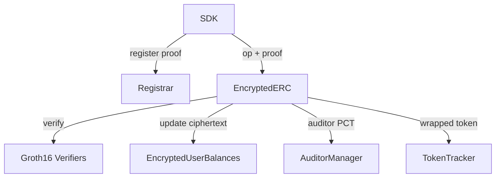

# eERC — Contract Architecture

## Overview
The eERC protocol is a small set of cooperating contracts. The main `EncryptedERC` orchestrates private operations and delegates registration, balance storage, auditing, and proof verification.

## Core contracts (`EncryptedERC/contracts/`)
- **`EncryptedERC.sol`** — the main contract. Implements private `privateMint`, `privateBurn`, `transfer`, `deposit`, `withdraw`; verifies ZK proofs; manages encrypted balances and auditor integration. Holds `name`, `symbol`, `decimals`, `isConverter`, `registrar`, `auditor`, `auditorPublicKey`.
- **`Registrar.sol`** — user registration + public key association. `register(proof)` stores a user's BabyJubJub public key; `getUserPublicKey(addr)` returns it (zero point = not registered).
- **`EncryptedUserBalances.sol`** — encrypted balance storage and homomorphic updates (the ElGamal ciphertext `EGCT` + amount PCTs + balance PCT).
- **`tokens/TokenTracker.sol`** — tracks registered tokens (converter mode), metadata, and blacklisting.
- **`auditor/AuditorManager.sol`** — auditor address + public key; permissions for selective decryption.
- **`types/Types.sol`** — shared structs (proofs, ciphertext points, PCTs).
- **`libraries/BabyJubJub.sol`** — curve operations (deployed as a linked library).

## Verifiers (`contracts/verifiers/` and `contracts/prod/`)
Five Groth16 verifiers, one per circuit:
`RegistrationCircuitGroth16Verifier`, `MintCircuitGroth16Verifier`, `TransferCircuitGroth16Verifier`, `WithdrawCircuitGroth16Verifier`, `BurnCircuitGroth16Verifier`.
`contracts/prod/*` are the production verifiers (proper trusted setup) — use these for mainnet ([[eerc-circuits-proofs]]).

## Interaction flow

## Key reads (used by the SDK)
`name()`, `symbol()`, `decimals()`, `registrar()`, `isConverter()`, `owner()`, `auditor()`, `auditorPublicKey()`, `balanceOf(user, tokenId)`, `getBalanceFromTokenAddress(user, token)`.

## Common Pitfalls
- **Forgetting to link BabyJubJub.** `EncryptedERC` must be deployed with the `BabyJubJub` library linked (see deploy scripts).
- **Wrong verifier set.** Mint/transfer/withdraw/burn/registration verifiers are distinct; mismatched verifiers reject valid proofs.

## AI Agent Prompt
> "Act as a Solidity auditor. Walk through the eERC contract suite (EncryptedERC, Registrar, EncryptedUserBalances, AuditorManager, TokenTracker, verifiers) and explain the call flow for a private transfer."

## References
See `references/README.md` (EncryptedERC `contracts/` + README architecture section).
