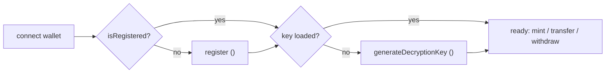

# eERC SDK — Registration & Decryption Keys

## Overview
Before a user can hold or move encrypted tokens, they must **register a BabyJubJub public key** in the `Registrar` and have a **decryption key** to read their own balance. This is the mandatory first step in the eERC lifecycle.

## 1. Register the user
```ts
const { isRegistered, register } = useEERC(/* ... */);

if (!isRegistered) {
  const { key, transactionHash } = await register();
  // `key` is the user's decryption key (persist securely, client-side only)
}
```
`register()` generates the user's keypair, produces a registration ZK proof, and submits it to the `Registrar`. It returns `{ key, transactionHash }`.

## 2. Generate / restore the decryption key
The decryption key is derived **deterministically from a wallet signature**, so it can be regenerated on any device with the same wallet.
```ts
const { shouldGenerateDecryptionKey, generateDecryptionKey } = useEERC(/* ... */);

if (shouldGenerateDecryptionKey) {
  const key = await generateDecryptionKey(); // prompts a signature
  // pass it back into useEERC(..., decryptionKey) or keep in memory
}
```
- `isDecryptionKeySet` (on the underlying `EERC` instance) tells you whether decryption is ready.
- `shouldGenerateDecryptionKey` is `true` when the user is registered but no key is loaded.

## 3. Check if any address is registered
```ts
const { isAddressRegistered } = useEERC(/* ... */);
const { isRegistered } = await isAddressRegistered(recipientAddress);
// You can only transfer to a registered recipient.
```

## Correct ordering


## Common Pitfalls
- **Operating before registration.** `privateMint`/`transfer`/`withdraw` fail if the user (or recipient) is not registered.
- **Transferring to an unregistered recipient.** Always check `isAddressRegistered` first — the recipient needs a registered public key to receive encrypted funds.
- **Losing the key server-side mindset.** The decryption key is client-side and re-derivable from the wallet signature; never store it on a server.

## AI Agent Prompt
> "Act as an eERC integrator. Implement the registration flow: detect unregistered users, call `register()`, generate/restore the decryption key, and verify recipients with `isAddressRegistered` before transfers."

## References
See `references/README.md` (ac-eerc-sdk `useEERC.tsx` register/generateDecryptionKey, `EERC.ts`).
