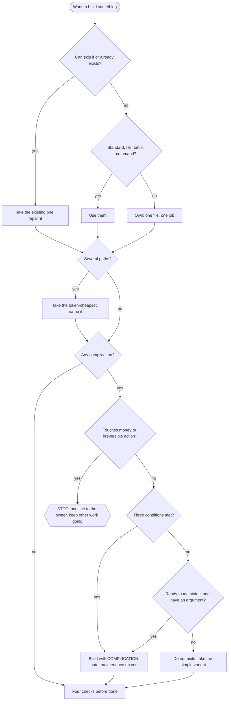

# /ak47: simpler and cheaper

Principle: build it so the owner can see it break and fix it with a hammer, and so it costs the fewest tokens. The agent decides every fork in this skill itself; asking the owner "A or B?" here is a role failure. Report the choice afterwards in one line: what was chosen and why. The only limit is your own list of hard stops (money, irreversible deletion, secrets to third parties).

## Step 1. Before building: five questions, first "yes" stops the walk
1. Can I not build it? A one-off pain is solved by hand or one existing command.
2. Do we already have it? Search memory, notes, skills, scripts. Take the existing thing and repair it.
3. Is there a mature standard or ready tool? Use it.
4. Is a file, a table or one command enough? Use those.
5. Only now write your own: one file, one job, no new services, databases or dependencies.

## Step 2. Token cost of the path
When several working paths reach the result, take the cheapest in tokens and name it. Ladder from cheap to expensive:
1. a ready result, a queue, a routine with no LLM;
2. a command-line utility, script, SQL, grep;
3. someone else's paid subscription through a model-router script;
4. your own model over a chunk of text;
5. a browser with screenshots, or waking an old fat session.

Take rung 5 only with a one-line reason said aloud, and in the same step order the cheap path for next time.

Cache note: a session stays warm about an hour after the last reply. While warm, continue. If leaving for longer, compress. Do not wake a stale fat session; summarise from disk with a cheap model and start a new session.

## Step 3. Complication: decide yourself, then maintain it yourself
A complication is a new field, table, dependency, service, automation or abstraction. Test it with three conditions:
- the pain happened twice or more (a watchdog, hook or new rule: three times);
- it breaks loudly and is easy to fix or pull out;
- there is no simpler way to get 80% of the value.

All three pass: build it. Any fails: default is not to build. If you still think it is needed, decide yourself: the argument is a named pain and what breaks without it; "I want it" is not an argument. Write the argument as a note inside the artifact and one line in your change log, so the next session knows it is a debt. Pulling a complication out together with accumulated data counts as deletion and follows your deletion rules.

Choosing a complication means you now maintain it as an engineer: support, repair, pull it out when it stops paying. Before choosing ask: am I ready to maintain this every week? No means do not build.

Mark it "COMPLICATION" with three lines: what pain it cures, what breaks without it, the cheap alternative.

## Step 4. Before "done": four checks
- the design can be explained in three sentences;
- the owner finds where to fix it without you;
- the part can be pulled out with one command;
- no copies, one source.

If any fails, simplify; do not hand it over.

## Decision tree

## Examples
- A lead label (hot / warm / cold) set by hand beats an auto-scoring formula: a label does not lie silently.
- Memory sync: one GitHub rail instead of two rails and an open port on every machine.
- Podcast: a queue or command-line tool before a browser with screenshots.
- Session cache freshness: the formula "now minus last reply time" in a table instead of polling machines every 15 minutes.

<!--kit-footer-->

---

**Like this skill?** It is part of [second-brain-starter-kit](https://github.com/tonydzi/second-brain-starter-kit): the second brain we built for ourselves and run every day at Palo Alto AI Research Lab. Install the whole set with `npx skills add tonydzi/second-brain-starter-kit`. Everything is open source and free, so take what you need.

Flagships worth a look on their own: [secondop-panel](https://github.com/tonydzi/secondop-panel) (a second opinion from a panel of external models), [claude-memory-tidy](https://github.com/tonydzi/claude-memory-tidy) (stop your agent's memory from rotting), [telegram-mcp-kit](https://github.com/tonydzi/telegram-mcp-kit) (your own Telegram over MCP in about 15 minutes).

Author: **Anton Dziatkovskii**, Palo Alto AI Research Lab. Telegram [@tonydzi](https://t.me/tonydzi) - WhatsApp [+1 341 222 9178](https://wa.me/13412229178) - X [@Tony_Stef_](https://x.com/Tony_Stef_)

**Engineers: want to test-drive this setup?** Message me. I hand out free starter seeds to engineers who test and report back, and custom skill requests are welcome.
