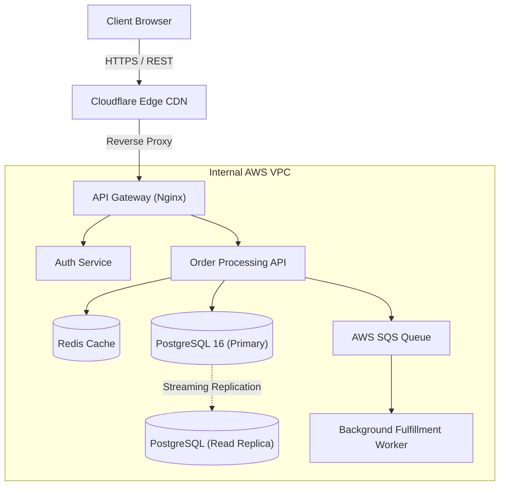
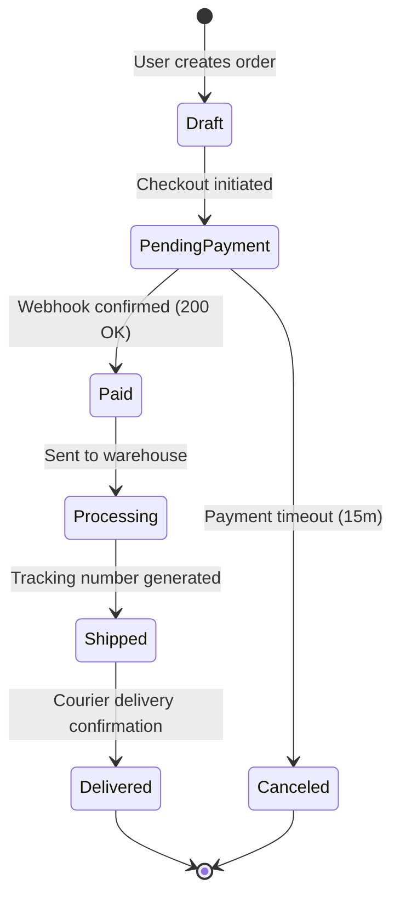
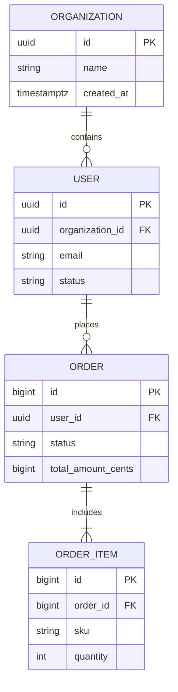

# Technical Diagrams with Mermaid.js

Mermaid enables developers to create diagrams, workflows, and visual architectures using declarative Markdown-fenced text blocks. Because Mermaid diagrams are text-based, they can be version-controlled, diffed in Git, and rendered automatically in GitHub, GitLab, and documentation engines.

## Core Rules

1. **Always quote node labels with special characters**: Any label containing parentheses `()`, brackets `[]`, braces `{}`, or punctuation must be wrapped in double quotes (e.g. `id["Process (Worker A)"]`) to prevent syntax parse failures.
2. **Keep diagrams readable and scoped**: Break massive monolithic architectures into smaller, focused diagrams (e.g. one for data ingestion, one for authentication flow).
3. **Choose the correct diagram type**:
   - `flowchart TD` / `flowchart LR`: Algorithms, deployment architectures, data pipelines.
   - `sequenceDiagram`: API interactions, multi-service communication, distributed handshakes.
   - `stateDiagram-v2`: Finite state machines, document/order lifecycles.
   - `erDiagram`: Database entity relationships and schemas.
4. **Never use unsupported diagram types**: Stick to standard supported Mermaid diagrams (Flowcharts, Sequence, State, ER, Class).
5. **Avoid raw HTML in node labels**: Use standard Markdown formatting inside labels rather than `<br>` or `<b>` tags.

---

## 1. Architecture Flowchart (`flowchart TD` / `LR`)



---

## 2. API Sequence Diagram (`sequenceDiagram`)

```mermaid
sequenceDiagram
    autonumber
    actor User
    participant Client as Web Frontend
    participant Auth as Auth Service
    participant API as Core API
    participant DB as Database

    User->>Client: Click "Submit Order"
    Client->>Auth: Verify JWT Bearer Token
    Auth-->>Client: Token Valid (role: customer)

    Client->>+API: POST /api/v1/orders (Payload + Idempotency-Key)
    API->>DB: Check Idempotency Key
    alt Key already exists
        DB-->>API: Previous order record found
        API-->>Client: 200 OK (Cached Order)
    else New order
        API->>DB: BEGIN Transaction; INSERT order; DEDUCT inventory;
        DB-->>API: COMMIT Success
        API-->>-Client: 201 Created (Order #1042)
    end
    Client-->>User: Display Order Confirmation
```

---

## 3. Finite State Machine (`stateDiagram-v2`)



---

## 4. Entity-Relationship Diagram (`erDiagram`)



---

## 5. Common Mistakes and Anti-Patterns

| Anti-Pattern | Bug / Risk | Correct Practice |
| :--- | :--- | :--- |
| Unquoted parentheses: `A[Load (API)] --> B` | Mermaid syntax error; diagram fails to render | Quote the label: `A["Load (API)"] --> B` |
| Overcrowded diagram with 50+ interconnected nodes | Unreadable spaghetti diagram | Break into component sub-diagrams |
| Using deprecated `graph TD` instead of `flowchart TD` | Lacks support for subgraphs and modern curve options | Use `flowchart TD` or `flowchart LR` |
| Ambiguous sequence arrows | Unclear sync vs async communication | Use `->>` for sync requests and `-->>` for return responses |

---

## 6. Verification Checklist

- [ ] All node labels with punctuation or parentheses are enclosed in double quotes.
- [ ] Diagram renders cleanly without syntax errors on GitHub.
- [ ] Logical flow reads smoothly (top-to-bottom or left-to-right).
- [ ] Diagram accompanied by explanatory text in the markdown document.
