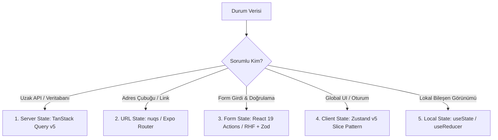

# Frontend State Management & Orchestration Architecture

Bu alt uzmanlık yeteneği; 2025–2026 kurumsal durum yönetimi mimarisini (**The Great State Unbundling**), monolitik store'ların parçalanmasını, 5 katmanlı durum taksonomisini, Zustand v5 type-safe **Slice Pattern** entegrasyonunu ve `nuqs` / Expo Router URL state standartlarını yönetir.

- **Ana Orkestratör Referansı:** [product-frontend-clean-architecture-development](../../SKILL.md)
- **Detaylı Sektör Araştırma Raporu:** [state_orchestration_architecture_deep_research.md](researches/state_orchestration_architecture_deep_research.md)

---

## 🚫 1. Katı Mimari Kurallar ve Kısıtlamalar (Enforced Guardrails)

1. **"Sync-State" Anti-Pattern Yasağı (Don't Sync — Derive It):**
   * Asenkron sunucu verileri (`useQuery`) ASLA `useEffect` ile bir Zustand store'una veya yerel `useState` içerisine kopyalanamaz. Çift gerçek kaynağı (dual sources of truth) oluşturulamaz. İstemcide yalnızca tanımlayıcı (ID) tutulur; veri render esnasında TanStack Query `select` ile türetilir.
2. **Context API'nin Global State Olarak Kötüye Kullanımı Yasağı:**
   * Sık güncellenen uygulama durumları için saf `React.createContext` KESİNLİKLE kullanılamaz (tüm alt ağaçta kontrolsüz re-render patlamasına yol açar). Global UI durumu için seçici abonelik (selective subscription) sunan **Zustand v5** zorunludur.
3. **Zustand v5 Inline Nesne Seçici Yasağı (Infinite Loop Guard):**
   * Bileşenler `useStore((s) => ({ a: s.a, b: s.b }))` şeklinde inline yeni nesne referansı dönemez. Bu durum `useSyncExternalStore` mekanizmasında sonsuz render döngüsüne yol açar. Çoklu seçimlerde mutlaka **`useShallow`** kullanılmalıdır.
4. **Paylaşılabilir Durumlar URL'de Yaşar:**
   * Sayfa yenilendiğinde (F5), link paylaşıldığında veya donanımsal geri tuşuna basıldığında korunması gereken tüm filtreler, sayfalama, sekmeler ve modal parametreleri URL State (`nuqs` / `useLocalSearchParams`) üzerinden yönetilmelidir.
5. **Kalıcılık Temizliği (Sanitized Persist):**
   * Zustand `persist` middleware'i kullanılırken `partialize` tanımlanmalı; geçici yüklenme durumları, form taslakları ve hassas olmayan UI bayrakları diske yazılmamalıdır.

---

## 🏛️ 2. 5 Katmanlı Durum Taksonomisi (The Great State Unbundling)



---

## 🛠️ 3. Temel Mimari Yapı Taşları ve Kod Şablonları

### A. Zustand v5 Modüler Slice Pattern (Type-Safe Immer Typing)

```typescript
// store/slices/authSlice.ts
import { StateCreator } from 'zustand';
import type { AppStore } from '../index';

export interface UserProfile {
  id: string;
  fullName: string;
}

export interface AuthSlice {
  user: UserProfile | null;
  accessToken: string | null;
  isAuthenticated: boolean;
  setSession: (user: UserProfile, token: string) => void;
  clearSession: () => void;
}

export const createAuthSlice: StateCreator<
  AppStore,
  [['zustand/immer', never]],
  [],
  AuthSlice
> = (set) => ({
  user: null,
  accessToken: null,
  isAuthenticated: false,
  setSession: (user, token) =>
    set((draft) => {
      draft.user = user;
      draft.accessToken = token;
      draft.isAuthenticated = true;
    }),
  clearSession: () =>
    set((draft) => {
      draft.user = null;
      draft.accessToken = null;
      draft.isAuthenticated = false;
    }),
});
```

### B. Store Kompozisyonu ve Kalıcılık (`store/index.ts`)

```typescript
import { create } from 'zustand';
import { devtools, persist, createJSONStorage } from 'zustand/middleware';
import { immer } from 'zustand/middleware/immer';
import { createAuthSlice, type AuthSlice } from './slices/authSlice';
import { createUISlice, type UISlice } from './slices/uiSlice';
import { appStorage } from './storage';

export type AppStore = AuthSlice & UISlice;

export const useAppStore = create<AppStore>()(
  devtools(
    persist(
      immer((...args) => ({
        ...createAuthSlice(...args),
        ...createUISlice(...args),
      })),
      {
        name: '@app_global_store',
        storage: createJSONStorage(() => appStorage),
        partialize: (state) => ({
          accessToken: state.accessToken,
          user: state.user,
        }),
      }
    ),
    { enabled: process.env.NODE_ENV === 'development' }
  )
);
```

### C. `useShallow` ile Re-render Şelalelerini Önleme

```tsx
import React from 'react';
import { useShallow } from 'zustand/react/shallow';
import { useAppStore } from '../store';

export function HeaderUserBadge() {
  // ✅ Doğru: Sığ karşılaştırma ile sadece user veya theme değiştiğinde render olur
  const { user, theme } = useAppStore(
    useShallow((s) => ({
      user: s.user,
      theme: s.theme,
    }))
  );

  return (
    <div className={`badge badge-${theme}`}>
      <span>{user?.fullName ?? 'Misafir'}</span>
    </div>
  );
}
```

### D. URL State: `nuqs` (Web) ve Expo Router (Mobil)

```tsx
// Web: nuqs v2 (Next.js App Router)
import { useQueryState, parseAsString, parseAsInteger, debounce } from 'nuqs';

export function useCatalogFilters() {
  const [search, setSearch] = useQueryState('q', parseAsString.withDefault('').withOptions({
    limitUrlUpdates: debounce(300),
    history: 'replace',
    shallow: true,
  }));
  const [page, setPage] = useQueryState('page', parseAsInteger.withDefault(1));

  return { search, setSearch, page, setPage };
}
```

```tsx
// Mobil: Expo Router useLocalSearchParams & setParams
import { useLocalSearchParams, useRouter } from 'expo-router';

export function useMobileFilters() {
  const router = useRouter();
  const params = useLocalSearchParams<{ q?: string; page?: string }>();

  const updateSearch = (query: string) => {
    router.setParams({
      q: query.trim() || undefined,
      page: '1',
    });
  };

  return { query: params.q ?? '', page: Number(params.page ?? '1'), updateSearch };
}
```

### E. Türetilmiş Sunucu Durumu (Don't Sync — Derive It)

```tsx
import { useQuery } from '@tanstack/react-query';
import { useAppStore } from '../store';

export function SelectedUserDetail() {
  // 1. İstemci deposunda yalnızca seçilen ID tutulur
  const selectedId = useAppStore((s) => s.selectedUserId);

  // 2. Veri senkronize edilmez; önbellek üzerinden anında türetilir
  const { data: user } = useQuery({
    queryKey: ['users'],
    queryFn: fetchUsers,
    select: (users) => users.find((u) => u.id === selectedId),
    enabled: Boolean(selectedId),
  });

  return <div>{user ? user.fullName : 'Kullanıcı seçilmedi'}</div>;
}
```

---

## ⚠️ 4. Kaçınılması Gereken Anti-Pattern'lar

| Anti-Pattern | Neden Zararlı? | Doğru Kurumsal Yaklaşım |
| :--- | :--- | :--- |
| **Server State'i Klonlamak** | Çift gerçek kaynağı, bayat veri ve bellek sızıntısına yol açar. | `select` fonksiyonu ile veriyi render anında türetin. |
| **Store'un Tamamını Destructure Etmek** | Alakasız her güncellemede tüm bileşeni baştan render eder. | Tekil seçiciler veya `useShallow` kullanın. |
| **Inline Nesne Seçici (`useStore(s => ({...}))`)** | Zustand v5'te referans eşitliğini bozarak sonsuz render döngüsü yaratır. | Mutlaka `useShallow(...)` sarmalayıcısı kullanın. |
| **Context API ile Global State** | Tüm alt bileşen ağacında render şelalelerine sebep olur. | Zustand v5 veya Jotai gibi seçici abonelik sunan araçlar kullanın. |
| **Filtreleri `useState`'e Hapsetmek** | F5 yapıldığında kaybolur, linkle paylaşılamaz, geri tuşu çalışmaz. | `nuqs` veya `useLocalSearchParams` ile URL'e bağlayın. |

---

## 📋 5. Doğrulama ve Kabul Kriterleri (Checklist)

- [ ] Hiçbir `useQuery` verisi `useEffect` ile Zustand store'una veya `useState` içine kopyalanmıyor.
- [ ] Paylaşılabilir tüm filtre, sayfalama ve modallar URL State (`nuqs` / `useLocalSearchParams`) ile bağlı.
- [ ] Zustand store tek bir büyük dosya yerine type-safe **Slice Pattern** ile modülerleştirilmiş.
- [ ] Birden çok alan seçilen Zustand kancalarında `useShallow` kullanılıyor (inline object selector yok).
- [ ] React Native / Expo projelerinde persist middleware senkron `react-native-mmkv` ile çalışıyor.
- [ ] Form durumları genel store yerine React 19 Actions veya izole form yöneticilerinde tutuluyor.
