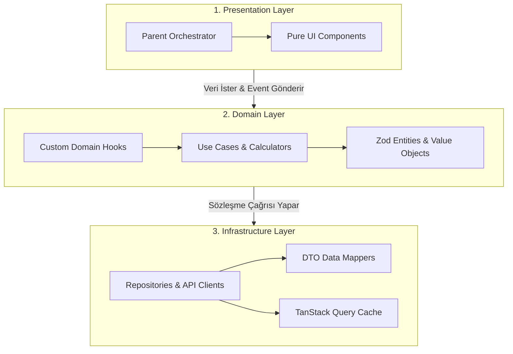

# Master Frontend Clean Architecture Orchestrator

Bu skill; modern web, mobil (React Native / Expo) ve çapraz platform frontend projelerinde **Clean Architecture (Temiz Mimari)** ve **Feature-Sliced Design (FSD)** standartlarını uçtan uca koordine eden ana orkestratördür.

Projeyi 3 temel mimari katmana ve 6 alt uzmanlık alanına bölerek monolitik bileşenleri engeller, iş mantığını saf tutar ve yüksek performanslı, test edilebilir sistemler inşa eder.

Master Araştırma Raporu: [senior_frontend_architecture_and_competencies_master_report.md](researches/senior_frontend_architecture_and_competencies_master_report.md)

---

## 🏛️ 1. Alt Uzmanlık Skilleri Dizini (Subskills Directory)

Geliştirilecek özelliğin veya refactoring ihtiyacının kapsamına göre aşağıdaki modüler alt uzmanlık skillerine delege edilir:

| Alt Uzmanlık Skilli | Kapsam ve Temel Sorumluluk | Göreli Bağlantı |
|---|---|---|
| 🖥️ **Presentation Layer** | Router ve Screen ayrımı, Pure UI (Dumb) bileşenler, 150 satır kuralı, Orchestrator deseni ve Headless UI. | [frontend-layer-presentation](subskills/frontend-layer-presentation/SKILL.md) |
| 🧠 **Domain Layer** | Saf TypeScript modelleri, Zod şemaları, framework-bağımsız use case fonksiyonları ve XState durum makineleri. | [frontend-layer-domain](subskills/frontend-layer-domain/SKILL.md) |
| 🔌 **Infrastructure Layer** | API Repositories, DTO-to-Domain mappers, Supabase adaptörleri ve donanımsal/güvenli depolama. | [frontend-layer-infrastructure](subskills/frontend-layer-infrastructure/SKILL.md) |
| 🔄 **State Orchestration** | State unbundling: Server State (TanStack Query), Client State (Zustand), URL State (`nuqs`) ve Form Actions. | [frontend-state-orchestration](subskills/frontend-state-orchestration/SKILL.md) |
| ⚡ **Performance & Ergonomics** | INP $\le 200\text{ ms}$, React 19 Compiler uyumu, FlashList v2, `react-native-keyboard-controller`, Safe Area. | [frontend-performance-ergonomics](subskills/frontend-performance-ergonomics/SKILL.md) |
| 🛡️ **Quality, Security & Tooling** | Testing Trophy (Vitest, RTL, Playwright, MSW v2), Nonce CSP v3, DOMPurify, Biome ve PR bundle bütçesi. | [frontend-quality-security-tooling](subskills/frontend-quality-security-tooling/SKILL.md) |

---

## 🚫 2. KRİTİK MİMARİ KISITLAMALAR (MANDATORY & STRICT)

### A. 150 Satır Kuralı ve Monolitik Bileşen Yasağı
* 150–200 satırı aşan veya birden fazla mantıksal alt görünümü (adım adım wizard, sekmeler, koşullu paneller) barındıran bileşenlerin tek dosyada tutulması kesinlikle yasaktır.
* Ekranlar bir **Parent Orchestrator** (sadece state ve akışı yöneten) ve `steps/` veya `components/` altında toplanan **Atomic Child Components** şeklinde ayrıştırılmalıdır.

### B. Zorunlu Ön Denetim Fazı (Audit Before Coding)
Kod yazılmadan önce hedef dosya taranır:
1. **Monolitik Yapı:** Dosya birden fazla ekranı veya adımı tek gövdede mi render ediyor?
2. **Hardcoded Metinler:** Arayüzde `t('module.key')` yerine doğrudan string var mı?
3. **Altyapı Sızıntısı:** UI bileşeni içinde doğrudan `fetch`, `axios` veya veritabanı sorgusu var mı?
* *Eylem:* İhlal tespit edilirse doğrudan kod yazılmaz; kullanıcıya refactoring planı sunulup onay alınır.

---

## 🔄 3. Katmanlar Arası Veri ve Kontrol Akışı

---

## 🚀 4. Orkestrasyon ve Yürütme Adımları

Geliştirici veya agent bir ekran/modül inşa ederken şu sırayı takip eder:
1. **Domain Tanımla:** [frontend-layer-domain](subskills/frontend-layer-domain/SKILL.md) ile Zod şemasını ve iş mantığı kurallarını saf TypeScript olarak yaz ve test et.
2. **Altyapıyı Bağla:** [frontend-layer-infrastructure](subskills/frontend-layer-infrastructure/SKILL.md) ile Repository arayüzünü ve DTO mapper'ı oluştur.
3. **Durumu Orkestre Et:** [frontend-state-orchestration](subskills/frontend-state-orchestration/SKILL.md) ile TanStack Query / Zustand bağlantısını kur.
4. **Sunumu İnşa Et:** [frontend-layer-presentation](subskills/frontend-layer-presentation/SKILL.md) ile Orchestrator ve Pure UI bileşenlerini 150 satır kuralına uygun yaz.
5. **Ergonomi ve Performansı Denetle:** [frontend-performance-ergonomics](subskills/frontend-performance-ergonomics/SKILL.md) ile liste sanallaştırma, keyboard ve safe area entegrasyonunu doğrula.
6. **Kalite ve Güvenlik Testlerini Koş:** [frontend-quality-security-tooling](subskills/frontend-quality-security-tooling/SKILL.md) ile Vitest/MSW testlerini yaz ve güvenlik kontrollerini tamamla.
