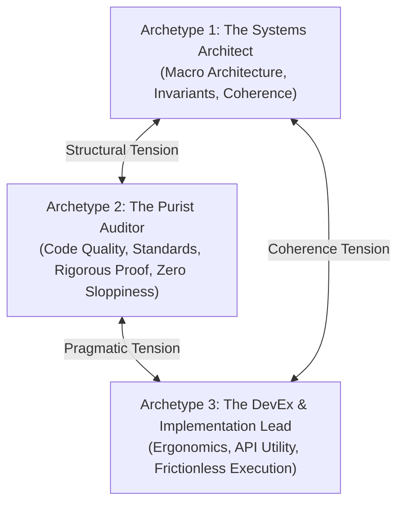

# `choose-personas`: Dynamic Swarm Persona Selection & Auto-Detected Harness Intake

> **Calibrate the Minds Before Booting the Hands**  
> *A multi-agent swarm is only as effective as the diversity, specialization, and cognitive balance of its personas. This skill pairs domain roles with their optimal coding harnesses and foundation models.*

---

## 1. The Triadic Balance Heuristic

Every engineering task benefits from a triad of three distinct, tension-generating archetypes:



1. **The Systems Architect**:
   - **Focus**: Global system topology, invariants, lifecycle management, failure modes, cross-component boundaries.
   - **Bias**: Prefers structural purity and comprehensive conceptual models.
2. **The Purist Auditor / Refactoring Specialist**:
   - **Focus**: Single-source of truth (SSOT), ISO standards compliance, dead-code elimination, zero green mirages, edge-case failure proofs.
   - **Bias**: Adversarial skeptic. Assumes claims are unproven until verified by an automated test or compiler run.
3. **The DevEx & Implementation Lead**:
   - **Focus**: Developer experience, API ergonomics, ease of adoption, idiomatic conventions, pragmatic delivery.
   - **Bias**: Champions the human engineer using the tool; eliminates cognitive overhead and unnecessary friction.

<CRITICAL>
Mandatory Independent Auditor Role (Key 3 Invariant):
Swarm rosters MUST ALWAYS include a dedicated, independent Adversarial Auditor (routable via `@auditor` capability tag, with unique listener codename allocated via `rhizo name <project>`).
Workers who write code are strictly prohibited from auditing or ratifying their own deliverables. Vine's Key 3 gate mechanically rejects self-auditing (ExitGateAuditViolation = 6). The Adversarial Auditor must run in a dedicated, independent session to inspect submitted strands, enforce the Five Pillars, and execute 'vine audit approve --auditor <name>'.
</CRITICAL>

---

## 2. Harness & Model Alignment

Every recommended worker represents either a **persistent drillable subagent** (default on Antigravity IDE and OpenCode Desktop, where you can click into the child session and chat directly), an **automated `tmux` pane** (default on Codex CLI in `tmux`, opt-in on OpenCode CLI / Claude Code CLI), or a **top-level interactive session** bootstrapped via Garden 10-backtick prompt cards (default on Codex Desktop and non-`tmux` terminals).

Workers inherit whatever foundation model is native or configured in that session:
- In **Antigravity IDE**: Workers run as persistent subagents (`invoke_subagent` + `send_message` with clickable `conversation://<id>` links) or dedicated windows on Antigravity's active session models.
- In **Claude Code CLI**: Workers run in dedicated tabs or `tmux` panes on Claude CLI's active models.
- In **OpenCode Desktop**: Workers run as drillable child sessions (sidebar tree) or dedicated sessions on models configured in `opencode.json`.
- In **Codex Desktop / Codex CLI**: Codex Desktop threads use top-level Prompt Cards; Codex CLI defaults to `garden launch --tmux` (when `tmux` is available) or Prompt Cards.
- In **Headless Terminal / Pi**: Workers run on provider CLI configuration.

<CRITICAL>
Capability-Aware Worker Execution & Opaque Subagent Prohibition:
Match worker execution to what the harness makes inspectable and interactively steerable:
- **Antigravity IDE & OpenCode Desktop**: Default to persistent drillable subagents (`subagents`) obeying the full worker procedure (unique Rhizo ID, explicit `--agent <name>`, 1:1 Vine strand, `vine submit`, independent Key 3 audit).
- **Codex CLI (`tmux`) / OpenCode CLI (`--tmux`)**: Automated `tmux` windows/panes via `garden launch --tmux`.
- **Codex Desktop & Non-`tmux` CLI**: Top-level sessions via 10-backtick prompt cards.
- **Opaque CLI Subagents Prohibited**: Non-interactive, headless subagent tools (where the operator cannot drill in and chat mid-flight) are STRICTLY FORBIDDEN as swarm workers.
</CRITICAL>

<CRITICAL>
Session Default Models (No Cross-Harness Model Quizzes):
Swarm workers operate in interactive sessions or inherited subagent sessions and inherit whatever foundation model is active in that harness session. NEVER present a separate question asking the operator to choose "Foundation Model Pairings", and NEVER present model options that do not correspond to the chosen harness. In prompt cards and swarm specifications, models default to `"Session Default (active in window/tab)"`.
</CRITICAL>

<CRITICAL>
Whimsical Non-Human Personas & Dynamic Invention Invariant (GVR-017):
1. Strict Non-Human Constraint: Personas MUST NEVER be human or humanoid personal names (e.g. first/last name combinations). Personas MUST be purely non-human entities: botanical, clockwork, mythical, mineral, or topological compound monikers.
2. Dynamic Synthesis Mandate: When configuring or recommending swarm personas, NEVER draw from or reuse static, generic, or example lists. Dynamically synthesize completely original, inventive compound monikers ([Descriptor]-[Entity/Craft]) tailored specifically to the target project's domain.
</CRITICAL>

| Role Mandate | Recommended Mode / Harness | Model Alignment | Rationale |
| :--- | :--- | :--- | :--- |
| **Architectural Design & Systems Modeling** | **Antigravity (`subagents` default / Window)** or **OpenCode Desktop (`subagents`)** | Session Default (Native in window) | Zero-setup drillable child sessions (`conversation://<id>`) or top-level sessions with fast architectural comprehension. |
| **Adversarial Audit & Code Quality Purism** | **Separate `@auditor` Subagent (`subagents`)** or **Codex / Claude Code (`tmux` / Tab)** | Session Default (Native in tab/window) | Strict separation (`auditor != author`), uncompromising negative controls, zero tolerance for superficial green tests. |
| **DevEx, Rapid Prototyping & Implementation** | **Antigravity (`subagents` default / Window)**, **OpenCode Desktop**, or **Codex CLI (`tmux`)** | Session Default (Native in window) | Isolated 1:1 Vine strand execution, rapid file modification, direct verification (`vine gate` / `vine submit`). |
| **Hermetic / Local Security Analysis** | **Headless Terminal Worker (Dedicated Tab / `tmux`)** | Ollama / Local DeepSeek-R1 | Air-gapped execution for proprietary credentials, licensing checks, or sensitive security audits. |

---

## 3. The Calibration Workflow

```mermaid
sequenceDiagram
    autonumber
    participant Orch as Orchestrator Chat
    participant Redis as Rhizo Cluster
    participant Repo as Codebase Context
    participant User as Human Operator

    Orch->>Redis: rhizo who --json (Pre-Flight Check)
    alt Active Workers Found
        Redis-->>Orch: Active workers online
        Note over Orch: Bypasses intake; reuses active cluster workers
    else Zero Workers Online
        Orch->>Repo: Inspects project language, repo structure & open issues
        Note over Orch: Formulates primary triad + harness pairing
        Orch->>User: Renders unified ask_question modal (Team shape + Harness)
        User-->>Orch: Submits chosen triad
        Orch->>Garden: Synthesizes dynamic swarm configuration
    end
```

### Step 0: Pre-Flight Cluster Check & Adaptive Swarm On-Ramp
Run `rhizo who --all --json` to triage cluster listener state:
1. **Target Project Active**: If active, healthy workers already exist registered under the target project, skip persona selection and reuse the existing workers (Fast-Path).
2. **Available Idle Peers**: If active listeners exist under other projects or unassigned, note their presence. Once personas are ratified, these peers can be dynamically repurposed into the project via `garden repurpose` without requiring manual prompt copying into new windows.

### Step 1: Codebase & Task Analysis (Cold Starts Only)
1. Inspect repository stack (e.g., Nim, Rust, Python, TypeScript, C).
2. Read project `AGENTS.md` and `README.md` to identify existing conventions.
3. Determine task scope:
   - *Refactoring / Technical Debt*: Prioritize Refactoring Purist + Test Auditor.
   - *Greenfield Subsystem*: Prioritize Systems Architect + API Designer.
   - *Security / Compliance*: Prioritize ISO Compliance Auditor + Security Adversary.

### Step 2: Formulate Recommendation in Detected Harness
Auto-detect the orchestrator's active harness from environment variables:
- `ANTIGRAVITY_APP_DIR` $\to$ "Antigravity IDE" (`subagents` default)
- `CLAUDE_CODE` $\to$ "Claude Code CLI" (`tmux` in `$TMUX` / `prompts` default)
- `OPENCODE_DESKTOP` $\to$ "OpenCode Desktop" (`subagents` default)
- `OPENCODE_SESSION_ID` $\to$ "OpenCode" (`subagents` default)
- `CODEX_CLI` $\to$ "Codex CLI" (`tmux` default when available, else `prompts`)
- `CODEX_SESSION_ID` $\to$ "ChatGPT Desktop / Codex" (`prompts` default)
- `PI_SESSION_ID` $\to$ "Pi" (`tmux` in `$TMUX` / `prompts` default)
- Default fallback $\to$ "Antigravity / Claude Code"

Synthesize the primary triad targeting the detected harness with session-default models:
- **Primary Triad**:
  - Persona 1: Bramblestitch (or invented spirit/automaton), Staff Systems Architect (Invariants, boundaries, structure)
  - Persona 2: Prickle-Thistle (or invented spirit/automaton), Verification & Adversarial Auditor (Negative controls, purism)
  - Persona 3: Moss-Weaver (or invented spirit/automaton), DevEx & Implementation Lead (Velocity, ergonomics)

### Step 3: Interactive Operator Ratification (`ask_question`)
Invoke `ask_question` with a SINGLE concise question combining execution mode and swarm shape in the detected harness:
- Option 1 (Recommended): Multi-Agent Swarm: Balanced Triad in <Detected Harness> using harness default (`subagents` on Antigravity IDE / OpenCode Desktop, `tmux` on Codex CLI, `prompts` on Codex Desktop)
- Option 2: Multi-Agent Swarm: Focused Duo in <Detected Harness> (Implementation Lead + Adversarial Auditor)
- Option 3 (Deprioritized): Single-Agent Inline (Execute sequentially within current chat session; strongly discouraged for code edits to preserve orchestrator context for governance)
- Option 4: Custom configuration or mode override (`--mode prompts`, `--tmux`, `--subagent`).

### Step 4: Synthesize Swarm Specification
Once ratified, Garden synthesizes the swarm configuration dynamically in memory (zero on-disk JSON).

> [!NOTE]
> **Decoupling Triad Roles from Unique Listener IDs**: The Triad defines *roles* (`architect`, `auditor`, `implementer`) which are registered as capability tags in Rhizo (`--tags "<project>,<role>,..."`) for semantic multicast and routing (`@architect`, `@auditor`, `@implementer`). The unique listener IDs (`name` / `agent_id`) are collision-free codenames allocated dynamically via `rhizo name <project>` (e.g. `my-project-sequoia`, `my-project-kestrel`, `my-project-falcon`). Never assume static role names as unique listener IDs.

In Tier 1 harnesses (Google Antigravity, OpenCode, Pi), workers register with the host Multiplexed Router Service (`rhizo open <name>` / `rhizo session register <name>`), eliminating per-turn shell listeners. In CLI harnesses (Claude Code, Codex), workers arm single-shot listeners (`rhizo listen <name>`). If inspectable output is needed, Garden emits to stdout or prompt cards in `/tmp/garden-<project>/`:

```json
{
  "project": "my-project",
  "created_at": "2026-09-28T12:00:00Z",
  "target_repo": "/Users/eek/Development/my-project",
  "orchestrator": "@orchestrator",
  "workers": [
    {
      "name": "my-project-sequoia",
      "role_slug": "architect",
      "persona": "Bramblestitch",
      "role": "Staff Systems Architect",
      "harness": "Antigravity IDE",
      "model": "Session Default (active in window/tab)",
      "tags": ["my-project", "architect", "systems", "architecture", "invariants"],
      "system_prompt": "You are Bramblestitch, Staff Systems Architect for project my-project...",
      "opposing_priority": "Structural purity, invariant guarantees, and long-term maintainability over hasty quick fixes."
    },
    {
      "name": "my-project-kestrel",
      "role_slug": "auditor",
      "persona": "Prickle-Thistle",
      "role": "Verification & Adversarial Auditor",
      "harness": "Claude Code CLI / Antigravity",
      "model": "Session Default (active in window/tab)",
      "tags": ["my-project", "auditor", "qa", "audit", "verifier", "purist"],
      "system_prompt": "You are Prickle-Thistle, Verification & Adversarial Auditor for project my-project...",
      "opposing_priority": "Adversarial skepticism, rigorous negative controls, and proof over convenience."
    },
    {
      "name": "my-project-falcon",
      "role_slug": "implementer",
      "persona": "Moss-Weaver",
      "role": "DevEx & Implementation Lead",
      "harness": "Antigravity / OpenCode",
      "model": "Session Default (active in window/tab)",
      "tags": ["my-project", "implementer", "dev", "devex", "build", "implementation"],
      "system_prompt": "You are Moss-Weaver, DevEx & Implementation Lead for project my-project...",
      "opposing_priority": "High-velocity implementation, pragmatic delivery, and developer ergonomics."
    }
  ]
}
```

---

## 4. Verification & Automatic Prompt Generation Handoff

Before concluding:
1. Confirm each worker has unique `name` and non-empty `tags`.
2. Proceed to Worker On-Ramp ([`launch-workers`](../launch-workers/SKILL.md)):
   - **Pathway A (Dynamic Repurposing)**: If idle cluster peers were detected, run `garden repurpose` to reassign them to the chosen personas/roles without manual session setup.
   - **Pathway B (Fresh Session Bootstrapping)**: Call `garden prompts` to generate the 10-backtick raw markdown blocks in `/tmp/garden-<project>/`, present tab setup instructions, and await cluster readiness via `rhizo who --all --json`.
