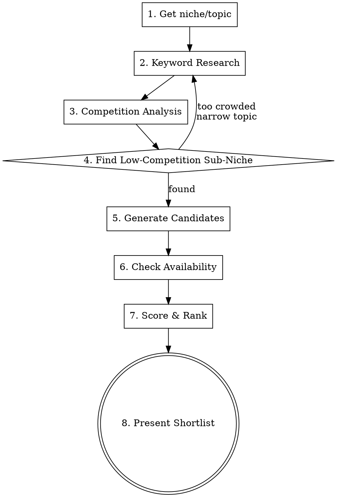

# Domain Finder

Find available domain names that contain popular search keywords for your niche.

## Overview

**Core principle:** A good domain contains a word people already search for. Start from search demand, not from brainstorming random names.

**Pipeline:** Keyword Research -> Competition Analysis -> Niche Narrowing -> Domain Generation -> Availability Check -> Shortlist

## When to Use

- Launching a new web app, SaaS, or side project
- Rebranding and need a new domain
- Want a domain that ranks naturally for the topic
- Need a name that's memorable AND searchable

## Process



### Step 1: Clarify the Niche

Ask the user:
- What does the app/site do? (1 sentence)
- Target audience? (developers, marketers, parents, etc.)
- Preferred TLDs? (.com priority by default, also .io, .app, .dev, .co)
- Any words they love or hate?
- Budget for domain? (affects premium domain suggestions)

### Step 2: Keyword Research

**Goal:** Find the 10-20 most searched words/phrases people use when looking for this type of product.

Use WebSearch to research keyword popularity:

```
Search queries to run (adapt to niche):
1. "most popular search terms for [niche] 2026"
2. "[niche] top keywords google trends"
3. "best keywords for [niche] website SEO"
4. "[niche] related searches google"
5. "people also ask [niche]"
6. "[competitor1] vs [competitor2]" (to find category terms)
```

**Extract from results:**
- High-volume single words (e.g., "fasting", "timer", "track", "habit")
- 2-word combos that people search (e.g., "meal prep", "code review")
- Action verbs associated with the niche (e.g., "ship", "launch", "build", "grow")
- Emotional/aspirational words (e.g., "zen", "calm", "boost", "swift")

**Organize keywords into tiers:**

| Tier | Type | Example (fasting niche) |
|------|------|------------------------|
| A | Core niche word | fast, fasting, timer |
| B | Action verb | track, start, plan |
| C | Benefit/emotion | lean, clean, free, zen |
| D | Modifier | my, go, get, hey, try |

### Step 3: Competition Analysis

**Goal:** Understand how crowded the niche is and find underserved angles where you can rank.

**3a. Map the competitive landscape:**

Use WebSearch to run:
```
1. "[niche] app" OR "[niche] tool" — count how many established players exist
2. "[niche keyword]" — check Google SERP: who ranks on page 1?
3. "best [niche] apps 2026" — see listicles, count competitors
4. "[niche] alternatives" OR "[niche] reddit" — what do users complain about?
5. site:producthunt.com "[niche]" — how many PH launches in this space?
```

**3b. Assess competition level per keyword:**

| Signal | Low Competition | High Competition |
|--------|----------------|------------------|
| Google page 1 | Small blogs, forums, indie sites | Big brands (Apple, Google, Forbes) |
| Domain age of top results | <3 years | 10+ years, high DA |
| Listicle count | 0-2 "best X" articles | 10+ SEO-optimized listicles |
| ProductHunt launches | <5 in niche | 20+ with traction |
| App Store/Play Store | <10 direct competitors | 50+ with reviews |
| Reddit/forum mentions | Few threads, unresolved complaints | Saturated, well-served |

**3c. Identify competition gaps:**

Look for patterns in user complaints and underserved angles:
```
Search queries:
1. "[niche] sucks" OR "[niche] alternative" reddit
2. "[competitor] complaints" OR "[competitor] missing features"
3. "[niche] for [specific audience]" — e.g., "fasting for women", "budgeting for freelancers"
4. "[niche] [geography]" — e.g., "meal planning UK", "tax calculator Germany"
5. "[niche] [use case]" — e.g., "habit tracker for ADHD", "project management for solopreneurs"
```

**Record findings in this format:**

| Keyword | Search Volume | Competition | Gap/Angle |
|---------|--------------|-------------|-----------|
| fasting app | HIGH | HIGH | Saturated — Zero, Fastic, Simple dominate |
| fasting timer | MEDIUM | MEDIUM | Less saturated than "app" |
| intermittent fasting tracker | MEDIUM | HIGH | Lots of content, hard to rank |
| fasting for women | MEDIUM | LOW | Underserved, specific audience |
| fasting zone tracker | LOW | VERY LOW | Novel concept, no direct competitors |

### Step 4: Find Low-Competition Sub-Niche

**Goal:** Narrow down to a sub-niche where your domain can realistically rank on page 1.

**The Sweet Spot Formula:**
```
IDEAL KEYWORD = decent search volume + low competition + clear intent + available domains
```

**Narrowing strategies (from broad to specific):**

| Strategy | Example | Why it works |
|----------|---------|-------------|
| **Audience niche** | "fasting" -> "fasting for women" | Smaller but loyal audience, less competition |
| **Method niche** | "budgeting" -> "envelope budgeting" | Specific methodology = specific searchers |
| **Problem niche** | "productivity" -> "ADHD productivity" | Pain-point driven, high intent |
| **Format niche** | "recipes" -> "5-ingredient recipes" | Constraint = differentiation |
| **Geography niche** | "tax calculator" -> "tax calculator UK" | Local = less global competition |
| **Combo niche** | "habit tracker" -> "habit tracker for couples" | Intersect two niches = blue ocean |

**Decision gate:**

```
IF all keywords show HIGH competition:
  -> Narrow the niche (add audience/method/problem modifier)
  -> Go back to Step 2 with the narrower topic
  -> Repeat until you find a keyword cluster with LOW-MEDIUM competition

IF you find 3+ keywords with LOW-MEDIUM competition:
  -> Proceed to domain generation using THESE keywords (not the broad ones)
```

**Red flags — niche is too narrow:**
- <100 monthly searches for ALL related keywords
- No one is searching for this problem at all
- You can't find 5+ related long-tail keywords
- No Reddit/forum threads discussing the topic

**Green flags — good sub-niche:**
- 500-5000 monthly searches for primary keyword
- Page 1 has indie sites/blogs (not all big brands)
- Clear user pain point with emotional language in forums
- 2-3 competitors max, not 20+
- Related long-tail keywords exist for content strategy

### Step 5: Generate Domain Candidates

**Use keywords from your low-competition sub-niche (Step 4), NOT the broad niche keywords.**

**Combine keywords using these patterns:**

| Pattern | Formula | Example |
|---------|---------|---------|
| Verb + Noun | action + niche | `shipcode.dev` |
| Modifier + Noun | prefix + niche | `gofasting.com` |
| Noun + Verb | niche + action | `fasttrack.io` |
| Noun + Benefit | niche + emotion | `fastzen.com` |
| Compound | word1 + word2 | `mealtimer.app` |
| Play on words | pun/rhyme | `fasthero.com` |
| Prefix + Root | try/get/my + word | `tryfasting.com` |

**Rules for good domain names:**
- Max 12 characters (excluding TLD) - shorter is better
- No hyphens
- No double letters at junction (e.g., "press-start" -> "pressstart" has "ss")
- Easy to spell when heard aloud (the "radio test")
- No trademark conflicts with major brands
- Contains at least 1 Tier A or Tier B keyword

**Generate 30-50 candidates** across patterns.

### Step 6: Check Availability

For each candidate, verify availability using these methods (in order of reliability):

**Method 1: WHOIS via Bash (most reliable)**
```bash
# Check single domain
whois example.com | grep -i "no match\|not found\|available\|no entries"

# If whois is not installed, use:
nslookup example.com | grep -i "NXDOMAIN"
# NXDOMAIN = likely available (no DNS record), but not 100% proof
```

**Method 2: WebSearch for registrar check**
```
Search: "example.com" site:who.is
Search: "example.com domain availability"
```

**Method 3: DNS probe via Bash**
```bash
# Quick batch check - no DNS = likely available
for domain in fastzen.com gofasting.io tryfasting.app; do
  echo -n "$domain: "
  dig +short "$domain" A | head -1 || echo "NO RECORD"
done
```

**Important caveats:**
- No DNS record does NOT guarantee availability (domain can be registered but not pointed)
- WHOIS is authoritative but rate-limited
- Always recommend user verify on registrar (Namecheap, Cloudflare, Porkbun) before purchasing
- Premium/aftermarket domains may show as "taken" but be for sale

### Step 7: Score & Rank

Rate each available domain on these criteria:

| Criteria | Weight | Score 1-5 |
|----------|--------|-----------|
| Low competition for keyword | 25% | VERY LOW = 5, LOW = 4, MEDIUM = 3, HIGH = 2, VERY HIGH = 1 |
| Contains searchable keyword | 20% | How popular is the keyword? |
| Length (shorter = better) | 15% | <8 chars = 5, 8-10 = 4, 10-12 = 3, 12+ = 2 |
| Memorability | 15% | Radio test: easy to spell when heard? |
| Brandability | 10% | Can you build a brand around it? |
| TLD quality | 10% | .com = 5, .io/.app/.dev = 4, .co = 3, others = 2 |
| Niche specificity | 5% | Generic = 1, sub-niche specific = 5 |

**Weighted score = sum(weight * score)**

### Step 8: Present Shortlist

Present top 5-10 domains as a ranked table:

```markdown
| # | Domain | Score | Sub-Niche | Competition | Why |
|---|--------|-------|-----------|-------------|-----|
| 1 | fastzone.app | 4.5 | fasting zones | LOW | Novel concept, no direct competitors, .app fits |
| 2 | herfasting.com | 4.3 | fasting for women | LOW | Underserved audience, .com, clear positioning |
| 3 | fastzen.com | 4.0 | mindful fasting | MEDIUM | Short, memorable, .com available |
```

Include:
- Estimated registration cost (standard ~$10-15/yr, premium varies)
- Note any trademark risks
- Which sub-niche keyword each domain targets
- Competition level for that sub-niche
- A "dark horse" pick (unconventional but memorable)

**Always end with:** "Verify availability on a registrar (Namecheap/Cloudflare/Porkbun) before purchasing - results may have changed since this check."

## Common Mistakes

| Mistake | Fix |
|---------|-----|
| Targeting high-competition keywords | A domain with "fasting" competes with Zero/Fastic. "fastzone" competes with nobody |
| Starting with brainstorming names | Start with keyword research - data before creativity |
| Ignoring the "radio test" | Say it aloud. If you need to spell it, it's bad |
| Chasing .com only | .io, .app, .dev are legitimate for tech products |
| Too clever/abstract | "zyxira.com" means nothing and ranks for nothing |
| Skipping trademark check | Search USPTO/EUIPO before committing |
| Domain too long | If you can't fit it in a tweet handle, it's too long |

## Quick Reference

**Best free keyword tools to search for:**
- Google Trends (trends.google.com) - relative search volume
- Google autocomplete - type "[niche]" and see suggestions
- "People also ask" in Google results
- AnswerThePublic - question-based keywords
- Ubersuggest free tier - keyword volume estimates
- AlsoAsked.com - related questions tree

**Best registrars (by price):**
- Cloudflare Registrar - at-cost pricing, no markup
- Porkbun - cheapest for most TLDs
- Namecheap - good UI, frequent sales
- Google Domains (now Squarespace) - simple but pricier

**TLD cheat sheet:**
- `.com` - default, highest trust, hardest to find available
- `.io` - tech/startups, well-recognized
- `.app` - mobile apps, requires HTTPS
- `.dev` - developers, requires HTTPS
- `.co` - short alternative to .com, some confusion risk
- `.ai` - AI products, trendy but expensive (~$80+/yr)
