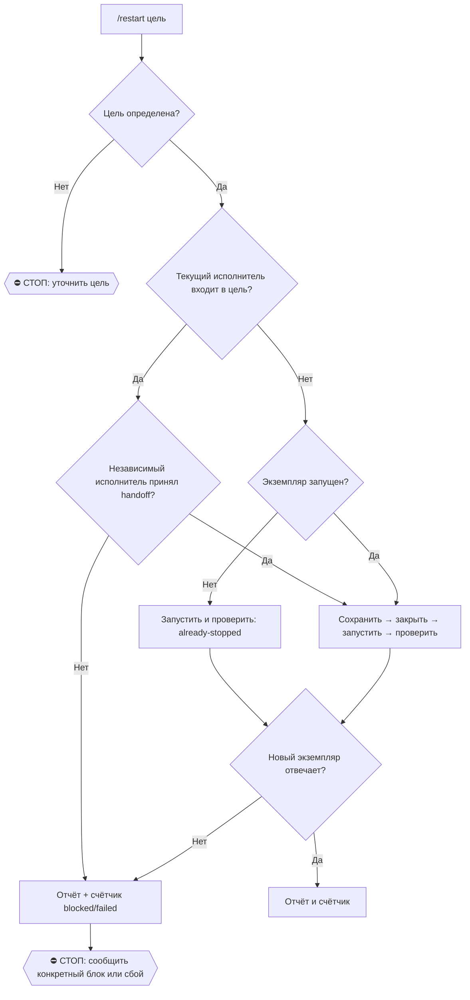

# /restart <цель>

Одна команда для управляемого перезапуска. Исполнитель: вызвавший агент на своей
машине. Вход: приложение и необязательный профиль/экземпляр. Выход: прежний
экземпляр завершён, новый отвечает, сохранённый контекст и ограничения названы.
Рельса: локальные инструменты ОС и существующие скиллы, без платного API.
Портируемость: Windows, macOS, Linux; выбирать штатные инструменты текущей ОС.

## Выбор цели

Регистр свободный: `/Restart Firefox` = `/restart firefox`.

| Запрос | Что выбирать | Существующий маршрут |
|---|---|---|
| chrome / хром | Google Chrome, нужный профиль | `../chrome-fix/SKILL.md` |
| firefox / фаерфокс | Mozilla Firefox, нужный профиль | локальные средства браузера и ОС |
| браузеры / browsers | запущенные обычные браузеры пользователя | перечислить экземпляры, затем по одному |
| claude desktop / клод десктоп | приложение Claude Desktop | `../claude-repair/SKILL.md` |
| claude code / клод код | конкретная CLI/GUI-сессия Claude Code | сохранить session id и способ resume |
| codex / кодекс | конкретный Codex Desktop или CLI | сохранить chat/session id и способ продолжения |
| cursor / курсор | приложение Cursor и рабочая папка | `../cursor-repair/SKILL.md` |
| antigravity / антигравити | установленное приложение Antigravity | определить exe/bundle/service и штатный запуск |
| edge, brave, opera, vivaldi | ровно названный браузер | тот же цикл сохранения и перезапуска |
| другая цель | установленное приложение либо конкретный сервис | сначала найти реальный запуск и потребителей |

Голый `/restart` требует одного короткого уточнения цели. «Claude» без уточнения
не означает все процессы `claude`: проверить, какое приложение/сессия зависло;
если одновременно видны Desktop и Code и контекст не различает их, уточнить.
Группа «браузеры» не включает Electron-приложения, WebView, Screenpipe и агентов.
Без физического узла в запросе работать локально. Перезагрузка ОС: `../reboot/SKILL.md`.

## Цикл выполнения

1. **Определить экземпляр.** Снять PID, время создания, путь exe/bundle, дерево
   процессов, профиль/рабочую папку, видимые окна и текущую нагрузку. Для браузера
   перечислить вкладки через уже разрешённый браузерный коннектор либо видимый UI.
   Ради перечисления не включать CDP/remote debugging/Marionette, не читать
   sessionstore/Sessions/SNSS, cookies или содержимое профиля. Если разрешённой
   двери нет, написать «вкладки не перечислены» и назвать риск потери контекста;
   не обходить ограничение. Не считать число процессов числом вкладок. Память/старые
   заметки дают гипотезы; цель и текущее состояние подтверждаются живым прибором.
   Приложение не запущено: пропустить закрытие, выполнить шаги 5–6 как запуск
   с исходом `already-stopped`.
2. **Сохранить продолжение.** Браузер: сохранить список обычных несекретных ссылок
   в локальном несинкаемом `~/.claude/restart-state/<UTC>-<target>-<UUID>.json`,
   доступном только пользователю (ACL пользователя в Windows, mode 600 на Unix).
   Проверить границу синка перед записью. URL с токенами, авторизацией, подписанными
   параметрами либо сомнительным содержимым не сохранять даже сюда: для такой вкладки
   записать только название и домен, без пути, query и fragment; отметить невозможность
   автоматического восстановления. Содержимое списка не помещать в отчёт, волт,
   закладки синкаемого профиля или счётчик. Путь к локальному файлу назвать в отчёте,
   чтобы пользователь мог найти сохранённое. Автоматическую чистку файлов не добавлять.
   Предупредить про несохранённые формы; для Chrome выполнить контроль cookies из
   `chrome-fix` до/после. Ссылки не сохраняют черновики, прокрутку и состояние форм.
   Редактор: штатно сохранить открытые документы; CLI/агент: checkpoint, session id,
   точный путь проекта и поддерживаемая команда resume. Не читать значения секретов.
3. **Закрыть штатно.** Использовать разрешённый текущим harness инструмент и штатный
   Quit/Exit, сигнал завершения либо менеджер конкретного сервиса. Дать до 30 секунд.
   Диалог о несохранённых данных не обходить. Не закрывать чужие automation-профили
   и активные сессии соседних агентов без согласования с владельцем.
4. **Если не вышел.** Перечитать PID, время создания, exe и окна. Завершить
   принудительно можно только доказанно зависший выбранный экземпляр в рамках
   явного приказа на его перезапуск и после сохранения доступного контекста.
   Фоновая работа без окна сама по себе не доказывает зависание. Не применять
   killall/taskkill по одному имени ко всем процессам; соседние экземпляры оставить.
   Если есть риск потерять несохранённое, назвать его и запросить решение.
5. **Запустить заново.** Сначала доказать выход старого экземпляра. Запустить тот же
   продукт, профиль и проект, не подменять приложением с похожим именем. Обычный
   restart восстанавливает контекст по настройкам продукта; он не закрывает навсегда
   все вкладки. Чистый старт с закрытием вкладок только по явному запросу.
6. **Проверить результат.** Новый PID/время старта плюс ответ интерфейса или health
   конкретного сервиса. Одного `Start-Process`/rc=0 недостаточно. Проверить сохранённый
   контекст; если обычное восстановление вкладок не сработало, восстановить
   только отсутствующие несекретные страницы из сохранённого списка, предварительно
   сравнив с текущими вкладками (кроме явно заказанного чистого старта).
   Ссылки с токенами/одноразовыми параметрами не открывать повторно автоматически.
   Если жаловались на тормоза, сравнить CPU/RAM до/после через `/perf`.
   Cookies count не доказывает живой логин. Если UI не проверен, так и написать.

Перезапуск не меняет автозапуск, расширения, политики, настройки безопасности,
профили, cookies и кэш, не обновляет и не переустанавливает приложение. Если для
устранения причины нужна другая операция, сначала назвать находку и её границы.
Не назначать периодические перезапуски без отдельного запроса. Запрет инструмента
не обходить альтернативным каналом; использовать только разрешённую альтернативу.

## Самоперезапуск агента

Если цель содержит текущий процесс исполнителя, сначала записать handoff вне его
памяти и передать точный план независимому разрешённому исполнителю. До закрытия
получить подтверждение, что тот принял выполнение и сможет заново открыть нужный
чат/проект. Отложенный процесс без проверки запуска и продолжения не считается
надёжной передачей. Независимого исполнителя нет: сохранить handoff, назвать блок;
не убивать свою сессию и не объявлять перезапуск успешным.

## Учёт и отчёт

При каждом исполнении с определённой целью дописать в `~/.claude/counters/restart.jsonl` один JSON-объект
с полями `ts`, `node`, `actor`, `event` (значение `restart`), `target`, `outcome`;
node = имя машины (hostname; в нашем флоте берётся из machine_stamp.py, у вас просто hostname), actor в форме
`<agent>@<node>`, например `claude@<node>` или
`codex@<node>`. Голый `/restart` без цели только уточняет её, это ещё не исполнение.
Без URL, команд с токенами и содержимого пользовательских документов.
Исходы: restarted / already-stopped
/ blocked / failed. `already-stopped` означает: приложение изначально не работало,
оно только запущено и проверено; это запуск, а не выполненный перезапуск.

Отчёт: что перезапущено, какой контекст сохранён, старый→новый PID, что отвечает,
до→после по нагрузке при наличии замеров, что не проверено. Не приписывать
улучшение одному фактору, если одновременно закрыли вкладки и перезапустили браузер.
Потребитель скилла: пользователь вызывает `/restart <цель>` в любой сессии; источник один
в общей полке, Codex/Cursor подключаются штатным `codex_skills_bridge.py`.

## 🌳 Дерево решений

<!--kit-footer-->

---

**Like this skill?** It is part of [second-brain-starter-kit](https://github.com/tonydzi/second-brain-starter-kit): the second brain we built for ourselves and run every day at Palo Alto AI Research Lab. Install the whole set with `npx skills add tonydzi/second-brain-starter-kit`. Everything is open source and free, so take what you need.

Flagships worth a look on their own: [secondop-panel](https://github.com/tonydzi/secondop-panel) (a second opinion from a panel of external models), [claude-memory-tidy](https://github.com/tonydzi/claude-memory-tidy) (stop your agent's memory from rotting), [telegram-mcp-kit](https://github.com/tonydzi/telegram-mcp-kit) (your own Telegram over MCP in about 15 minutes).

Author: **Anton Dziatkovskii**, Palo Alto AI Research Lab. Telegram [@tonydzi](https://t.me/tonydzi) - WhatsApp [+1 341 222 9178](https://wa.me/13412229178) - X [@Tony_Stef_](https://x.com/Tony_Stef_)

**Engineers: want to test-drive this setup?** Message me. I hand out free starter seeds to engineers who test and report back, and custom skill requests are welcome.
