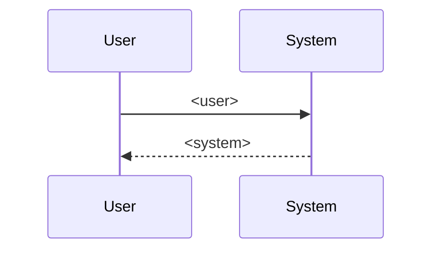

# Use case sequence diagram

The diagram is a view. The Steps table and the Alternative flow blocks are the source.
Never change a block to make the diagram match.

Follow the steps in order. The same file must always give the same result. If a case
is not covered by a rule, stop and report; do not choose on your own.

## 1. Read

Read the target use case file.

- Steps: `| S<n> | ... |` rows in the `## Steps` table. Keep file order. Read the User
  column and the System column (columns 2 and 3).
- Alternatives: `### A<n> · <name>` headings under `## Alternative flows`. Read
  `- **At:**` and `- **Ends:**`.

Stop and report, writing nothing, when: the table is missing a column; a step row has no
`S<n>`; an alternative is missing At or Ends; At names a step that does not exist; there
is a duplicate step; there are no steps.

## 2. Build messages

1. Declare participants: `participant U as User` and `participant S as System`.
2. For each step in order:
   - User column not empty → `U->>S: <user>`.
   - System column not empty → `S-->>U: <system>`.
   - Replace every `"` in the content with `'`.
   - Replace every `;` in the content with `,`. Mermaid treats `;` as a statement
     separator, so a label containing `;` breaks parsing.

## 3. Alternative flows

Alternative flows carry back/continue/switch-use-case semantics, so they are not
flattened into the sequence. Record them in a note line under the diagram, not drawn:
for each alternative, `<A<n>> (<Ends>)`; join with `, `; if there are none, write
`none`.

## 4. Write the block

The block is exactly these lines (each line inside the code block indented 2 spaces):

````
<!-- BEGIN generated: use-case-sequence -->


*Not drawn (alternative flows): <list>.*
<!-- END generated: use-case-sequence -->
````

## 5. Write to file

- Read the file first. Use one Edit; `old_string` runs from the BEGIN line to the END
  line (both included); `new_string` is the whole new block starting at the BEGIN line.
- If the markers are missing, insert `## Interaction diagram`, a blank line, and the
  block right after the frontmatter, before the first heading.
- Change nothing outside the markers.

## 6. Portability

Follow "Portability defaults" in [mermaid-markdown](../mermaid-markdown/SKILL.md).
Readers use GitHub and VS Code 1.121 or later (Mermaid preview built in).

## 7. Check and report

- Each step becomes exactly one message. Each alternative is recorded in the "Not drawn"
  line.
- If `npx` is available, check syntax with the Mermaid CLI; say whether it ran.
- Report: the file, the message count, the alternatives list, and the checks that ran.
