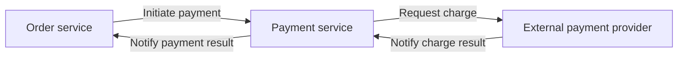

# 4R Architecture

## Core understanding

4R is a logical framework for explaining a system clearly: at a defined level of observation, describe what the system consists of, how its parts relate, and how they work together to achieve a goal.

The same system can have different views. Each view addresses a set of concerns, and key scenarios connect the views. This carries forward the 4+1 view model's idea of describing a system from multiple perspectives and checking it through scenarios.

## Four dimensions

### Rank: the level of observation

Rank defines the scope and granularity of the discussion, such as an enterprise, system, service, module, or code.

The same object may be a single role in an overall diagram and, when expanded, a system containing several roles. Rank determines which details belong in the current view and which belong at the next level.

### Role: what the system consists of

Roles are the key parts at the current level, represented by nodes in a structure diagram.

A role can be a business capability, subsystem, service, module, or infrastructure element. Its meaning comes from its responsibility: what work it performs and where its responsibility ends and another role's begins.

### Relation: how roles connect

Relations are calls, dependencies, information transfers, or shared resources between roles, represented by lines in a structure diagram.

A relation explains which roles connect, in which direction, and what they exchange. Roles and relations together describe the system's static structure.

### Rule: how roles work together

Rules explain how roles complete a business activity together under specific conditions and in a particular order within a scenario.

They cover request flow, state changes, error handling, and constraints that collaboration must satisfy. Sequence diagrams and flowcharts express these runtime rules.

Relation describes which connections exist. Rule describes when and under what conditions those connections take effect.

## Different views of the same system

| Perspective | Role: main parts | Relation: main connections | Rule: main rules |
|---|---|---|---|
| Business | Business capabilities, departments, participants | Business collaboration, information and value flows | The process from initiating a business activity to completing it |
| System | Subsystems, services, external systems | Calls, messages, shared data | Collaboration across systems and failure handling |
| Inside an application | Modules, components, classes, interfaces | Calls, dependencies, inheritance and implementation | Request handling and state changes |
| Deployment | Running instances, machines, network infrastructure | Network connections, traffic forwarding | Routing, scaling, and failover |

These views describe the same system: applications implement business capabilities, application code forms runtime units, and runtime units are deployed onto infrastructure. These mappings can be many-to-many.

## Example: a payment

At the level of collaboration between systems, the order service manages orders, the payment service manages the payment process, and an external payment provider charges the customer.

This diagram shows Role and Relation. Runtime behavior also needs Rule:

- An order can enter the paid state only after the charge is confirmed successful.
- A request timeout leaves the result unconfirmed; the payment service continues to verify it.
- Duplicate notifications for the same payment produce only one effective state change.

A deployment view would also explain where these services run and how requests reach their instances. It is related to the diagram above but answers different questions.

## Avoiding mistakes

- Describe perspective and level separately. Business, system, application, and deployment views do not correspond to a fixed L1-L4 hierarchy.
- Make the meaning of nodes and lines explicit; identify expanded levels, external participants, and mappings between views.
- Rule includes conditions and constraints, not just a sequence of successful steps; a business sequence diagram does not automatically belong to a deployment view.
- Distinguish goals discussed, behavior implemented in code, and analytical inferences. Mark statements without sufficient evidence as unconfirmed.
