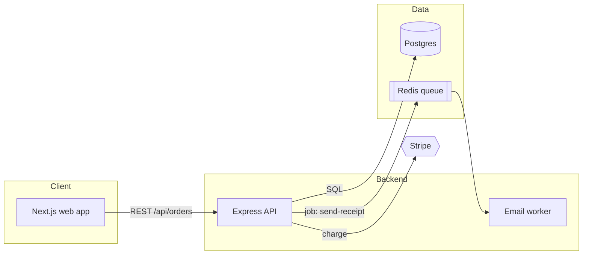

# Architecture Diagram

## Overview

Draw diagrams from the code, not from imagination. Pick the one view that answers the reader's question, keep it to what fits on a screen, and render it as Mermaid so it lives in the repo and shows on GitHub.

## Method

1. **Ask what question the diagram answers** (or infer it): "what are the parts?", "what happens when a user checks out?", "how is data stored?", "where does it run?".
2. **Pick the view:**

| Question | Diagram | Mermaid type |
|---|---|---|
| What are the main parts and how do they talk? | Container / component | `flowchart LR` |
| What happens step by step in one request? | Sequence | `sequenceDiagram` |
| What does the data look like? | ERD | `erDiagram` |
| Which states can an object be in? | State | `stateDiagram-v2` |
| Where does it run? | Deployment | `flowchart TB` with subgraphs per environment |

3. **Collect facts:** entry points, services and packages, external systems (databases, queues, third-party APIs) from config, `docker-compose`, infrastructure files, imports and HTTP clients. For a sequence, follow one real request through the code.
4. **Draw** with the rules below.
5. **Verify** every box and arrow against a file. Remove anything you cannot point to.
6. **Deliver** the Mermaid code block plus a 3-5 line legend of what each part is, with file paths.

## Rules

- One diagram, one question. Split rather than cram; 5-15 nodes is ideal.
- Label arrows with what flows: `-->|REST: create order|`, `-->|SQL|`, `-->|event: OrderPaid|`.
- Group with `subgraph` by boundary (frontend, backend, data, third party).
- Use real names from the code, not generic "Service A".
- Show external systems distinctly (different shape or a subgraph named External).

## Example

## Common mistakes

- Drawing every file. Diagrams show boundaries and flows, not the folder tree.
- Arrows without labels.
- Including planned or imagined components as if they exist.
- Mermaid syntax errors: quote labels containing parentheses or special characters, for example `a["Auth (JWT)"]`.

---

Made by **Wageesha Tripathi** · [LinkedIn](https://www.linkedin.com/in/wst2002/) · [Email](mailto:tripathiwageesha2002@gmail.com) · [More skills](https://github.com/WST2002/claude-code-skills)
