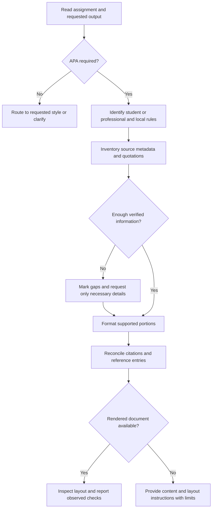

# APA Formatting

Turn supplied writing and verified source metadata into APA seventh-edition output.
Guidance checked **2026-10-25**. The seventh edition remains current; online APA
updates supplement the manual. Consult [references/sources.md](references/sources.md)
when a rule is disputed, time-sensitive, or outside the examples.

## When to use

Activate for explicit APA formatting, APA citation repair, an APA reference list,
or a comparison that needs the APA side. For MLA output use the MLA skill; for an
unspecified citation style, establish the required style before converting anything.
Do not silently rewrite claims, invent research, or treat a formatting request as
permission to submit an assignment or publish a document.

## Core process

1. **Set the contract.** Read the rubric, journal instructions, edition, paper type,
   and target format. Local requirements may override APA defaults; label each
   departure. For coursework use student setup unless professional setup is
   required. When only a citation is requested, deliver the citation directly.
2. **Separate evidence from presentation.** Record author order, date, title,
   source type, container, volume/issue/pages or article number, publisher, and
   DOI/URL as applicable. Verify against the source or publisher record when
   available. Record whether each detail was supplied, independently verified,
   or unresolved. Never manufacture a locator, author, DOI, date, or quotation.
3. **Choose the needed reference.** Read
   [references/layout.md](references/layout.md) for paper structure and appearance;
   [references/citations.md](references/citations.md) for attribution and quotations;
   [references/reference-patterns.md](references/reference-patterns.md) for source
   types, missing metadata, DOI/URL decisions, and current AI guidance.
4. **Apply and reconcile.** Preserve meaning and verified quotations. Cross-check
   every recoverable cited work against the references, and every reference
   against an actual citation. Account explicitly for personal communications and
   secondary-source exceptions. Check author spellings, years/suffixes, author
   order, quotation locators, title capitalization, italics, and link destinations.
5. **Verify the deliverable at its actual level.** A text review can check citation
   consistency; only the final document can show margins, headers, page breaks,
   fonts, spacing, and table overflow. When tools permit, render and inspect the
   DOCX/PDF in its target application. State exactly what was inspected. A regex,
   Markdown preview, or citation-manager export does not establish compliance.

## Output contract

Scale the response to the task. A single reference needs the entry, its in-text
form, and any consequential uncertainty. A paper audit or conversion returns:

- Corrected content or a clearly named artifact; distinguish a scaffold from a
  formatted document.
- Assumptions: edition, student/professional, local overrides, and output format.
- A short correction log for material changes, with rule/source links when useful.
- Missing or unverifiable details, named precisely; use conspicuous placeholders
  in drafts and keep unresolved entries out of a claimed submission-ready artifact.
- Verification scope: content checks performed; rendered checks observed; remaining
  layout checks. Never say “APA compliant” when only plain text was available.

Use [examples/worked-examples.md](examples/worked-examples.md) for finished small
examples and an audit handoff. Use
[templates/student-paper.md](templates/student-paper.md) only to start a student
paper's content; its comments require actual word-processor settings.

## Anti-patterns

### Put a running head on every student paper

**Novice:** Apply a professional title page and an abstract to all assignments.
**Expert:** Establish the paper type and rubric first; student defaults differ.
**Timeline:** Seventh-edition guidance introduced a separate student setup in 2019;
current online instructions retain that distinction. See the layout reference.

### Use the in-text author limit in the reference list

**Novice:** Change every three-author reference to “et al.”
**Expert:** In-text abbreviation and reference-list author transcription have
separate rules; preserve source order and resolve ambiguous shortened citations.
**Timeline:** Seventh-edition in-text rules differ from sixth-edition first-citation
rules. See the citations and reference-patterns references.

### Cite AI using an undated remembered recipe

**Novice:** Always copy the archival 2023 ChatGPT example, or assume a citation
makes AI use permissible.
**Expert:** Check current official guidance, distinguish a helpful shareable chat
from general tool use, and apply the institution/publisher policy independently.
**Timeline:** APA replaced the 2023 post with a September 2025 series. Recheck it
when handling AI; do not invent a model version or tool-update date.

### Treat typography instructions as rendered proof

**Novice:** Declare a Markdown scaffold submission-ready after checking punctuation.
**Expert:** Report content validation separately from observations of the final
file. Inspect page headers, styles, breaks, and tables after conversion.
**Timeline:** This is a format boundary, not an edition change.

## Bundle guide

- [references/layout.md](references/layout.md) — Open for title pages, headings,
  headers, spacing, tables, and the final visual inspection pass.
- [references/citations.md](references/citations.md) — Open for paraphrases,
  quotations, author/group forms, ambiguity, and nonrecoverable material.
- [references/reference-patterns.md](references/reference-patterns.md) — Open when
  constructing entries or dealing with missing metadata, links, or AI.
- [references/sources.md](references/sources.md) — Open to verify claim provenance,
  check dates, and distinguish accessible sources from research gaps.
- [examples/worked-examples.md](examples/worked-examples.md) — Open for fictional
  citation/reference examples and a realistic limited-verification handoff.
- [examples/activation-evals.md](examples/activation-evals.md) — Open when testing
  activation boundaries or regression after description changes.
- [templates/student-paper.md](templates/student-paper.md) — Open when a content
  scaffold helps begin an APA student paper; apply layout in the target editor.
- [README.md](README.md) — Open for bundle purpose, scope, and entry point.
- [CHANGELOG.md](CHANGELOG.md) — Open for version and research-refresh history.
