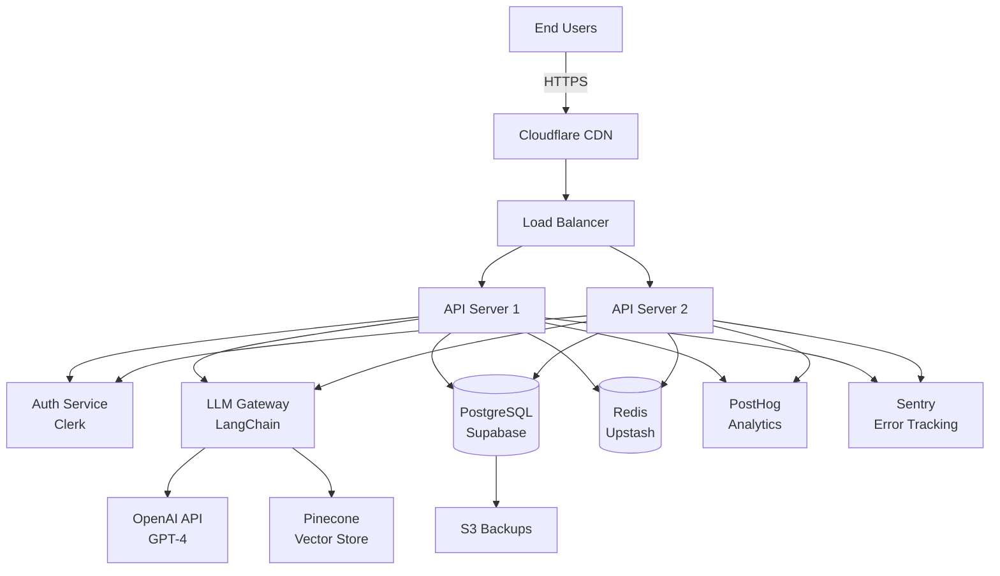

# AI Solution Architecture

## Purpose

Design comprehensive, production-ready AI/ML solution architectures for enterprise B2B clients during pre-sales cycles. Translates business requirements into technical designs with infrastructure sizing, integration patterns, security considerations, and cost modeling.

## Trigger Patterns

- "Design an AI solution for..."
- "What architecture do we need for..."
- "Scope this AI implementation"
- "Technical proposal for [AI use case]"
- "Integration architecture for AI"
- "Infrastructure requirements for ML"
- Client mentions: solution design, technical scoping, reference architecture, AI implementation plan

## Input Requirements

```yaml
required:
  - business_objective: "What problem is AI solving?"
  - scale_parameters: "Users, requests/day, data volume"
  - existing_systems: "Current tech stack, APIs, databases"
  
optional:
  - compliance_requirements: "GDPR, HIPAA, [COMPLIANCE FRAMEWORK], etc."
  - budget_constraints: "Infrastructure budget, timeline"
  - team_capabilities: "In-house AI expertise level"
```

## Process

### 1. Requirements Discovery

**Business Context Analysis**
```markdown
- Problem statement: What manual process is being automated?
- Success metrics: How will ROI be measured?
- User personas: Who interacts with the AI?
- Scale requirements: Peak load, data growth, latency SLOs
```

**Technical Constraints Mapping**
```markdown
- Existing infrastructure: Cloud provider (AWS/Azure/GCP), on-prem
- Integration points: CRM, ERP, databases, APIs
- Security posture: Authentication, authorization, data encryption
- Compliance mandates: Industry regulations, data residency
```

### 2. Architecture Design

Component stack options — LLM layer, application framework, data layer, and infrastructure — with selection criteria. See `references/stack-reference.md` for the full stack comparison tables.

### 3. Integration Mapping

Authentication, authorization, and API integration pattern options. See `references/stack-reference.md` for the full integration pattern tables.

### 4. Infrastructure Sizing

**Request Volume Modeling**

See `references/sizing-calculator.md` for detailed methodology.

**Quick Estimates**

Small / medium / large deployment tiers with monthly cost and hosting breakdowns. See `references/stack-reference.md` for the full pricing tier and hosting tables.

### 5. Security Architecture

**Threat Model**
```yaml
threats:
  prompt_injection:
    mitigation: Input sanitization, content filtering, system prompt isolation
  
  data_exfiltration:
    mitigation: Network policies, egress filtering, audit logging
  
  unauthorized_access:
    mitigation: JWT validation, rate limiting, IP allowlisting
  
  model_poisoning:
    mitigation: Frozen base models, validation of fine-tuning data
```

**Compliance Mapping**

See `references/compliance-patterns.md` for detailed frameworks.

## Output Format

### Architecture Diagram (Mermaid)



### Technical Specification Document

```markdown
# AI Solution Architecture: [Client Name] - [Use Case]

**Date:** 2025-01-22
**Version:** 1.0
**Prepared by:** Loxihart Inc. Sales Engineering

---

## Executive Summary

**Business Objective:** [1-2 sentences]
**Proposed Solution:** [Technology stack summary]
**Estimated Timeline:** [Weeks to production]
**Total Cost:** $[monthly recurring] + $[one-time implementation]

---

## Architecture Overview

### Component Stack
- **LLM Provider:** [OpenAI GPT-4 / Claude 3.5 Sonnet / Self-hosted Llama 3.1]
- **Application Framework:** [FastAPI / Next.js / Custom]
- **Vector Database:** [Pinecone / Weaviate / pgvector]
- **Relational Database:** [PostgreSQL / MySQL]
- **Authentication:** [Clerk / Auth0 / Custom JWT]
- **Hosting:** [Vercel / AWS / GCP]

### Integration Points
1. **[System A]:** [Integration method, data flow direction]
2. **[System B]:** [Integration method, data flow direction]

---

## Infrastructure Sizing

**Expected Load:**
- Daily Active Users: [number]
- Requests per Day: [number]
- Peak QPS: [number]
- Data Storage: [GB/TB]

**Provisioned Resources:**
- Compute: [Instance types, count]
- Database: [Size, IOPS]
- Vector DB: [Dimensions, vectors count]

---

## Security & Compliance

**Data Classification:** [Public / Internal / Confidential / Restricted]

**Compliance Requirements:**
- [ ] GDPR (EU data residency, right to deletion)
- [ ] HIPAA (PHI encryption, audit logging)
- [ ] [COMPLIANCE FRAMEWORK] (access controls, monitoring)

**Security Controls:**
- Authentication: [Multi-factor, SSO]
- Authorization: [RBAC, RLS policies]
- Encryption: [At-rest AES-256, In-transit TLS 1.3]
- Audit Logging: [All API requests logged, 90-day retention]

---

## Cost Breakdown

| Component | Monthly Cost | Notes |
|-----------|--------------|-------|
| Hosting (Vercel Pro) | $20 | Scales to 100GB bandwidth |
| Database (Supabase Pro) | $25 | 8GB RAM, 100GB storage |
| Vector DB (Pinecone) | $70 | 1 pod, 1M vectors |
| LLM API (OpenAI) | $500-2,000 | Variable by usage |
| Observability (PostHog) | $0-50 | Free tier, then usage-based |
| **Total** | **$615-2,165/month** | |

**One-Time Costs:**
- Implementation (Loxihart Services): $[amount]
- Data migration: $[amount]
- Training: $[amount]

---

## Deployment Phases

### Phase 1: Foundation (Weeks 1-2)
- Setup infrastructure (VPC, databases, hosting)
- Configure authentication (SSO, user management)
- Deploy base API (health checks, monitoring)

### Phase 2: Core AI Features (Weeks 3-4)
- LLM integration (prompts, context management)
- Vector database setup (embeddings, search)
- API endpoints (chat, document processing)

### Phase 3: Integration (Weeks 5-6)
- Connect to [Client System A]
- Connect to [Client System B]
- Data pipeline setup (ETL, synchronization)

### Phase 4: Testing & Launch (Weeks 7-8)
- Load testing (target: 1,000 concurrent users)
- Security audit (penetration testing)
- Production deployment (blue/green rollout)

---

## Risks & Mitigations

| Risk | Likelihood | Impact | Mitigation |
|------|------------|--------|------------|
| LLM API rate limits | Medium | High | Implement retry logic, fallback models |
| Data migration delays | High | Medium | Parallel track, early testing |
| Integration complexity | Medium | Medium | Dedicated integration engineer, buffer time |
| Cost overruns | Medium | Medium | Usage monitoring, alerts at 80% budget |

---

## Success Criteria

- [ ] P95 latency < 2 seconds
- [ ] 99.9% uptime (max 43 minutes downtime/month)
- [ ] < 0.5% error rate
- [ ] User satisfaction > 4.5/5
- [ ] Processes [target number] requests/day

---

## Next Steps

1. **Client:** Review and approve architecture
2. **Loxihart:** Finalize SOW (Statement of Work)
3. **Client:** Provision accounts (cloud, LLM providers)
4. **Loxihart:** Begin Phase 1 implementation

**Questions? Contact:** [EMAIL]
```

## Validation Gates

```yaml
architecture_review:
  - [ ] All integration points documented
  - [ ] Security controls mapped to threats
  - [ ] Infrastructure sized for peak + 30% buffer
  - [ ] Costs broken down by component
  - [ ] Compliance requirements addressed
  
technical_review:
  - [ ] No single points of failure
  - [ ] Observability hooks in all components
  - [ ] Graceful degradation patterns defined
  - [ ] Rollback strategy documented
  
business_review:
  - [ ] ROI justification included
  - [ ] Timeline realistic (client validation)
  - [ ] Risks quantified (likelihood × impact)
  - [ ] Success metrics measurable
```

## Error Handling

| Error | Cause | Fix |
|-------|-------|-----|
| "Insufficient scale data" | Client doesn't know expected load | Provide 3 sizing tiers (S/M/L), let client choose |
| "Integration unclear" | Legacy system documentation missing | Schedule technical discovery call, request API docs |
| "Budget misalignment" | Proposed solution exceeds budget | Offer phased approach, start with MVP |
| "Compliance unknown" | Client unsure of regulatory requirements | Provide compliance questionnaire, reference common frameworks |

## Cross-References

- See `roi-calculator-building` for cost/benefit analysis
- See `competitive-battle-cards` for positioning vs alternatives
- See `poc-scoping` for proof-of-concept design
- See `technical-discovery` for requirements gathering templates

---

**Version:** 1.1.0  
**Last Updated:** 2025-01-22  
**Maintainer:** Loxihart Inc. Sales Engineering  
**Support:** For questions, reference `/references/` or contact [EMAIL]


---

## Reference Files

- `references/stack-reference.md` — full stack comparison tables (LLM, application framework, data layer, infrastructure), integration pattern options, and deployment pricing/hosting tiers (moved from sections 2–4).
- `references/sizing-calculator.md` — detailed infrastructure sizing methodology.
- `references/compliance-patterns.md` — detailed compliance frameworks.

---

## CLAIMS
<!-- [SOURCED] or [GENERATED] labels for assertions in this skill. None yet — footer added by audit fix pass. -->

## COUNTEREXAMPLE
<!-- Known cases where this skill should NOT activate or may produce wrong output -->

## CONTRADICTIONS
<!-- ! Conflicts with other skills or system prompts -->
