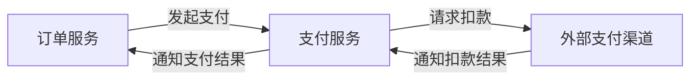

# 4R 架构

## 核心认识

4R 是把系统讲清楚的逻辑框架：在一个确定的观察层级，说明系统由什么组成、各部分怎样联系，以及如何协作完成目标。

同一个系统可以有不同视图。每个视图关注一类问题，关键场景把它们联系起来。这延续了 4+1 视图模型中“多角度描述、用场景检验”的思想。

## 四个维度

### Rank：从哪一级观察

确定讨论的范围与粒度，例如企业、系统、服务、模块或代码。

同一个对象，在整体图中可能只是一个角色，展开后又成为包含多个角色的系统。Rank 决定当前保留哪些细节，以及哪些细节属于下一层。

### Role：系统由什么组成

角色是当前层级中的关键组成部分，对应结构图中的节点。

角色可以是业务能力、子系统、服务、模块或基础设施。角色的意义在于职责：它承担什么工作，与其他角色的责任边界在哪里。

### Relation：角色怎样联系

关系是角色之间的调用、依赖、信息传递或资源共享，对应结构图中的连线。

关系说明谁与谁联系、方向是什么、交换什么。角色与关系共同描述系统的静态结构。

### Rule：角色怎样协作

规则说明角色在具体场景中，如何按照条件与顺序共同完成业务。

它包括请求流转、状态变化、异常处理，以及协作必须满足的约束。时序图和流程图用于表达这些运行规则。

Relation 说明存在什么联系，Rule 说明这些联系在什么时候、按什么条件发挥作用。

## 同一个系统的不同视图

| 观察角度 | Role：主要角色 | Relation：主要联系 | Rule：主要规则 |
|---|---|---|---|
| 业务 | 业务能力、部门、参与者 | 业务协作、信息与价值流转 | 从业务发起到完成的过程 |
| 系统 | 子系统、服务、外部系统 | 调用、消息、数据共享 | 跨系统协作与失败处理 |
| 应用内部 | 模块、组件、类、接口 | 调用、依赖、继承与实现 | 请求处理与状态变化 |
| 部署 | 运行实例、机器、网络设施 | 网络连接、流量转发 | 路由、扩缩容与故障切换 |

各视图描述同一个系统：业务能力由应用实现，应用代码形成运行单元，运行单元部署到基础设施。它们之间可以是多对多关系。

## 例子：一笔支付

在系统协作这一层，订单服务管理订单，支付服务管理支付过程，外部支付渠道执行扣款。

这张图给出了 Role 与 Relation。运行还需要 Rule：

- 扣款结果确认成功后，订单才能进入已支付状态。
- 请求超时表示结果尚未确认，由支付服务继续核实。
- 同一笔支付的重复通知，只产生一次有效状态变更。

换到部署视图，还需要说明这些服务运行在哪里、请求怎样到达实例。它与上图有关，但回答的问题不同。

## 避免误用

- 观察角度与层级分别说明。业务、系统、应用、部署不固定对应一套 L1—L4 层级。
- 节点和连线的含义应明确；层级展开、外部参与者与跨视图对应关系应标明。
- Rule 包含条件与约束，不能只列一串成功步骤；业务时序图也不自动属于部署视图。
- 讨论中的目标、代码中的实现和分析推断分别表述，缺少依据的内容标为待确认。
