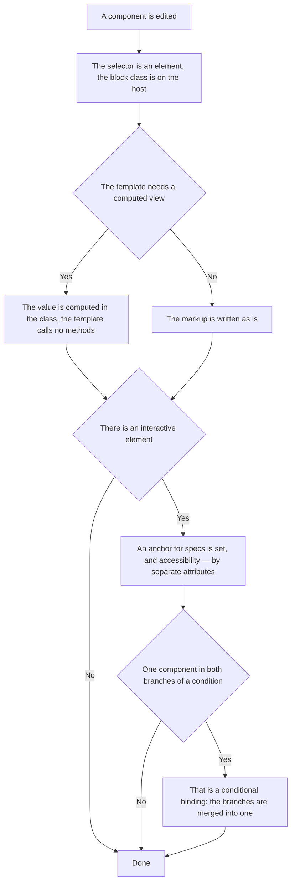

<!-- rt-kit v0.34.0 · rules/component-structure.md · f10d44c07a7d · правится надстройкой, не здесь -->

# Component file — how it works here

Rule under the law `docs/constitution/frontend-application.md`. The law says what must be true; here
— how the component file itself and its template are arranged. State and streams —
`angular-patterns`, styles — `styling-bem`, the browser environment — `platform-access`, the server
access layer — `api-layer`. All five under one law.

## What it is called here

| In the law                                       | Here                                                                        |
| ------------------------------------------------ | --------------------------------------------------------------------------- |
| component                                        | `<prefix>-<name>` — one prefix for all applications of the tree             |
| a ready value, not a computation in the template | `computed()`; where the value comes from the template context — a pure pipe |
| an anchor for a check                            | the `qa-dataid` attribute in kebab-case by the meaning of the element       |
| markup root                                      | `:host` with the block class from `host: { class: '<prefix>-<name>' }`      |

## Where it lives

In this tree — the table in `implementation.md` next to it. Paths live there, not here: the rule
travels between repositories, the layout does not, and a path named in the rule lies in the first
tree that keeps its code differently.

## Flow

The flow of editing a component: where the markup is decided, where the binding is, and what is put
on every interactive element.

## How the law applies here

- **The template calls no methods.** The linter rule bans `{{ getTotal() }}` and `@if
  (computeFlag())`, signal reads it does not touch.
- **Every interactive element carries `qa-dataid`.** It is the only anchor of the specs: BEM classes
  change with the layout, and a search by role and text breaks on translation locales.
- **A component is allowed only an element selector.** The linter rule demands from a component an
  element with the tree prefix and a hyphenated name, from a directive — an attribute and a one-word
  name. A technique that hangs on a foreign tag is written as a directive from the start: with a
  component on an attribute selector the lint turns red only after all three files and the styles
  are written.
- **The block class hangs on the host, not on a wrapper inside the template.** An extra wrapper
  around all the children is layout, and its place is on `:host`.

## What of the law is not here

The order of decorator properties, import grouping and self-closing tags are checked by nothing —
they are held by reading the neighbouring file. There is no check for a direct call to the browser
environment either — that is `Q-FA-1` in the law.

## Patterns

- `component-structure-new` — a ready-made component file and the template conventions.

## Pitfalls

- **`href="#id"` in markup does not work.** The build is one for all locales, the markup holds
  `<base href="/">`, and the browser resolves the fragment against the base: instead of a scroll you
  get a full navigation with a reload. Scrolling — through the router: `<a [routerLink]="[]"
  fragment="booking">`.
- **The same component in both branches of an `@if` is a conditional binding.** Two branches with
  different inputs recreate the component and lose its state.
- **A kit that draws in an overlay is not addressed from the caller's host:** its markup lies
  outside the host, and `[qa-dataid="x"] button` does not reach the buttons. Such buttons carry
  their own anchors right in the kit template, and the guard does not check the dependency
  catalogue.
- **`qa-dataid` does not replace `aria-label` and roles:** accessibility separately, the anchor
  separately. And it is not removed when the layout is edited — the specs hang on it.
- **Markup is edited by the edit tool, not by a script.** The anchor guard judges a shell command
  by its whole body: the old markup in a find-and-replace pair counts as written, and an edit that
  adds every anchor is refused for the lines it removes. The article in full is in the rule
  `doc-style`.
- What the kit has ready is not written anew: own markup with `role="alert"`, `<table>`,
  `role="dialog"`, `role="tablist"` or `role="tooltip"` means that `<prefix>-message`,
  `<prefix>-table`, `<prefix>-dialog`, `<prefix>-tabs` or `<prefix>-tooltip` were bypassed. The rule
  whole — `reuse-first`.
- **A kit icon name is copied from its file, and an unknown name draws an empty frame.** The kit
  draws the frame of an icon it did not find and says nothing. The build, the lint and the tests
  stay green, and the owner sees an empty square. Before the edit the name is looked up among the
  kit icon files: some names carry the `ico-` prefix and most do not.
- **A component that grew past the file limit is split, not squeezed.** An edit of a component does
  not load the rule of plain TypeScript files, where the 500-line article lives, so it is repeated
  in one line here: what the component does on its own moves out into a file next to it.

## Content that arrived from outside is built as nodes

Text that arrived from outside is shown as a tree of nodes built by a parser, not as a string
glued into the markup. There is no way around this: a string handed to the page is the execution
of what arrived in the browser of whoever is looking.

- **Parsing the arrived text lives as a pure function, and the component draws its nodes.** The
  decision about what in the text is markup and what is visible characters is checked by a call;
  the component stays thin and starts no branching of its own.
- **The list of understood markup is closed and nailed inside the component.** Such a component
  has one input — the text itself: there is nothing to configure, so there is nothing to weaken
  either. A forgotten input would silently open more than intended.
- **What the parser does not know stays visible text and is not cleaned away.** Cleaning is a
  promise held by a setting; a node the parser does not build never reaches the page without one
  anyway. Raw HTML, images and addresses of foreign schemes are therefore visible as characters,
  as they arrived.
- **A link leads outward only by a known scheme.** The address of a scheme that executes code
  looks like a link and fires on a click: schemes are chosen by a list, not sifted by danger.
- **The display of arrived text is assembled once for every section that shows it.** Assembled
  apart, they drift in appearance one by one, and it is the reader who notices, not a check.
