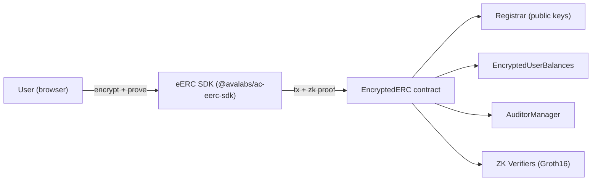

# eERC (Encrypted ERC) — Introduction

## Overview
The **Encrypted ERC-20 (eERC)** standard, developed by **AvaCloud**, enables confidential token transfers on Avalanche (and any EVM chain). Balances and transfer amounts are **encrypted on-chain**, while validity is proven with **zk-SNARKs**. No protocol changes, relayers, or off-chain actors are required — it is fully on-chain.

## Key Features
- **Confidential transactions** — balances and amounts are hidden on-chain.
- **Client-side operations** — encryption, decryption, and proof generation run on the user's device. The contract only *verifies* proofs; it never sees plaintext.
- **Fully on-chain** — no relayers or trusted off-chain intermediaries.
- **Built-in, rotatable auditors** — selective decryption for compliance, without redeploying.
- **Dual-mode** — create a brand-new private token (Standalone) or wrap an existing ERC-20 (Converter). See [[eerc-deployment-modes]].
- **Large integers** — supports amounts up to 2^251.
- **Chain-agnostic** — deployable on any EVM chain (C-Chain mainnet, Fuji, custom L1s).
- **(New) Encrypted metadata** — attach arbitrary encrypted metadata to transactions.

## Architecture (high level)

All sensitive math happens **client-side** in the SDK; the chain stores ciphertext and verifies proofs. Details: [[eerc-architecture-contracts]], [[eerc-cryptography]].

## The eERC lifecycle
`register` → `generateDecryptionKey` → (`privateMint` / `deposit`) → `privateTransfer` → (`privateBurn` / `withdraw`). Compliance via the auditor key ([[eerc-auditor-compliance]]).

## Common Pitfalls
- **Skipping registration.** Every user must `register()` and have a decryption key before any operation — see [[eerc-sdk-registration]].
- **Confusing eERC with general FHE.** eERC uses zk-SNARKs + *partially* homomorphic ElGamal for token amounts specifically, not arbitrary encrypted computation.

## AI Agent Prompt
> "Act as an eERC specialist. Explain how eERC keeps balances and amounts confidential on a public Avalanche chain while remaining EVM-compatible and compliance-ready, then outline the build steps."

## References
See `references/README.md` (EncryptedERC repo README + academy "What is eERC").
