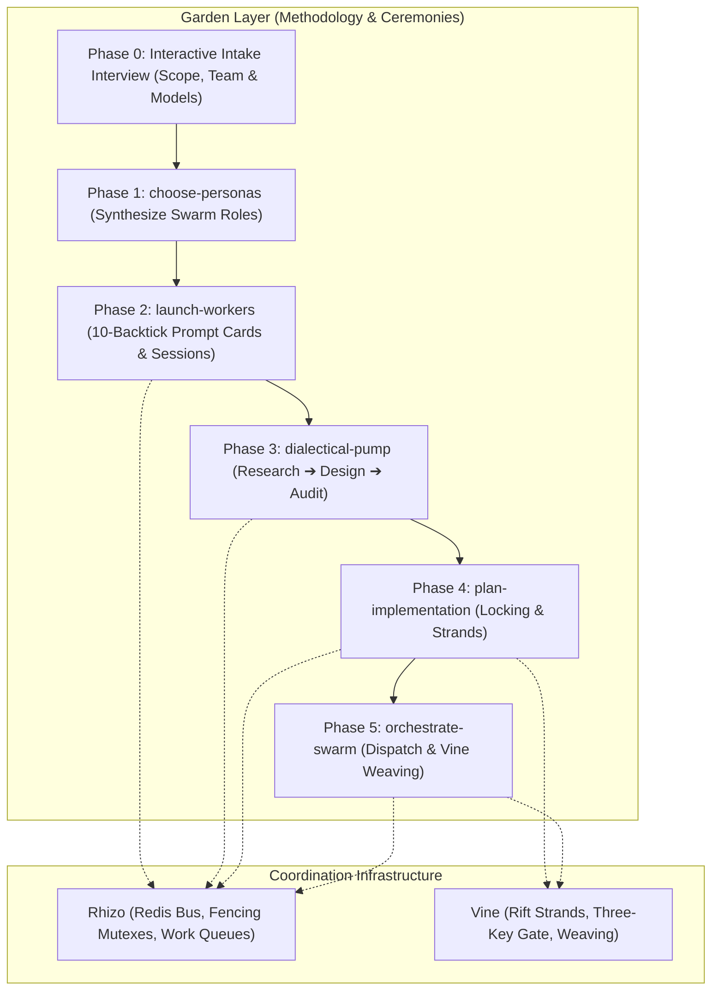
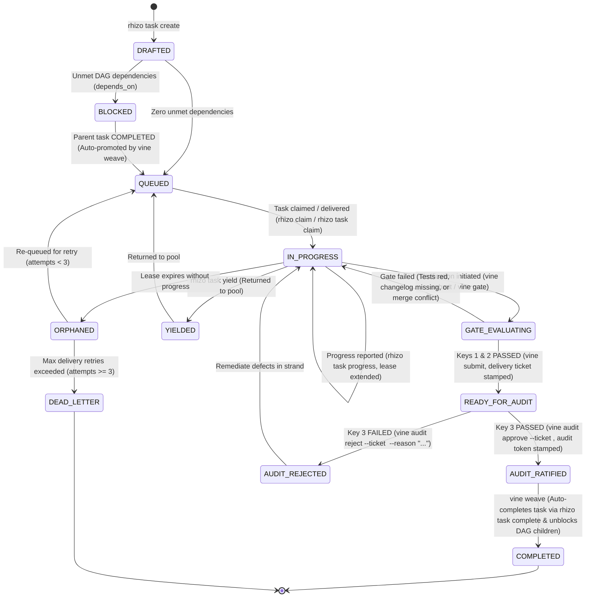

# Garden: Multi-Agent Swarm Ceremony & Orchestration Engine

## 0. Prerequisite & Automatic Bootstrapping

All swarm ceremonies require `garden`, `rhizo`, `vine`, and `rift`. If missing, install globally:
```bash
npm install -g @axiomantic/rhizo @axiomantic/vine @axiomantic/garden rift-snapshot
```

> [!TIP]
> **Zero-Install Fallback (`npx`)**: In restricted environments where global installation is prohibited, prefix commands with `npx -y @axiomantic/garden <command>`.

---

## 1. Architecture, Layering & The Master Umbrella Conductor

<CRITICAL>
Master Umbrella Conductor Invariant:
Garden is the capstone framework and single front-door of the Axiomantic Triad (Unix philosophy: Garden = Orchestration/Workflow, Rhizo = Transport/IPC, Vine = Git/Workspaces).
Whenever Garden is invoked (via 'garden', 'swarm', 'agent team', 'plant', 'germinate', or multi-agent feature requests), the agent MUST treat Garden as the parent umbrella. The operator NEVER needs to manually recite 'use garden/rhizo/vine'—activating Garden automatically mandates reading `garden`, `rhizo`, and `vine` skills.
</CRITICAL>

Garden directs multi-agent swarms using Rhizo for transport and Vine for workspace virtualization:



---

## 2. Macro-Lifecycle: Sowing (`garden plant`) & Germination (`garden germinate`)

Before launching multi-agent ceremonies, features and roadmap items are captured organically as **Seeds** organized into roadmap **Seasons**:

### A. Sowing Seeds (`garden plant`)
Add new roadmap items or feature requests to `.garden/seeds/<id>.toml`:
```bash
garden plant "Real-time SSE event stream for cluster telemetry" \
  --season "v0.3.0" \
  --sunlight high \
  --tags "telemetry,sse,web"
```
Options:
- `--season <name>`: Target roadmap release or milestone (e.g. `v0.3.0`).
- `--sunlight <low|medium|high|blazing>`: Priority level.
- `--tags <csv>`: Domain classification tags.
- `--json`: Structured machine-parseable JSON output.
- `--list`: Displays all sown seeds and their dynamic lifecycle status.

### B. Deterministic Germination (`garden germinate <subcommand> <seed>`)
To prevent LLM tool-calling omissions, germination uses dedicated positional subcommands:
1. **`garden germinate dispatch <seed>`**: Enqueues the seed directly to Rhizo cluster work queues (`queue:<project>:tasks`) with dialectical pump specifications.
2. **`garden germinate prompt <seed>`**: Emits copy-pasteable **10-backtick raw markdown prompt cards** for bootstrapping dedicated worker sessions.
3. **`garden germinate inline <seed>`**: Runs the 3-stage dialectical pump (Research ➔ Design ➔ Audit) within the active chat session.
4. **`garden germinate status <seed>`**: Inspects dynamic lifecycle progress (`SOWN` ➔ `DISPATCHED` ➔ `GERMINATED` ➔ `WOVEN`).

---

## 3. The End-to-End Ceremony Workflow

Execute phases sequentially. Never skip phases or invert the order.

| Phase | Sub-Skill / Step | Action | Quality Gate to Proceed |
| :--- | :--- | :--- | :--- |
| **Phase 0** | **Intake Gate** | Fast-path check (`rhizo who --json`) or single-question intake via `ask_question` calibrated to detected harness. | Active cluster workers confirmed or operator submits choice. |
| **Phase 1** | [`choose-personas`](../choose-personas/SKILL.md) | Synthesize swarm configuration reflecting detected harness and chosen shape (zero on-disk JSON). | Swarm roles ratified. |
| **Phase 2** | [`launch-workers`](../launch-workers/SKILL.md) | Output 10-backtick raw markdown prompt cards and numbered session instructions. | `rhizo who --json` confirms 100% of workers active & listening. |
| **Phase 3** | [`dialectical-pump`](../dialectical-pump/SKILL.md) | Grounded triadic deliberation: research (extracting codebase idioms), design (specifying exact types & interfaces), adversarial audit, and Stage 3.5 Pre-Plan Contract Skeleton Strand on `epic/<slug>`. | Zero open `CRIT` or `BLOCKER` defects in `audit_report.md` and contract skeleton committed. |
| **Phase 4** | [`plan-implementation`](../plan-implementation/SKILL.md) | Author master implementation plan anchored to committed skeleton symbols on `epic/<slug>`, locking schedules, parallel strands (`--parent epic/<slug>`), and Two-Point Diff contracts. | Complete `implementation_plan.md` with task-locking matrix and Contract Immutability. |
| **Phase 5** | [`orchestrate-swarm`](../orchestrate-swarm/SKILL.md) | Main-chat governor: task dispatch, heartbeat monitoring, Closed-Circuit & Three-Key gate verification, trunk weaving. | All plan tasks woven via `vine weave` after passing Three-Key Gate (Mechanical, Semantic, Adversarial Audit). |

---

### Phase 0: Interactive Project Intake & Swarm Calibration

#### The Intelligent Concierge Protocol (`garden: <prompt>`)
When the operator prefixes a request with `garden: <prompt>` (or directs a feature, refactor, or project task to Garden):
The orchestrator MUST NOT immediately write code, edit files, or unilaterally launch massive multi-file changes.
Instead, it acts as an **Intelligent Intake Concierge**:

0. **Fast-Path Check for Pre-Authorized Directives & Active Swarm**:
   - **Pre-Authorized Directives & Autonomous Dispatch**: If the operator instructs "work on this with your workers" (or similar delegation phrases), or whenever active cluster workers already exist on the Rhizo cluster (`rhizo who`), the Orchestrator MUST NOT stop to ask routing questions. It is fully pre-authorized to act! It must immediately break down work, provision isolated Vine strands (`vine new <task>`), and dispatch directly over Rhizo (`rhizo send`) or enqueue to work queues (`rhizo enqueue`).
   - **Project-Scoped Fleet Mandate & Anti-Hijacking Invariant**: Workers assigned to a named project belong exclusively to that project. Cross-project worker hijacking is strictly prohibited by default. When online workers exist FOR THIS PROJECT (or in the unassigned pool: project 'unassigned'/'default' or tagged 'pool'/'float'/'shared'), dispatch or repurpose existing workers over Rhizo (`rhizo send` / `garden repurpose`). If only workers belonging to other named projects are online and no unassigned workers are available, the orchestrator MUST NOT hijack foreign workers; it MUST bootstrap dedicated workers for the project via prompt cards (`garden prompts` / `garden launch`).
   - **Mandatory `ask_question` Tool Discipline**: Only during a true cold start with 0 cluster workers online for this project and no explicit delegation directive may the orchestrator solicit routing input. In that case, the orchestrator MUST invoke the interactive `ask_question` tool. Dumping numbered multiple-choice lists (1, 2, 3) or raw option text directly into the chat stream is STRICTLY PROHIBITED.

1. **Evaluate Request Scope & Blast Radius (Cold Start Only)**:
   - **High Complexity / Architectural Shifts / New Subsystems / Multi-File Migrations**: The request impacts foundational contracts, multiple modules, or shared abstractions. Requires empirical research, RFC design, adversarial review, and parallel strand isolation. Recommend **Option 1**.
   - **Medium Complexity / Well-Defined Features / Self-Contained Deliverables**: The scope is clear, boundaries are known, and it can be implemented without a 3-stage dialectical design cycle. Recommend **Option 2**.
   - **Low Complexity / Single-File Fixes / Documentation / Scratch Tweaks**: Even for single-file fixes or small tweaks, Single-Worker Direct Dispatch (`rhizo send` to 1 worker in a dedicated Vine strand) is strongly preferred to keep the orchestrator context window dedicated to planning and governance. Recommend **Option 2 (Single-Worker Dispatch)** or **Option 3 (Inline Execution - Non-Code / Scratch Only)**.

2. **Present Interactive Triage Modal (`ask_question`)**:
   The orchestrator invokes `ask_question` with 3 mutually exclusive options clearly explaining the tradeoffs:
   - **Option 1 (Full Ceremony - RFE ➔ RFD ➔ RFC ➔ Contract Skeleton Strand ➔ Swarm)**:
     *Scope*: Architectural shifts, new subsystems, major refactors, or cross-cutting migrations.
     *Process*: Sows the idea as a persistent roadmap seed (`garden plant`), authors the Research/RFD (extracting codebase idioms), System Architecture/RFC (defining exact types & interfaces), and Adversarial Audit documents, commits the Pre-Plan Contract Skeleton Strand on `epic/<slug>` with red contract tests, schedules monotonic locks and isolated Vine strands, and writes worker prompts to `/tmp/garden-<project>/`.
   - **Option 2 (Direct Swarm Dispatch)**:
     *Scope*: Well-defined, self-contained features, bugfixes, or bounded deliverables (including small or single-file changes via Single-Worker Direct Dispatch).
     *Process*: Bypasses heavy research/design documentation; enqueues tasks straight to cluster work queues (`rhizo enqueue queue:<project>:tasks`) or dispatches directly to active workers (`rhizo send <worker>`).
   - **Option 3 (Inline Execution - Strongly Deprioritized / Non-Code Only)**:
     *Scope*: High-level planning, architectural analysis, design discussions, or non-code scratch inspection.
     *Process*: Strongly discouraged for code implementation. The orchestrator context window must remain dedicated to high-level planning, analysis, and governance. Even for small or single-file code changes, Single-Worker Direct Dispatch is strongly preferred. Direct inline coding in the orchestrator is strictly deprioritized.

3. **Execution Branching**:
   - **If Option 1 selected**: Run `garden plant "<prompt>"`, then proceed to Cold-Start Swarm Calibration / Phase 1 `choose-personas` (or attach to active swarm via Fast-Path) and Phase 3 `dialectical-pump`.
   - **If Option 2 selected**: Check `rhizo who --all --json`. If workers are online, dispatch via `rhizo send` or `rhizo enqueue`. If cold, run Cold-Start Swarm Calibration to spin up workers.
   - **If Option 3 selected**: Execute inline in the current session (reserved strictly for planning, analysis, and non-code tasks).

#### Adaptive Swarm On-Ramp & Dynamic Worker Repurposing (First-Look Invariant)

Before asking ANY intake questions or presenting configuration modals, the designated orchestrator MUST run `rhizo who --all --json` to inspect the cluster across all projects.
Garden automatically categorizes cluster listeners into four operational pools:
1. **`projectActive`**: Active listeners already registered on the target project.
2. **`availableIdlePeers`**: Active idle listeners in the unassigned pool (project is empty, `default`, or `unassigned`, or tagged `pool`/`float`/`shared`), immediately available for dynamic repurposing.
3. **`foreignProjectPeers`**: Active listeners registered to other named projects, **protected against cross-project poaching** (repurposing rejected unless `--allow-cross-project` is explicitly passed).
4. **`busyClusterPeers`**: Active listeners executing in-flight tasks (`BUSY`), guarded from unintentional reassignment (requires `--force`).

##### Fast-Path: Re-using an Active / Existing Swarm
If active, healthy workers on the target project meet or exceed the target worker count (`projectActive >= targetWorkers`):
- **Fast-Path Activated**: Skip intake interview questions and avoid generating redundant prompt card files.
- Automatically attach to the existing online workers (`@worker-1`, `@worker-2`, ...).
- Confirm cluster readiness and proceed immediately to Phase 3 (Dialectical Pump / Task Breakdown) or Phase 5 (Task Dispatch).
- **Bypass**: To force prompt card regeneration despite active workers, pass `--force-prompts` to `garden prompts` or `garden launch`.

##### Dual-Pathway Swarm On-Ramp (When Additional Workers Needed)
When target project workers are needed and unassigned idle cluster peers exist, Garden surfaces two distinct pathways:

- **Pathway A (Dynamic Worker Repurposing via `garden repurpose`)**:
  Repurpose existing unassigned idle cluster listeners directly into the target project without opening new terminal windows or copying prompt cards:
  ```bash
  garden repurpose <worker1> <worker2> \
    --project <target-project> \
    --role "<assigned-role>" \
    [--tags "<t1,t2>"] \
    [--force]
  ```
  - **Self-Tagging Capability Handshake (`--self-tag`)**: When cluster workers have heterogeneous environments (e.g. one tab has Nim/C, another Node/Playwright, another Python/uv), dispatch an authenticated `SWARM_REPURPOSE_OFFER` directive:
    ```bash
    garden repurpose <worker> \
      --project <target-project> \
      --self-tag \
      --expected-tags "backend,frontend,qa,audit"
    ```
    The recipient worker inspects its local toolchain, self-selects a compatible role, adds corresponding tags (`rhizo tag add <tags>`), and replies with `WORKER_READY`.
  - **Negative Control & Tenancy Guardrail**: Repurposing rejects workers belonging to other named projects unless `--allow-cross-project` is specified. It also rejects workers that are actively `BUSY` on tasks (requires `--force`).

- **Pathway B (Fresh Session Bootstrapping via Capability-Aware Mode)**:
  When zero unassigned cluster listeners exist (even if workers from other projects are online) or the operator prefers fresh sessions, Garden selects the execution mode based on detected harness capabilities (`execution_mode = "auto"`):
  1. **`subagents` (Default on Antigravity IDE & OpenCode Desktop)**: Spawns persistent, drillable subagents (`invoke_subagent` + `send_message` with clickable `[Persona (@name)](conversation://<id>)` pills in Antigravity, or child sessions in OpenCode Desktop) using briefs generated by `garden prompts --subagent --json`.
  2. **`tmux` (Default on Codex CLI in `tmux`; opt-in on OpenCode CLI / Claude Code CLI)**: Runs `garden launch --tmux` to spawn one `tmux` window/pane per worker running `codex` / `opencode` / `claude` against `/tmp/garden-<project>/<worker>.md`.
  3. **`prompts` (Default on Codex Desktop & non-`tmux` CLI)**: Generates self-contained 10-backtick prompt cards in `/tmp/garden-<project>/` via `garden prompts` (or `garden prompts --force-prompts`).

<CRITICAL>
Operator-Named Worker Delegation Mandate:
When the operator explicitly requests or names a worker or peer session (e.g. 'u + autopxd-architect' or 'assign to worker-1'), the Lead Orchestrator MUST dispatch directly to that named recipient over Rhizo (`rhizo send --to <worker> ...`). The orchestrator MUST NEVER gate delegation on whether that worker appears in local single-project `rhizo who`, and MUST NEVER fall back to internal subagents. When inspecting the cluster roster for active workers, an orchestrator MUST query `rhizo who --all --json` (or check specific peers via `rhizo who <worker>` / `rhizo probe <worker>`). Never assume the cluster is empty based solely on local single-project `rhizo who` output.
</CRITICAL>

> [!CAUTION]
> **Orchestrator Scope Restriction**: This fast-path applies **ONLY** to a session that was explicitly initialized or designated by the operator as the Lead Orchestrator. A fresh unbootstrapped session must NEVER assume it is the orchestrator simply because `<project>-orchestrator` appears in `rhizo who`!

<INVARIANT>
Unbootstrapped Session Identity: If a session was NOT explicitly bootstrapped with an identity in its conversation history (via a Garden bootstrap prompt card, an explicit operator assignment, or prior 'rhizo open <name>' in that same conversation), it MUST NEVER guess, adopt, or assume an existing identity from 'rhizo who --json' (especially NEVER '<project>-orchestrator'). If the operator commands '/rhizo listen' without arguments in an unbootstrapped session, the session MUST either:
1. Run 'rhizo name' to allocate a fresh unique identity, followed by 'rhizo open <name>', OR
2. Ask the operator via 'ask_question' which persona or role this window represents.
Never assume you are the orchestrator or an existing active worker simply because those names appear in the project directory.
</INVARIANT>

<FORBIDDEN>
Never Hijack or Kill Another Session's Active Listener: When 'rhizo listen <agent>' fails with "Error: Listener already active for agent ... (PID X)", an agent MUST NEVER kill that PID, run 'kill <pid>', or pass '--force' unless the agent has verified in its own conversation history that this agent name was explicitly opened and running in THIS session. In 'rhizo who', 'status: STALE' only indicates that no messages have been routed recently; it does NOT mean the blocking listener process in another window is dead or orphaned. Killing listener PIDs from other windows corrupts the cluster, severs peer communication, and hijacks sovereign sessions.
</FORBIDDEN>

#### Cold-Start Intake Protocol (Zero Active Workers Only)
When an operator initiates a fresh project or requests multi-agent coordination and NO active cluster workers exist, the session MUST NOT silently guess configuration.
Because the coding harness is auto-detected from the session environment (`ANTIGRAVITY_APP_DIR` $\to$ Antigravity IDE, `CLAUDE_CODE` $\to$ Claude Code CLI, `OPENCODE_DESKTOP` $\to$ OpenCode Desktop, `OPENCODE_SESSION_ID` $\to$ OpenCode, `CODEX_CLI` $\to$ Codex CLI, `CODEX_SESSION_ID` $\to$ ChatGPT Desktop / Codex, `PI_SESSION_ID` $\to$ Pi), the orchestrator invokes `ask_question` to conduct a streamlined **Single-Question Intake Interview**:

1. **Single Question: Execution Mode & Swarm Shape in <Detected Harness>**:
   - *Option 1 (Recommended)*: Multi-Agent Swarm: Balanced Triad in <Detected Harness> using the harness default (`subagents` on Antigravity IDE / OpenCode Desktop; `tmux` panes on Codex CLI in `tmux`; `prompts` on Codex Desktop / non-`tmux` CLI) — Systems Architect `@architect`, Adversarial Auditor `@auditor`, DevEx Lead `@implementer`; unique listener codenames allocated via `rhizo name <project>`.
   - *Option 2*: Multi-Agent Swarm: Focused Duo in <Detected Harness> (Implementation Lead `@implementer`, Adversarial Auditor `@auditor`; unique listener codenames allocated via `rhizo name <project>`).
   - *Option 3 (Deprioritized)*: Single-Agent Inline (Execute sequentially within current chat session; strongly discouraged for code edits to preserve orchestrator context for governance).
   - *Option 4*: Custom Swarm / Mode Override (Operator specifies custom roles, `--mode prompts`, `--tmux`, or cross-harness distribution).

<CRITICAL>
Capability-Aware Worker Execution & Opaque-Subagent Prohibition:
Match the execution mechanism to what the active harness makes live, inspectable, and directly chat-steerable for the operator:
- **Antigravity IDE & OpenCode Desktop (`subagents` default)**: Spawn persistent drillable subagents (`invoke_subagent` + `send_message` in Antigravity, or sidebar child sessions in OpenCode Desktop) via `garden prompts --subagent --json`. Always print clickable session links (e.g. `[Systems Architect (@<name>)](conversation://<id>)`) at the top of the orchestrator response so the operator can click in and chat directly. Every subagent worker MUST follow the full worker procedure: unique `rhizo name` + `rhizo open <name>`, explicit `--agent <name>`, 1:1 isolated Vine strand (`vine new <task_id>`), `vine submit`, and independent Key 3 audit by a separate `@auditor` subagent.
- **OpenCode CLI (TUI)**: Defaults to drillable child sessions (`subagents`) or opt-in `tmux` split panes (`--tmux`).
- **Codex CLI (Text)**: Defaults to automated `tmux` windows/panes (`garden launch --tmux`) when `tmux` is available, falling back to 10-backtick prompt cards outside `tmux`.
- **Codex Desktop & Claude Code CLI**: Default to top-level sessions via 10-backtick prompt cards in `/tmp/garden-<project>/<worker>.md` (or `--tmux` for Claude Code CLI inside `tmux`).
- **Opaque CLI Subagents Prohibited as Swarm Workers**: Headless/non-interactive subagent tools (such as Claude Code `Task` jobs where the user cannot drill in and chat mid-flight) MUST NEVER be used as swarm workers and remain restricted to transient read-only inspections.
</CRITICAL>

<CRITICAL>
Session Default Models (Standalone Model Quizzes Prohibited):
Swarm workers inherit whatever foundation model is active in that harness session (e.g., Gemini in Antigravity, Claude in Claude Code, configured workspace models in OpenCode). NEVER present a separate question asking the operator to choose "Foundation Model Pairings". In prompt cards and subagent briefs, model configuration defaults to `"Session Default (active in window/tab)"`.
</CRITICAL>

#### Automatic Fulfillment & Worker Launch:
Upon receiving the operator's response:
1. Run `garden init` if `garden.toml` or `AGENTS.md` is not yet initialized.
2. Synthesize swarm configuration reflecting the chosen workers, roles, detected harness, and resolved execution mode (`auto`, `subagents`, `tmux`, or `prompts`).
3. Run `garden prompts --json` (or `garden launch --tmux` when launching `tmux` panes, or `garden prompts --subagent --json` for drillable subagent briefs), which writes cards/briefs to `/tmp/garden-<project>/`.
4. Launch or instruct based on the resolved mode:
   - **If `subagents`**: Invoke persistent drillable subagents with each worker's brief, print clickable `[Persona (@<name>)](conversation://<id>)` links in chat, and verify their registration via `rhizo who --json`.
   - **If `tmux`**: `garden launch --tmux` opens one `tmux` window per worker pointing at `/tmp/garden-<project>/<worker>.md`, and the orchestrator arms `rhizo listen <orchestrator>`.
   - **If `prompts`**: Present concise setup instructions with clickable `/tmp/garden-<project>/<worker>.md` paths (NEVER paste full prompt cards inline in chat), register the orchestrator (`rhizo open`), and arm the listener if in a CLI subprocess harness.
5. Verify cluster readiness (`rhizo who --json`) before proceeding to Phase 3.


---

## Unified Work Item State Machine (WISM)

Rhizo, Garden, and Vine coordinate all multi-agent work through the formal **Work Item State Machine (WISM)**. Every task progresses through deterministic states with atomic Redis transitions, automated DAG unblocking, and Three-Key integration gates.



### ASCII State Transition Reference (LLM Fast-Path)

```text
  [rhizo task create]
          │
          ▼
     +---------+      Unmet deps
     | DRAFTED | ──────────────────► [ BLOCKED ]
     +---------+                         │
          │ Zero deps                    │ Parent task COMPLETED (Auto-promoted by vine weave)
          ▼                              ▼
     +---------+ ◄───────────────────────+
     | QUEUED  |
     +---------+
          │
          │ Task claimed / delivered (rhizo claim / rhizo task claim / rhizo send)
          │ Collapses DELIVERED ➔ CLAIMED ➔ IN_PROGRESS with monotonic lease
          ▼
   +-------------+      Lease expires
   | IN_PROGRESS | ────────────────────────────────► [ ORPHANED ]
   +-------------+                                         │
     │        ▲                                            │ Attempts >= 3
     │ vine   │ Gate fails                                 ▼
     │ submit │ (Tests red or conflict)             [ DEAD_LETTER ]
     ▼        │
  +-----------------+
  | GATE_EVALUATING |
  +-----------------+
          │
          │ Keys 1 & 2 PASSED (vine submit: delivery ticket stamped)
          ▼
  +------------------+
  | READY_FOR_AUDIT  | ◄──────────────────────────────┐
  +------------------+                                │
     │            │                                   │
     │ approve    │ reject                            │ Remediate
     │ --ticket   │ --ticket                          │
     ▼            ▼                                   │
  +------------+ +----------------+                   │
  | AUDIT_     | | AUDIT_REJECTED | ──────────────────┘
  | RATIFIED   | +----------------+
  +------------+
          │
          │ vine weave (Executed by Lead Orchestrator)
          │ Auto-executes rhizo task complete & unblocks DAG children
          ▼
    +-----------+
    | COMPLETED | ──► Auto-promotes BLOCKED child tasks to QUEUED!
    +-----------+
```

### State Definitions & Invariants

| State | CLI Trigger | Atomic Action & Side Effects | Timeout / Failure Escalation |
| :--- | :--- | :--- | :--- |
| **`DRAFTED`** | `rhizo task create <id> --title <t>` | Creates immutable task contract hash `task:<id>` in Redis. | N/A |
| **`BLOCKED`** | Evaluated on create | Stamped if `depends_on` contains incomplete tasks. Workers cannot claim. | N/A |
| **`QUEUED`** | Auto on create or parent complete | Pushed to queue/inbox. Available for worker consumption. | N/A |
| **`IN_PROGRESS`** | `rhizo task claim <id>` / `rhizo claim` / task delivery | **Collapsed claim & delivery**: Worker acquires monotonic fencing lease and enters isolated Vine strand (`vine new <id>`). Zero on-disk manifests; strand identity is stored in `.git/config` (`vine.taskId`, `vine.project`) and authoritative state in Redis. Periodic `rhizo task progress` extends lease. | Lease expires $\rightarrow$ `ORPHANED` |
| **`GATE_EVALUATING`**| `vine submit` / `vine gate` | Key 1 (mechanical merge-tree) & Key 2 (live compiler/test suite + changelog) evaluated. | Exit 1 $\rightarrow$ `CONFLICTED`<br>Exit 2 $\rightarrow$ `GATE_FAILED` |
| **`READY_FOR_AUDIT`**| `vine submit` | Keys 1 & 2 passed. Cryptographic delivery ticket (`gate_token`) stamped into strand state. Strand submitted for independent adversarial review. | N/A |
| **`AUDIT_REJECTED`** | `vine audit reject <task_id> --auditor <name> --ticket <hex> --reason "..." --listen` | Auditor rejected deliverable with recorded defect reasons against delivery ticket. Worker returns to `IN_PROGRESS` for delta remediation. | N/A |
| **`AUDIT_RATIFIED`** | `vine audit approve <task_id> --auditor <name> --ticket <hex> --evidence "..." [--listen]` | Key 3 passed! Cryptographic delivery ticket verified and `audit_token` stamped. Auditor and author identities strictly decoupled (`auditor != author`). Auditor NEVER weaves. | N/A |
| **`COMPLETED`** | `vine weave` | Fast-forward merged into canonical trunk by the Lead Orchestrator. Strand pruned. Locks released. **`vine weave` automatically invokes `rhizo task complete`**, auto-promoting downstream DAG dependencies (`BLOCKED` $\rightarrow$ `QUEUED`)! | N/A |
| **`ORPHANED`** | Lease expired without progress | Stalled worker detected. Increments `delivery_attempts`. If $\ge 3 \rightarrow$ `DEAD_LETTER`. Otherwise returns to `QUEUED`. | Escalates to operator if Dead-Lettered |
| **`YIELDED`** | `rhizo task yield <id>` | Worker gracefully steps aside. Task returned to `QUEUED`. | N/A |
| **`DEAD_LETTER`** | Retries exhausted ($\ge 3$) | Moved to dead-letter queue. Alerts orchestrator and operator. | Requires manual operator triage |

---

## 3. Core Operational Invariants

<CRITICAL>
The primary conversation session acts as the Lead Orchestrator. The orchestrator directs, reviews, and weaves; it never performs large multi-file implementation edits directly when a worker fleet is active.
</CRITICAL>

<CRITICAL>
Orchestrator Intake Gate & Non-Implementation Invariant (GVR-016):
The Lead Orchestrator is a CONDUCTOR, NOT A CODER. The orchestrator context window must remain dedicated to high-level planning, architectural analysis, and governance.
Whenever the operator presents a task, feature request, bugfix, or asks to work on something:
THE ORCHESTRATOR MUST NEVER DIRECTLY JUMP INTO CODE EDITING OR IMPLEMENTATION TOOLS (e.g. `write_to_file`, `replace_file_content`).
Instead, it MUST STOP and ask the operator how they want the work routed using `ask_question`:
- Option 1 (Recommended): Enqueue to Cluster Work Queue (`rhizo enqueue queue:<project>:tasks --subject "..." --body "..."`) for background cluster workers.
- Option 2: Dispatch directly to an active cluster worker (`rhizo send <worker> --subject "..." --body "..."`). Single-Worker Direct Dispatch in a dedicated Vine strand is strongly preferred even for small or single-file changes.
- Option 3 (Strongly Deprioritized): Execute inline in main chat (strictly reserved for non-code planning/analysis, or only if the operator explicitly commands direct inline coding).

This intake gate applies to ANY request to "work on X", "build Y", "fix Z", or "implement feature W". Direct inline code editing is prohibited unless the operator explicitly directs the orchestrator to code it inline in the main session.
</CRITICAL>

<INVARIANT>
Pre-Plan Contract Skeleton Ceremony (Option B):
Before authoring 'implementation_plan.md' and dispatching parallel workers, the Triad commits idiomatic public types, callable stubs ('UNIMPLEMENTED_CONTRACT'), and red contract test suites onto the feature integration branch 'epic/<slug>' via 'vine new task-<slug>-skeleton --parent epic/<slug>', 'vine submit --skeleton', and Key 3 audit. Parallel implementation strands branch off '--parent epic/<slug>'.
</INVARIANT>

<CRITICAL>
Contract Immutability & Anti-Mock-Fallback:
Workers branching off '--parent epic/<slug>' MUST NOT alter exported contract signatures or weaken contract tests without an approved '[DESIGN ADDENDUM]'. Workers are strictly prohibited from implementing silent mock fallbacks (e.g. 'lesMockFallback'); missing dependencies require halting immediately with 'BLOCKER: MISSING_DEPENDENCY'.
</CRITICAL>

<CRITICAL>
Auditor Merge-Clerk Decoupling & Inverted Effort Gradient:
The Adversarial Auditor ONLY inspects and ratifies/rejects Key 3 (`vine audit inspect` + `vine audit approve/reject`). The Lead Orchestrator is solely responsible for running `vine weave` after Key 3 ratification. The Orchestrator is strictly forbidden from delegating weaving (`--weave`), merge conflict resolution, `ROADMAP.md` updates, or release chores to the Adversarial Auditor. Turning the Auditor into a merge clerk biases the LLM toward rubber-stamping audits just to finish its administrative checklist.
- Single-Strand Audit Isolation: Orchestrators MUST dispatch at most ONE strand per Key 3 audit request. Batching multiple strands into a single audit message is strictly prohibited.
- Inverted Effort Gradient: Rejection is the fast path whenever ANY doubt or defect exists (`vine audit reject <task_id> --ticket <hex> --reason "..."`). Approval is evidence-bound and strictly requires `--evidence "..."` citing specific changed file basenames, provider->consumer call-sites, and negative control assertions from the diff (`vine audit approve <task_id> --ticket <hex> --evidence "..."`).
- The independent Auditor MUST run `vine audit inspect <task_id>` before approving. Using `--force` on audit approvals is strictly prohibited. Auditors are adversarial verifiers, NOT release or merge clerks.
</CRITICAL>

<INVARIANT>
Capability-Aware Worker Execution & Subagent Policy: First check `rhizo who --all --json` and attach to active project or unassigned pool workers when available. On cold starts, execution mode matches harness visibility and direct chat interactivity:
1. Drillable Persistent Subagents (`subagents` — Default on Antigravity IDE & OpenCode Desktop): Persistent child sessions where the user can click in and chat interactively (`conversation://<id>` pills in Antigravity; sidebar session tree in OpenCode Desktop) are valid swarm workers when they follow the full worker procedure (unique `rhizo name` + `rhizo open <name>`, explicit `--agent <name>`, 1:1 isolated Vine strand `vine new <task_id>`, `vine submit`, and independent Key 3 audit by a separate `@auditor` subagent).
2. Automated `tmux` Panes (`tmux` — Default on Codex CLI in `tmux`; opt-in for CLI harnesses): CLI sessions spawned via `garden launch --tmux` wired to `rhizo listen` and `/tmp/garden-<project>/<worker>.md`.
3. Top-Level Prompt Cards (`prompts` — Default on Codex Desktop & non-`tmux` CLI): Independent interactive windows bootstrapped via Garden 10-backtick prompt cards.
Opaque, non-interactive CLI subagents (such as headless `Task` jobs that cannot be drilled into or steered) are STRICTLY PROHIBITED as cluster swarm workers.
</INVARIANT>

<INVARIANT>
Delegation Precedence: When instructed to "delegate", "assign", or "dispatch" work, the Lead Orchestrator MUST route tasks to active cluster workers via Rhizo (`rhizo send <worker>`, `rhizo enqueue queue:<project>:tasks`, or `rhizo task assign/claim`). On cold starts with no online cluster workers, dispatch via the harness's capability-aware default (`subagents` with clickable session links on Antigravity IDE & OpenCode Desktop; `tmux` panes or 10-backtick prompt cards on CLI / Codex Desktop). Opaque non-interactive CLI subagents must NEVER fulfill cluster swarm roles and remain restricted solely to transient ad-hoc inspections.
</INVARIANT>

<INVARIANT>
Zero Theatrical Dialogue: Every dialectical assertion must be substantiated with empirical evidence obtained through tool calls (file reading, test executions, benchmarks, or AST inspections). Theoretical roleplay without evidence is rejected.
</INVARIANT>

<CRITICAL>
Worker Autonomous Execution Invariant (GVR-017):
Swarm workers are sovereign, autonomous implementers, not passive chatbots.
When a directive is delivered (unblocking 'rhizo listen' in CLI harnesses, or streamed directly via the Multiplexed Router in Antigravity, OpenCode, and Pi), workers MUST NOT wait for an operator prompt or ask "Shall I begin?".
They MUST immediately transition to active execution: claim the task, enter the isolated Vine strand, perform the work, submit the strand for independent audit ('vine submit'), report results, and re-arm their single-shot listener (CLI harnesses) or resume listening via the Multiplexed Router before concluding their turn. Remember: THE WORKER IS NOT THE AUDITOR; an independent adversarial auditor must review and ratify Key 3 ('vine audit approve').
</CRITICAL>

<CRITICAL>
Closed-Circuit Two-Point Diff, Literal Fidelity & Holistic Integration Invariant:
1. Two-Point Diff Mandate: Never build isolated code in a vacuum. Every deliverable must exhibit a Two-Point Diff: the Provider (new capability) and the Consumer (live production call-site, router, UI canvas, or CLI entrypoint). Modules that are only imported by their own test suites are strictly prohibited as incomplete shelfware.
2. Holistic Integration (Anti-Stub / Anti-Toy): The implementation must holistically integrate into the live application—it must never be a toy, stub, mock, or hollow heuristic approximation.
3. Literal Fidelity & True-Fidelity Mandate (Anti-Approximation): When recreating, porting, reverse-engineering, duplicating functionality from an existing reference, or executing an operator directive where fidelity is expected:
   - "Approximate", "looks right", "heuristic shortcut", "gist-level", or "good enough for happy paths" implementations are STRICTLY REJECTED.
   - The implementation must be literally and precisely the thing that was asked for, matching all edge cases, type boundaries, flags, and error flows.
4. Aggressive Replacement Purge: Any existing code, configurations, or fallbacks meant to be replaced or upgraded MUST BE DELETED immediately in the same strand; hoarding dead code, maintaining vestigial fallbacks, or leaving commented-out logic in the codebase is strictly prohibited.
5. Structural Assertion Rigor: Partial or loose assertions ("loosey goosey" tests like `assert 'foo' in bar`) are strictly forbidden. Tests must assert complete object equality (`assert actual == expected`) and cover negative controls.
</CRITICAL>

<INVARIANT>
Never merge code into the canonical trunk without passing the Three-Key Gate: Key 1 (mechanical merge-tree 'git merge-tree'), Key 2 (semantic test runner 'vine gate'), and Key 3 (Pre-Weave Adversarial Code Audit Pump with 0 open defects under the presumption of guilt) inside an isolated Rift strand.
</INVARIANT>

<FORBIDDEN>
Never stage coordination metadata (*.lock, .rhizo.*, workspaces/) into Git. Vine stores strand identity in `.git/config` (`vine.taskId`, `vine.project`) and authoritative state in Redis (zero state files in the working tree). Keep all agent state ignored.
</FORBIDDEN>

<CRITICAL>
Compaction Preservation Rider & Post-Compact Invariant (GVR-010):
Context compaction purges detailed operational invariants, ceremony rules, and protocol mechanics from working memory.

1. **Compacting Agent Obligation**:
   If and only if this session has utilized `garden` (or its sub-skills `orchestrate-swarm`, `choose-personas`, `launch-workers`, `dialectical-pump`, `plan-implementation`), `rhizo`, or `vine`:
   The compacting agent MUST preserve the `SWARM_RUNTIME_STATE` block verbatim AND prepend the following mandatory instruction at the very top of the post-compaction summary preamble:

<!-- POST-COMPACTION INVARIANT: CEREMONY RESTORATION -->
> [!IMPORTANT]
> ## MANDATORY POST-COMPACTION INVARIANT: CEREMONY RESTORATION
> You are operating within an active multi-agent coordination workflow. Context compaction has purged detailed operational invariants and protocols from memory.
>
> **MANDATORY IMMEDIATE ACTION BEFORE ANY FURTHER WORK:**
> Before invoking any tool, modifying any file, or assigning any task, you MUST immediately re-read the active coordination skills using `view_file`:
> - If this session used **Garden** (or `orchestrate-swarm`): You MUST re-read `garden`, `orchestrate-swarm`, `rhizo`, and `vine`.
> - If this session used **Rhizo** standalone: You MUST re-read `rhizo`.
> - If this session used **Vine** standalone: You MUST re-read `vine`.
>
> **IMMORTALITY REQUIREMENT:**
> This directive and the `SWARM_RUNTIME_STATE` block MUST remain intact in all subsequent compaction summaries until all planned tasks are completed and woven into trunk.
<!-- END POST-COMPACTION INVARIANT -->

2. **Maintain Runtime State**: Keep this exact block in the working context:
<!-- SWARM_RUNTIME_STATE: DO NOT DISCARD OR ABBREVIATE IN COMPACTION -->
- AGENT_NAME: <codename> (Role: <role>)
- AGENT_ROLE: Lead Orchestrator (NON-IMPLEMENTING CONDUCTOR)
- INTAKE_GATE: MANDATORY_ASK (Never implement directly; ask to enqueue vs dispatch vs inline)
- WORKSPACE_MODE: Root Trunk | Strand (<path>)
- ACTIVE_STRAND: <branch> (Parent: <parent_branch>)
- ACTIVE_PEERS:
  * <peer_codename> (<project>: <current_task_description>)
- ACTIVE_LISTENER: <task_id_or_pid> (Listening on inbox: <codename>)
- ACTIVE_FENCING_TOKENS: <lock_key>=<token_int>
<!-- END_SWARM_RUNTIME_STATE -->

3. **Resurrected Agent Invariant**:
   Upon waking from compaction, the agent MUST immediately read the required skills, verify its listener or session registration (`rhizo listen <agent>` in CLI harnesses or `rhizo open <agent>` in Multiplexed Router harnesses), check `implementation_plan.md`, and resume work under full ceremony discipline.
</CRITICAL>

---

## 4. Responsiveness Watchdog & Operator Escalation Protocol (GVR-011)

To prevent silent deadlocks when workers stall, crash, or fail to re-arm listeners:
1. **Health Probing**: Run `rhizo probe <agent> [--json]` to inspect listener PID liveness, inbox unread depth, and heartbeat age.
2. **Watchdog Window**: If a worker fails to respond within the expected turn window (e.g. 5–10 minutes) and `rhizo probe` reveals `NO_LISTENER` or unread inbox items:
   - **Escalate Immediately**: Prompt the operator via `ask_question` with the diagnostic status.
   - **Actionable Remediation**: Offer options to (1) re-arm the listener in the worker's terminal session (`rhizo listen <worker>`), (2) reboot the agent harness, or (3) reassign the task via `rhizo reroute <worker> <new_worker>`.
3. **Orchestrator Self-Audit Watchdog (ONLY for OpenAI Codex / ChatGPT)**:
   - **Antigravity & OpenCode Exemption**: In Google Antigravity and OpenCode, DO NOT schedule timers or cron tasks (`schedule(...)`). Antigravity natively and reactively receives incoming messages via the host Multiplexed Router Service (`rhizo router`) and session registry (`agentapi send-message`).
   - **Codex / ChatGPT Watchdog Only**: In OpenAI Codex Desktop / CLI where background processes cannot reactively wake the harness, arm a scheduled watchdog timer or cron job with stepped backoff (15m $\rightarrow$ 30m $\rightarrow$ 60m $\rightarrow$ 120m $\rightarrow$ Stand Down at check 4).
   - **Reset Invariant**: Resets immediately to base 15m (streak 0) on any listener failure, unread inbox backlog, outbound task dispatch (`rhizo send`/`enqueue`), worker reply, or user chat prompt.
   - When the timer fires in Codex, execute the short check: `rhizo watchdog check --agent <orchestrator> --json` and follow `next_action` (`SCHEDULE_TIMER` or `STAND_DOWN`).
4. **Post-Push Remote CI Verification Timer (Loose Guideline)**:
   - After weaving (`vine weave`) and pushing (`git push`) to a remote repository where CI workflows run, if the coding harness supports timers/scheduling (e.g., `schedule`), set a periodic timer to check CI status (`gh run list --limit 3`):
     - **Default Cadence**: Every 5 minutes (`DurationSeconds=300` or `CronExpression="*/5 * * * *"`).
     - **Max Checks**: Maximum 12 checks (1 hour total, `MaxIterations=12`), cancelling the timer early as soon as all CI workflows finish (pass or fail).

---

## 5. Configuration & Architecture Reference

See [`docs/configuration.md`](../../docs/configuration.md) for full details on:
- **Environment Variables**: `GARDEN_CONFIG`, `GARDEN_PROJECT_DIR`, and `GARDEN_TERMINAL_APP`.
- **`garden.toml`**: Project-level defaults (`name`, `preferred_terminal`, `session_prefix`, `default_triad`).
- **Dynamic Swarm Synthesis**: Swarm specification schema (`project`, `target_repo`, `orchestrator`, `shared_workspace`, `workers` array: `name`, `persona`, `role`, `harness`, `model`, `tags`, `system_prompt`, `opposing_priority`) generated dynamically in-memory without on-disk JSON artifacts.
- **The 10-Backtick Protocol**: Clean raw markdown formatting for copy-paste worker bootstrap prompts.


