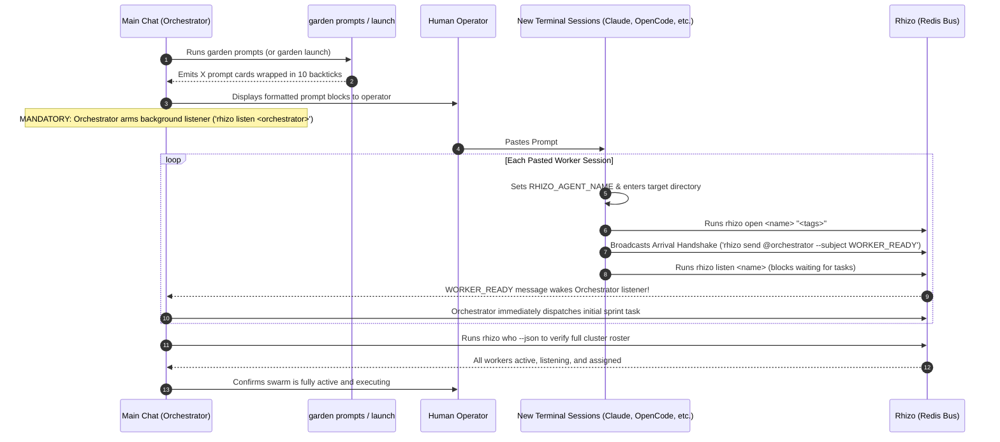
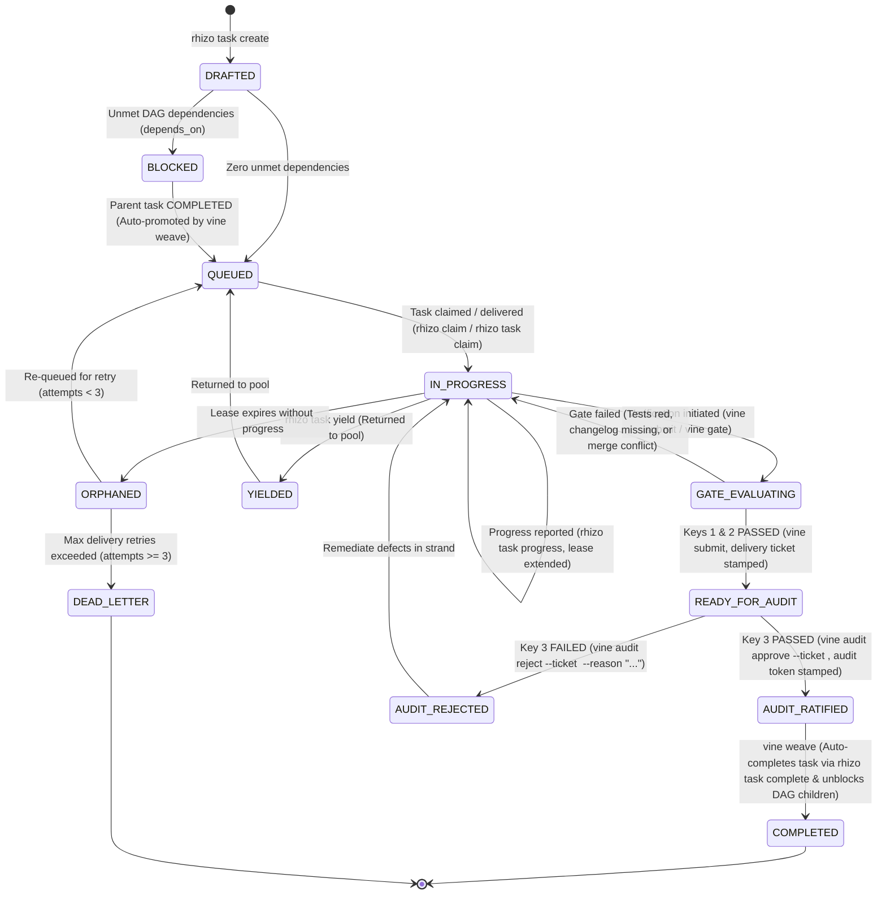

# `launch-workers`: Prompt-Based Swarm Bootstrapping & Work Group Onboarding

> **From Manifest to Coordinated Sessions Across Any AI Harness**  
> *Garden generates self-contained, 10-backtick-fenced prompt cards for the human operator to paste into separate terminal tabs or coding harnesses (Claude Code, OpenCode, Antigravity, Pi, Cursor). Each session is immediately grounded in its identity, joins the Rhizo work group, and arms its listener.*

---

## 1. System Philosophy & Invariants

1. **Capability-Aware Swarm Launch Pathways**:
   Before launching new workers, always check `rhizo who --all --json` first to reuse active project workers or repurpose idle unassigned peers (`garden repurpose`). On cold starts (`execution_mode = "auto"`), choose the pathway matching the harness's visibility and direct chat interactivity:
   - **Pathway 1 (Default on Antigravity IDE & OpenCode Desktop): Persistent Drillable Subagents (`subagents`)**:
     Run `garden prompts --subagent --json` to generate per-worker briefs (`/tmp/garden-<project>/subagent-<worker>.md`), spawn persistent child sessions (`invoke_subagent` + `send_message` in Antigravity; child sessions in OpenCode Desktop), and surface clickable `[Persona (@name)](conversation://<id>)` links in chat so the operator can drill in and steer directly.
   - **Pathway 2 (Default on Codex CLI in `tmux`; opt-in on OpenCode CLI / Claude Code CLI): Automated `tmux` Split-Pane / Window Factory (`tmux`)**:
     Run `garden launch --tmux` to spawn one `tmux` window/pane per worker running `codex` / `opencode` / `claude` pointed at `/tmp/garden-<project>/<worker>.md`.
   - **Pathway 3 (Default on Codex Desktop & Non-`tmux` CLI): 10-Backtick Prompt Cards (`prompts`)**:
     Workers run in top-level interactive sessions bootstrapped from 10-backtick prompt cards in `/tmp/garden-<project>/<worker>.md`.
2. **Prompt Card & Subagent Brief Temp File Delivery (Zero Chat Flooding)**:
   <CRITICAL>
   `garden prompts` and `garden launch` automatically write worker prompt cards to `/tmp/garden-<project>/<worker-name>.md`, subagent briefs to `/tmp/garden-<project>/subagent-<worker-name>.md`, and a combined roster to `/tmp/garden-<project>/all-workers.md`.
   Orchestrator agents MUST NEVER dump thousands of lines of prompt text inline into the chat conversation. Dumping cards inline exhausts token context budgets, causes scrolling fatigue, and triggers chat UI rendering bugs.
   Instead, orchestrators MUST output concise session assignments with clickable file links (e.g. `/tmp/garden-<project>/<worker>.md` or `[Persona (@name)](conversation://<id>)`).
   Inside the generated files and when `--inline` is passed, blocks are wrapped in 10 backticks (``````````markdown) to protect nested markdown and shell code blocks.
   </CRITICAL>
3. **Listener Discipline & Multiplexed Router**:
   <CRITICAL>
   Coordination operates in two harness-specific listener models:
   - **Multiplexed Router Harnesses (Google Antigravity, OpenCode, Pi)**: Sessions register via `rhizo open <name> "<tags>"` or `rhizo session register <name> --tags "<tags>"`. One singleton `rhizo router` service listens for all agents on the machine and routes messages directly to the right session/conversation ID, while hooks and CLI commands automatically update `rhizo:agent:<name>` and `rhizo:agy_host:<machine_id>` whenever the language server address or CSRF token changes. Agents in these harnesses DO NOT need to run blocking `rhizo listen <name>` subprocesses every turn!
   - **CLI Subprocess Harnesses (Claude Code, Codex, Generic Shells)**: Inside worker prompts, `rhizo listen <name>` must always be presented as a single-shot, blocking foreground command with zero timeout (infinite wait). NEVER wrap `rhizo listen` in a shell loop (`while true; do rhizo listen; done` or `until rhizo listen; do ...`). Loops trap message payloads inside unmonitored subshell logs and hang coordination.
   </CRITICAL>
4. **Worker Autonomous Execution Invariant (GVR-017)**:
   <CRITICAL>
   Swarm workers operate as sovereign, autonomous implementers, not passive chatbots.
   When a directive arrives (unblocking 'rhizo listen' in CLI harnesses, or streamed directly via the Multiplexed Router in Antigravity, OpenCode, and Pi), a directive has been delivered!
   Workers MUST NOT wait for operator intervention or ask "Shall I start?".
   They MUST immediately inspect the delivered directive, claim the task, switch to their isolated Vine strand, execute the requested work, submit the strand for independent audit ('vine submit'), report results, and re-arm their single-shot listener (CLI harnesses) or resume listening via the Multiplexed Router. Remember: THE WORKER IS NOT THE AUDITOR; an independent adversarial auditor must review and ratify Key 3 ('vine audit approve').
   </CRITICAL>
5. **Zero Dirty Commits**:
   - Never stage coordination state (`.rhizo.*`, `*.lock`, `workspaces/`) into Git. Vine stores strand identity in `.git/config` (`vine.taskId`, `vine.project`) and authoritative state in Redis (zero state files in the working tree).
6. **Capability-Aware Subagent & Session Invariant**:
   <CRITICAL>
   - **Drillable Persistent Subagents (Antigravity IDE & OpenCode Desktop)**: Allowed and recommended as first-class swarm workers when spawned from `garden prompts --subagent --json`, provided each subagent follows the full worker procedure: unique Rhizo identity (`rhizo open <name>`), explicit `--agent <name>`, 1:1 isolated Vine strand (`vine new <task_id>`), `vine submit`, and independent Key 3 audit by a separate `@auditor` subagent. Always display clickable session links (`conversation://<id>`) in chat.
   - **Top-Level / `tmux` Interactive Sessions (Codex Desktop, Codex CLI, Claude Code CLI)**: Bootstrapped via `/tmp/garden-<project>/<worker>.md` (manually pasted or spawned via `garden launch --tmux`).
   - **Opaque Ephemeral Subagents Prohibited**: Non-interactive CLI subagents (such as headless `Task` jobs that the user cannot click into and chat with) are STRICTLY FORBIDDEN from acting as swarm workers.
   </CRITICAL>
7. **Closed-Circuit & Holistic Integration Invariant**:
   <CRITICAL>
   Swarm workers must never produce isolated shelfware or mock toys. Every task must implement both the Provider and an active Consumer call-site in live entrypoints, must holistically integrate with real application state and events, and must aggressively delete any legacy code it replaces in the same strand.
   </CRITICAL>

8. **Mutual Arrival Handshake Invariant**:
   <CRITICAL>
   Swarm workers MUST NEVER boot into silent, passive states.
   Turn 1 of every worker prompt card mandates executing the Mutual Arrival Handshake:
   `rhizo send --to "@<orchestrator>" --subject "WORKER_READY" --body "..."`
   This broadcast guarantees that the Orchestrator is immediately notified upon session initialization.
   Conversely, in CLI subprocess harnesses, the Lead Orchestrator MUST arm its background listener (`rhizo listen <orchestrator>`) in the exact turn that prompt cards are emitted to prevent bootstrap deadlocks. In Multiplexed Router harnesses (Antigravity, OpenCode, Pi), the orchestrator session is automatically registered via `rhizo open` / `rhizo session register` with the host `rhizo router` service.
   </CRITICAL>

---

## 2. The Bootstrapping Flow



---

## 3. Execution Procedure

### Step 1: Generate Worker Bootstrap Prompts
Run `garden prompts` (or `garden launch`) from the project root:

```bash
# Output all worker prompts to terminal (and optionally write to file):
garden prompts --write garden-prompts.md

# Or generate for a specific worker or role:
garden prompts --role architect       # Filter by triad role
garden prompts --worker <unique_id>   # Or filter by unique codename
```

Garden automatically synthesizes the standard balanced triad with procedurally generated whimsical entities and unique listener codenames (e.g. botanical spirits, clockwork automatons, mythical cryptids):
- `@architect` tag (e.g. Bramblestitch - Staff Systems Architect; unique listener ID: `<project>-sequoia`)
- `@auditor` tag (e.g. Prickle-Thistle - Verification & Adversarial Auditor; unique listener ID: `<project>-kestrel`)
- `@implementer` tag (e.g. Moss-Weaver - DevEx & Implementation Lead; unique listener ID: `<project>-falcon`)

### Step 2: Present & Paste Prompts into Sessions
The Orchestrator presents the generated prompt blocks to the operator with clear, structured guidance:

1. **Numbered Terminal Tab / Session Instructions**:
   Provide a concise setup list instructing the operator on how many sessions to open and which harness/model to configure for each:
   - **Session 1 (@architect / <unique_id>)**: e.g. Antigravity IDE (Window 1) or Claude Code CLI (Tab 1) $\to$ Paste Card 1
   - **Session 2 (@auditor / <unique_id>)**: e.g. Claude Code CLI (Tab 2) or Antigravity IDE (Window 2) $\to$ Paste Card 2
   - **Session 3 (@implementer / <unique_id>)**: e.g. Antigravity IDE (Window 3) or OpenCode $\to$ Paste Card 3
2. **Harness & Model Agnostic Flexibility**:
   Explicitly reassure the operator: *"Workers can run in ANY coding harness (Antigravity, Claude Code, OpenCode, Pi, Cursor) and inherit the active model configured in that window/session. Coordination occurs strictly over Rhizo (local Redis) and Vine (Rift strands)."*
3. **Temp File Links (Zero Inline Chat Flooding)**:
   NEVER paste the multi-page prompt card bodies inline into chat. Output the concise list of workers with clickable file links (written with both role slug and unique ID):
   - **Architect**: `/tmp/garden-<project>/architect-<unique_id>.md` and `/tmp/garden-<project>/<unique_id>.md`
   - **Auditor**: `/tmp/garden-<project>/auditor-<unique_id>.md` and `/tmp/garden-<project>/<unique_id>.md`
   - **Implementer**: `/tmp/garden-<project>/implementer-<unique_id>.md` and `/tmp/garden-<project>/<unique_id>.md`
   - **All Combined**: `/tmp/garden-<project>/all-workers.md`
4. **Immediate Autonomous Onboarding**:
   Each prompt instructs the pasted session to immediately:
   - `cd "<project_dir>"`
   - `export RHIZO_AGENT_ID="<unique_id>"`
   - `export RHIZO_AGENT_NAME="<unique_id>"`
   - `rhizo open "<unique_id>" "<tags>"` (registers session in Redis registry with host Multiplexed Router)
   - `rhizo hook install --antigravity --agent "<unique_id>"` (if running in Antigravity IDE)
   - `rhizo hook install --codex --agent "<unique_id>"` (if running in Codex CLI/Desktop)
   - `rhizo listen "<unique_id>"` (ONLY in CLI harnesses: Claude Code, Codex, Generic Shells)
5. **Scheduled Health Check Template (ONLY for OpenAI Codex / ChatGPT CLI)**:
   In Google Antigravity (using the continuous ambient ear and hooks) and OpenCode (using background ear), DO NOT configure scheduled tasks; reactive event/hook streams handle wakeups natively.
   In Codex Desktop / CLI where sessions cannot wake from background process exits without external stimulation, prompts include the bulletproof 4-step template:
   - STEP 1: Inspect completed background listener processes / hooks for unhandled delivered tasks and execute them immediately (never stay quiet with pending work).
   - STEP 2: Inspect active tasks to verify a listener is currently running, and re-arm if missing.
   - STEP 3: Run `rhizo probe <name> --json` and drain any inbox backlog.
   - STEP 4: Stay quiet ONLY when a background listener process is actively running AND no delivered tasks are pending.
6. **Readiness Prompt**:
   Instruct the operator: *"Once you have pasted these prompts and the sessions are listening, tell me here (or I will automatically detect them online via `rhizo who`), and we will proceed to Phase 3 (Dialectical Deliberation)."*

### Step 3: Verify Cluster Readiness Gate
Before dispatching tasks, verify that every worker has registered in Redis and is showing active heartbeats:

```bash
rhizo who --json
```

**Pass Criteria**:
1. All worker codenames from the manifest appear in `active_agents`.
2. Heartbeats have active TTLs (> 0).
3. `rhizo probe <agent>` shows an active listener PID ready to receive work.

---

## 4. Teardown & Swarm Cleanup

When the swarm mission is completed, or when canceling a run:

```bash
# Gracefully deregister all swarm agents from Redis:
garden teardown
```

Or dynamically querying the project workers:
```bash
for worker in $(rhizo who --all --json | jq -r '.active_agents[] | select(.tags | contains(["<project>"])) | .name'); do
  rhizo close "$worker" 2>/dev/null || true
done
```

---

## Unified Work Item State Machine (WISM)

Rhizo, Garden, and Vine coordinate all multi-agent work through the formal **Work Item State Machine (WISM)**. Every task progresses through deterministic states with atomic Redis transitions, automated DAG unblocking, and Three-Key integration gates.



### ASCII State Transition Reference (LLM Fast-Path)

```text
  [rhizo task create]
          │
          ▼
     +---------+      Unmet deps
     | DRAFTED | ──────────────────► [ BLOCKED ]
     +---------+                         │
          │ Zero deps                    │ Parent task COMPLETED (Auto-promoted by vine weave)
          ▼                              ▼
     +---------+ ◄───────────────────────+
     | QUEUED  |
     +---------+
          │
          │ Task claimed / delivered (rhizo claim / rhizo task claim / rhizo send)
          │ Collapses DELIVERED ➔ CLAIMED ➔ IN_PROGRESS with monotonic lease
          ▼
   +-------------+      Lease expires
   | IN_PROGRESS | ────────────────────────────────► [ ORPHANED ]
   +-------------+                                         │
     │        ▲                                            │ Attempts >= 3
     │ vine   │ Gate fails                                 ▼
     │ submit │ (Tests red or conflict)             [ DEAD_LETTER ]
     ▼        │
  +-----------------+
  | GATE_EVALUATING |
  +-----------------+
          │
          │ Keys 1 & 2 PASSED (vine submit: delivery ticket stamped)
          ▼
  +------------------+
  | READY_FOR_AUDIT  | ◄──────────────────────────────┐
  +------------------+                                │
     │            │                                   │
     │ approve    │ reject                            │ Remediate
     │ --ticket   │ --ticket                          │
     ▼            ▼                                   │
  +------------+ +----------------+                   │
  | AUDIT_     | | AUDIT_REJECTED | ──────────────────┘
  | RATIFIED   | +----------------+
  +------------+
          │
          │ vine weave (Executed by Lead Orchestrator)
          │ Auto-executes rhizo task complete & unblocks DAG children
          ▼
    +-----------+
    | COMPLETED | ──► Auto-promotes BLOCKED child tasks to QUEUED!
    +-----------+
```

### State Definitions & Invariants

| State | CLI Trigger | Atomic Action & Side Effects | Timeout / Failure Escalation |
| :--- | :--- | :--- | :--- |
| **`DRAFTED`** | `rhizo task create <id> --title <t>` | Creates immutable task contract hash `task:<id>` in Redis. | N/A |
| **`BLOCKED`** | Evaluated on create | Stamped if `depends_on` contains incomplete tasks. Workers cannot claim. | N/A |
| **`QUEUED`** | Auto on create or parent complete | Pushed to queue/inbox. Available for worker consumption. | N/A |
| **`IN_PROGRESS`** | `rhizo task claim <id>` / `rhizo claim` / task delivery | **Collapsed claim & delivery**: Worker acquires monotonic fencing lease and enters isolated Vine strand (`vine new <id>`). Zero on-disk manifests; strand identity is stored in `.git/config` (`vine.taskId`, `vine.project`) and authoritative state in Redis. Periodic `rhizo task progress` extends lease. | Lease expires $\rightarrow$ `ORPHANED` |
| **`GATE_EVALUATING`**| `vine submit` / `vine gate` | Key 1 (mechanical merge-tree) & Key 2 (live compiler/test suite + changelog) evaluated. | Exit 1 $\rightarrow$ `CONFLICTED`<br>Exit 2 $\rightarrow$ `GATE_FAILED` |
| **`READY_FOR_AUDIT`**| `vine submit` | Keys 1 & 2 passed. Cryptographic delivery ticket (`gate_token`) stamped into strand state. Strand submitted for independent adversarial review. | N/A |
| **`AUDIT_REJECTED`** | `vine audit reject <task_id> --auditor <name> --ticket <hex> --reason "..." --listen` | Auditor rejected deliverable with recorded defect reasons against delivery ticket. Worker returns to `IN_PROGRESS` for delta remediation. | N/A |
| **`AUDIT_RATIFIED`** | `vine audit approve <task_id> --auditor <name> --ticket <hex> --evidence "..." [--listen]` | Key 3 passed! Cryptographic delivery ticket verified and `audit_token` stamped. Auditor and author identities strictly decoupled (`auditor != author`). Auditor NEVER weaves. | N/A |
| **`COMPLETED`** | `vine weave` | Fast-forward merged into canonical trunk by the Lead Orchestrator. Strand pruned. Locks released. **`vine weave` automatically invokes `rhizo task complete`**, auto-promoting downstream DAG dependencies (`BLOCKED` $\rightarrow$ `QUEUED`)! | N/A |
| **`ORPHANED`** | Lease expired without progress | Stalled worker detected. Increments `delivery_attempts`. If $\ge 3 \rightarrow$ `DEAD_LETTER`. Otherwise returns to `QUEUED`. | Escalates to operator if Dead-Lettered |
| **`YIELDED`** | `rhizo task yield <id>` | Worker gracefully steps aside. Task returned to `QUEUED`. | N/A |
| **`DEAD_LETTER`** | Retries exhausted ($\ge 3$) | Moved to dead-letter queue. Alerts orchestrator and operator. | Requires manual operator triage |

---

## 4. Key 3 Auditor Merge-Clerk Decoupling Invariant

<CRITICAL>
Auditor Merge-Clerk Decoupling Invariant:
The Adversarial Auditor ONLY inspects and ratifies/rejects Key 3 (`vine audit inspect` + `vine audit approve/reject`). The Lead Orchestrator is solely responsible for running `vine weave` after Key 3 ratification. The Orchestrator is strictly forbidden from delegating weaving (`--weave`), merge conflict resolution, `ROADMAP.md` updates, or release chores to the Adversarial Auditor. Turning the Auditor into a merge clerk biases the LLM toward rubber-stamping audits just to finish its administrative checklist.
</CRITICAL>

