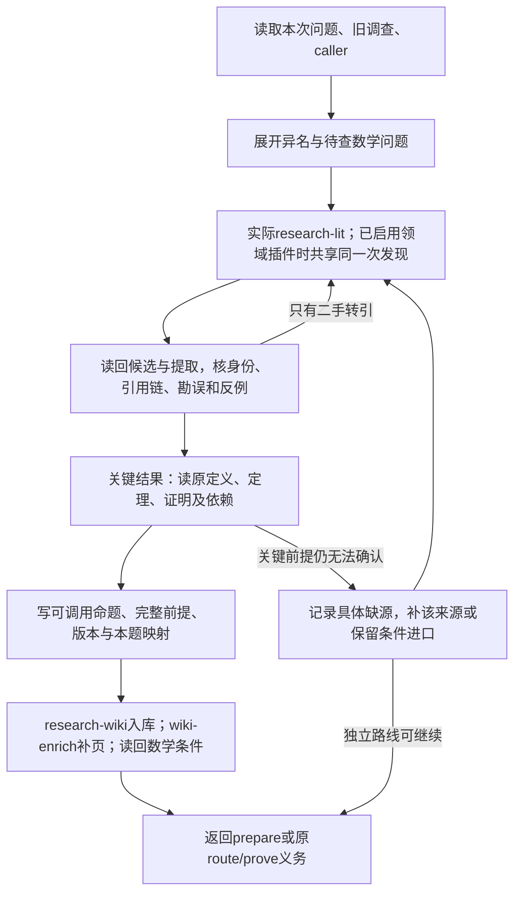

# MathRSI 数学文献调查与进口核读

以当前数学问题为中心，完成“真实检索→候选筛选→前后引用与纠错查漏→关键原文深读→可用结论／基线→任务wiki”的完整阶段。已有PDF和wiki是种子；新题仍需外部搜索，不能把旧知识库当成领域全貌。调查的产物要能直接用于原题定稿和方法设计，不止是一份论文清单。

主流程通常先用 [mathrsi-specify](../mathrsi-specify/SKILL.md) 的初步模式提供对象和量词，再调用本技能；独立调用时也可从用户原话建立足以搜索的问题，不要求已有完整规格。这里不做求解路线autoreview，也不要求先发明方法才能查文献。路线设计由主流程在消费调查后继续。

**先记住本次返回点。** prepare调用则完成调查后回prepare，由它调specify定稿；route-loop或prove带具体义务增量调用，则把版本、条件、原文位置和准确缺口返回同一原义务，不调用specify、不重开prepare、不改规格。独立调用默认交付调查结果；是否另行定稿或求解由用户请求或上层调度决定。本技能不自行启动同级后继阶段。

## 输入、产物与内部ARIS动作

先读工作区约定、`FORMAL_SPEC.md`或现有同义规格、`NEXT_SESSION.md`、当前 `LITERATURE.md`，以及相关wiki页。已有调查恢复其查询、版本与待读项，只补新内容。输入也包括用户给的PDF／URL、`ref/`、`papers/`、`literature/`或明确授权的论文库；不要把未授权的另一研究工作区当默认资料库。

新任务默认由本技能写 `LITERATURE.md`，原论文保存在任务已有资料目录，无目录时用 `ref/`；持续知识进入同一个 `research-wiki/`。已有文件名优先。组合运行时父流程若声明自己是报告writer，本技能返回独有内容，由父流程合并；wiki由一个明确owner串行更新，worker只交回原文定位与提取。保留原始证据，不为了组合模式删除可复用论文、代码或review trace。

内部动作选择相应宿主的实际文件。Codex与Claude都先读完整入口再执行；下表不是只报名字的“路由表”，后续逐步说明这些动作怎样接回本阶段。

| 动作 | Codex入口 | Claude入口 | 本阶段实际消费的返回 |
|---|---|---|---|
| 本地／外部发现与逐篇提取 | [research-lit](../skills-codex/research-lit/SKILL.md) | [research-lit](../research-lit/SKILL.md) | 候选表、来源、提取内容、未覆盖材料和检索局限 |
| 建立／续用paper实体与关系 | [research-wiki](../skills-codex/research-wiki/SKILL.md) | [research-wiki](../research-wiki/SKILL.md) | 实际paper页、graph关系、log和query pack |
| paper页TODO补充 | [wiki-enrich](../skills-codex/wiki-enrich/SKILL.md) | [wiki-enrich](../wiki-enrich/SKILL.md) | 已填页及来源／缺失统计，仍需原文核对的数学条件 |
| 已有候选贡献的定点查新 | [novelty-check](../skills-codex/novelty-check/SKILL.md) | [novelty-check](../novelty-check/SKILL.md) | 近邻、明确差异、建议及实际review范围 |

`research-lit`支持 `composed: LITERATURE.md`；传它使child返回table、landscape和gaps，由当前报告owner合并。`research-wiki`、`wiki-enrich`和`novelty-check`本入口未承诺这一参数，不给它们编造 `--composed`。前两者正常写wiki，后者返回报告和trace，本技能把相关判断合入文献报告；不要求child都写同一canonical文件。

MathRSI以本仓副本为准，helper都用明确绝对路径。所有shell块在任务工作区运行，并在同一shell重新设置实际克隆位置：

```bash
export ARIS_REPO="/clone/MathRSI/base"
python3 "$ARIS_REPO/tools/research_wiki.py" --help
```

`/clone/MathRSI`是示例，实际执行必须替换。技能源中的resolver若优先命中任务旧 `tools/`，不能只export后就宣称版本已绑定；实际命令改用本副本绝对helper路径。缺资源修复本包或准确报告，不回退作者机器的另一仓或全局pointer。双端与依赖说明见 [ARIS_REUSE](../../../docs/ARIS_REUSE.md)。

## 执行顺序：先发现，再把可用事实交回去



图中的回路只处理新缺口；已取得的PDF、查询和已核事实继续保留。下文§2给实际调用，§3–5说明读回什么才可用，§6执行wiki更新，§7判断何时交回。对来自route/prove的定点问题，可直接从旧报告所缺的原文核读进入，不把全图再跑一遍。

例如Property B一般界研究需要RS精确积分时，survey应交回“原文算法、Claim及附录估计的准确版本和前提”，并指出组合为`B_RS`是本项目的新定义；不是只交一条论文链接或声称原文已定义`B_RS`。route/prove随后负责组合推导。发现这个定义错位就定点修进口及其引用，不重搜所有Property B文献。这个实际转折见[历史依据](../../../development/workflow-redesign/REAL_PROJECT_TRANSITIONS.md)。

## 1. 把问题转为多种可检索表述

先在 `LITERATURE.md` 开头记本次问题、调查日期、原题路径和这次要解决的未知。例如要找的是定理是否已有、最强可核基线、归约条件，还是某条引理的反例；这些不是同一检索任务。已有完整调查只记录本轮增量，不复制旧正文。

从对象、目标与可能等价表述展开关键词：标准名称／旧称／不同语言或学科名称，符号及不用符号的句子，极值问题与其普适表述，参数相邻结果，可能的对偶或代数表示。等价转换尚未核实时保留为候选检索词，不能拿它当已证归约。用排除词区分同名异义，例如矩阵的实数rank与有限域rank、图着色与超图Property B并非一类问题。

在报告中写一个简短“问题—异名—查询意图”段落或小表，再开始实际检索。已有wiki可给作者、来源和失败机制，但首轮外网仍查。数学基础结果不设“最近两年”截断；先找原始来源与关键后继，再补当前日期前的新版本和近期结果。新颖性判断准备对外使用前，重新核查最近更新，不能沿用历史日期为今日结论。

## 2. 本地种子与外网搜索实际运行

先枚举当前任务已给的PDF和配置论文库。`research-lit`默认找 `papers/`、`literature/`，所以材料在 `ref/`时显式传 `paper library`；多个根逐批运行或给明确文件清单，不能漏掉后称“local已查”。先读标题、摘要和引言作筛选，记下直接相关／可能相关／不适用的原因，不把所有PDF都称已全文核读。

### 已启用Property B时，实际接入领域文献流程

当前题属于Property B且该插件已启用时，完整读取并执行本仓 [propertyb-literature](../../../plugins/propertyb/skills/propertyb-literature/SKILL.md)中本次相关的查询、archive种子、误读核对和来源条件；不是只把它列为推荐阅读。它负责Property B的术语与方向、RS／CK／Pluhár／GL等原文、历史错误的准确作用域及共同基线；通用survey继续负责身份核验、进口记录、wiki读回和返回调用者。

先给领域子调用指定本轮范围及独占输出，再由它拥有这次research-lit发现动作，跳过下面通用分支的同范围重复广搜。领域入口所列 `knowledge/archive/ref/` 是实际本地种子库，同时把任务 `ref/`已有PDF作为明确文件清单交进去；从 [知识入口](../../../plugins/propertyb/knowledge/README.md)选择与当前义务相关的来源地图和历史误读材料，不要求读完整archive。已取得同范围research-lit结果时直接传给它，要求只补新增关键词、遗漏来源或原文核查，不再另开完整检索。

```text
读取 /clone/MathRSI/plugins/propertyb/skills/propertyb-literature/SKILL.md并执行本次范围。
原题/当前义务见FORMAL_SPEC及本轮调用；参数k、预算M、是否固定v按原题。
本地种子用本仓 plugins/propertyb/knowledge/archive/ref/，
并读取本任务ref/中的已给文件；按领域技能查来源地图与历史误读。
本次由你执行唯一一次共享research-lit发现，sources: local, web；
该research-lit子调用传 — composed: /tasks/problem/LITERATURE.md，
令它返回内容给本次调查的唯一writer，不直接覆盖该报告。
如已有本轮research-lit结果，复用它，仅补未覆盖问题。
只写 work/literature/propertyb/ 的独占提取稿，或直接返回提取内容；
不写共享LITERATURE.md、不另建第二份完整文献报告或wiki。
返回原文条件/版本/位置、方向和基线核对、勘误/反例及实际覆盖。
```

调用返回后，survey报告owner实际读领域提取，将独有正文合入 `LITERATURE.md`；若保留独占提取稿，就把它作为有明确内容的附件链接，canonical报告仍写出关键进口与用途，不再复制一份同内容总报告。wiki由本轮指定owner合并更新。领域子调用中的ARIS提取、原PDF和来源证据继续保留；它并不取得调度后继prove的权限。

### 已启用 DD 时，实际接入构造族与公开比较

当前题属于 degree–diameter 且插件已启用时，读取 [mathrsi-degree-diameter](../../../plugins/degree-diameter/skills/mathrsi-degree-diameter/SKILL.md)的接手／公开比较段和 [dd-transfer-diagnosis](../../../plugins/degree-diameter/skills/dd-transfer-diagnosis/SKILL.md)§4，再按[调用地图](../../../plugins/degree-diameter/references/reading-and-calling.md)定位本次原件。输入包括 `(d,D,n)`、最大度还是正则、固定构造还是竞争目标、已有来源和原caller。以随仓[历史 research-wiki](../../../plugins/degree-diameter/archive/source/research-wiki/)及[公开比较目录](../../../plugins/degree-diameter/archive/source/research/ddp/two_successful_methods_20261101/public_baseline_audit/)为本地种子，读与当前参数／机制相关的实体、来源和后续更正；历史比较不冒作今日最强纪录，归档wiki只读，新事实写当前任务wiki。

本survey协调者持有唯一一次research-lit发现与LITERATURE writer；DD子调用负责本次领域关键词、构造族条件与合法代入，不另开平行广搜。已取得同范围结果时传给DD阅读者，只补未核来源或条件；新题仍执行本次需要的外部查漏，不把归档视为全领域覆盖。可直接发出：

```text
读取本克隆 plugins/degree-diameter/skills/mathrsi-degree-diameter/SKILL.md，
并执行 dd-transfer-diagnosis 的§4公开比较范围。
原题/当前义务、(d,D,n)、最大度/正则、固定/竞争目标及原caller见本次输入。
读archive/source/research-wiki相关页与public_baseline_audit相关原件，
给本轮research-lit的领域关键词、构造族/引用链及确切缺源；已有发现结果一并消费，
不重复完整广搜。调查由当前survey统一调用research-lit并传composed到LITERATURE.md。
返回已发表实例、已知族合法代入、条件/版本/原文定位及候选影响；
只写 work/literature/dd/ 独占提取稿或返回正文，不改archive、共享LITERATURE或另建wiki。
```

收到DD提取后，按本技能§3–5核原对象、参数存在性、最大度／正则条件和一般复制等组合规则；将明确发表值、合法代入推论与未核当前最优分开合入 `LITERATURE.md`。只比某家族已列实例不足以支撑竞争判断。把“旧比较→新保证→受影响候选／可用新源→剩余条件”返回prepare或原route-loop／prove义务，父caller据此调整实际队列；固定目标保持不变。原公式及证明留在DD，不在survey重抄；引用、wiki及后续深读仍按下文共享流程完成。

其它四类已入库领域按[领域调用与返回](../../../docs/DOMAIN_ROUTING.md)“准备与增量文献”实际调用：ECC读取mathrsi-ecc并核当前参数的分类/文献进口；极值超立方体读取mathrsi-hypercube-extremal，分清有限密度与极限；Hamilton读取mathrsi-hypercube-hamilton，核匹配/根/目标与方向；Happy Ending读取mathrsi-happy-ending，核signotope与几何、weak与split。带原问题、已查来源与准确疑问，收回原文定位、可调用条件和待核范围，合入本次LITERATURE并返回原caller。领域提供种子和语义，不替代新题广搜/引用链；归档仍只读。无适用插件的数学题继续下面通用research-lit分支。

### 通用发现分支与共享结果消费

按宿主读取上表的research-lit后，调用可写成：

```text
Codex：读取 /clone/MathRSI/base/skills/skills-codex/research-lit/SKILL.md。
Claude：读取 /clone/MathRSI/base/skills/research-lit/SKILL.md。
执行：调查 FORMAL_SPEC.md 的当前问题与本轮关键词。
— paper library: /tasks/problem/ref/
— sources: local, web
— composed: /tasks/problem/LITERATURE.md
数学适配：不按近两年截断基础来源；先发现并提取候选，
保留实际检索渠道、原文可得性、身份核验与未处理候选。
将表格与叙述交回当前报告owner，不由child覆盖canonical报告。
```

这是agent调用文字，不是不存在的shell executable。技能已被正确发现时Codex也可 `$research-lit`、Claude可 `/research-lit`，但必须确认它指向本仓对应宿主入口，而非名称相同的旧全局版本。

返回后实际读表和提取：它们是否覆盖原对象、是否有直接证明或反例、关键名称是否新增、哪些只有标题没有可读内容。检查sources到底运行了什么；`sources: all`并不包括S2、OpenAlex、DeepXiv、Exa或Gemini，要用时按原skill显式列出。例如旧论文期刊版缺失时补 `web, semantic-scholar, openalex`；无需为渠道数调用每种服务。数学检索不给S2沿用仅CS／Engineering过滤，也不把OpenAlex的示例年份复制为本题约束。

外网调用必须实际发生。用宿主现有Web搜索访问学术索引、出版社、作者主页、预印本与可信图书资源；需要精确出处时打开正文，别仅保留搜索snippet。宿主没有某工具，按原skill可用fallback执行并记录缺失。用户明确指定的独占来源不可用时报告该限制；其它可行渠道仍可推进已授权的独立部分，不能冒称指定来源已覆盖。网络全不可用时完成本地部分并标“仅本地，外部查漏未完成”，留具体待查问题，不输出“未有人做过”。

需要结构化arXiv检索或下载时，读取仓内 [Codex arxiv](../skills-codex/arxiv/SKILL.md)／[Claude arxiv](../arxiv/SKILL.md)，用真实接口：

```bash
export ARIS_REPO="/clone/MathRSI/base"
python3 "$ARIS_REPO/tools/arxiv_fetch.py" search 'all:"Ramsey number"' --max 10
```

上例是查询示例，不要求每道题研究Ramsey数。下载时使用已核候选的真实ID（需要保留版本时使用版本化ID）和 `download ID --dir ref/`；返回后检查实际文件，读失败就记录未取到。本文不提供凭空的论文ID。非arXiv原文从出版社或作者公开稿取回，记录实际URL与版本；本地使用与远端发布不是同一授权。

## 3. 身份确认、前后引用及纠错查漏

发现直接决定基线、提供关键工具或可能否定目标的来源，就让对应阅读者转入§4深读，不等宽泛搜索全部结束。首轮保留其它异名与纠错链的查漏；重复结果增加且当前关键依赖已有来源时，停止继续扩泛词，集中读这些原文。没有固定“必须几轮/几篇”的配额：若一篇即可闭合当前问题就读这一篇；若关键依赖仍未找到，就沿这个缺口补查，不能因达到数量提前结束。

候选是否存在与数学解释是否正确分开。research-lit的两宿主实现不完全同形；按实际返回核对，身份状态若缺失，用本仓 `verify_papers.py`补。为本轮候选保存已有工作目录下的小JSON，每项用真实 `id`、`title`、已知 `arxiv_id`／`doi`，未知填null，不从记忆编标识符。调用示例：

```bash
export ARIS_REPO="/clone/MathRSI/base"
python3 "$ARIS_REPO/tools/verify_papers.py" \
  --input work/literature/candidate_papers.json \
  --output work/literature/verified_papers.json
```

报告owner读逐paper状态：verified仅是身份被某来源确认，verify_pending是尚待核，unverified不是自动不存在。helper失败保留候选和真实错误，靠一手题录可独立核对时写明来源；不能删除未核候选使清单显得全绿。这一步不验证定理条件或证明。

沿最相关论文的参考文献向后查：它用了谁的引理、哪个版本、有没有转引混淆。再向前查引用它的后继、作者主页更新、刊版、预印本新版本。引文图工具可帮助发现，但其“cites”关系本身不说明改进了什么，必须读后继正文的相关声明。对关键结果用论文标题／作者／定理名结合 `erratum`、`corrigendum`、`counterexample`、`correction`、`retraction`等查漏，也查目标本身是否已有反例。

查询记录在 `LITERATURE.md`现有检索段落即可：日期／来源、查询意图及词组、实际读到什么、下一条有价值的链。无需逐点击建档。被排除的近邻保留一行数学原因，如“只适用线性对象，本题允许大交”；发现直接证明或反例马上回交本次caller，不等整批检索结束。

勘误只影响具体陈述时隔离该陈述及依赖链；不否定整篇所有结论。新版本修了常数、范围或缺失条件时同时保留旧版和修正版的定位，说明当前到底引用哪个版本，避免题录用刊版而推导仍用旧稿页码。

## 4. 从候选阅读转到关键进口深读

research-lit的20篇／前三页规则用于发现，不是数学进口的阅读上限。识别出真正支撑当前证明的结果后，直接读其定义、完整定理、证明及必要依赖；需要扩到前文或附录就扩。无关章节不必为“全文读过”加工。PDF公式／图形被抽取破坏时看实际页面或截图；不能凭损坏文本猜分母、严格性或下标。

每项拟使用的进口在 `LITERATURE.md`形成能交给方法设计的正文：

1. 作者、题名、版本／日期、URL或本地文件、定理／Claim／公式号及实际页码。
2. 原对象、参数域、完整假设与原结论；概率、均值、渐近常数与“存在足够大阈值”按原样保留。
3. 变成本题符号后的陈述，参数／单位如何对应；哪些前提从原输入已能取得，哪些仍待证明。
4. 本次实际阅读范围及依赖；未读证明时不能称已核证明，只有摘要时只能列候选。

深读必要时继续使用 [alphaxiv Codex](../skills-codex/alphaxiv/SKILL.md)／[Claude](../alphaxiv/SKILL.md) 定位内容，或 [deepxiv Codex](../skills-codex/deepxiv/SKILL.md)／[Claude](../deepxiv/SKILL.md) 按章节读取；返回的summary仍回到原文核公式与条件。正确动作是“找到相关章节→读原文→抽取完整可用命题”，不是“总结工具返回成功→进口已证”。

文献证明里的中间估计可以成为更有用的资源。明确它来自哪个证明段落、是否原文独立声明、我们怎样保留其更精确形式；别给它编一个原文定理名。组合两项文献结论时要确认对象、概率空间、算法与条件相容，组合本身需要的新论证留给后继数学义务。

如果缺原文，先找作者稿、版本化预印本、图书合法预览或其他一手可读版本；仍未取得就把它列作待核进口，后继可发展不依赖它的路线。不能把二手引用摘要补成全文证明，也不因全文付费就永久宣称该工具不能读论文。

## 5. 建立准确基线，并按需做候选查新

基线回答“在同一原对象和参数范围内，已经知道什么”。写出上下界、严格性、归一化、有限起点与依赖。表中分开原文明确报告的纪录、由原文公式本次代入推得的数、以及我们新组合的推论。渐近领先项更好不必在小参数更强；“充分大”未给阈值就不擅自给有限起点。没有完成当前纪录查漏时称“本次已核来源中的基线”，不要称世界最强。

当调查会决定候选是否有竞争价值，除表列实例还要检查已知构造族能否在本参数合法代入：核参数存在性、对象限制及组合规则，再写本次推得的保证。表中“已构造下界”和“理论上界”必须分列；一般族未单列该数值不等于没有这一保证。返回 caller 时给旧比较→新保证→受影响候选／队列→可用新输入或具体缺源，使它能立即改变下一动作。合法性、验证等级与纪录价值分别保留，不要求重跑未变构造。DD 的 F7 实例被 Delorme 合法代入超过、P33 表的33与上界43被误读风险，见[实际比较链](../mathrsi-meta-evolve/references/evidence-and-transfer.md#4-链三基线改变的是研究价值不是图的合法性)；这里只复用消费动作，领域公式仍由插件提供。

如果后继已形成明确方法／贡献，需要单独核“某结果是否已被包含”，这时才调用novelty-check。先读对应宿主入口，交给它原题、候选delta、上述近邻与原文定位，而非只说“评价新颖性”：

```text
Codex：读取 /clone/MathRSI/base/skills/skills-codex/novelty-check/SKILL.md。
Claude：读取 /clone/MathRSI/base/skills/novelty-check/SKILL.md。
核对 LITERATURE.md 中的候选方法与明确delta，
原目标见FORMAL_SPEC.md，关键近邻及原文位置已在该报告。
数学适配：跨全部相关年代／领域检索，不按原skill的ML会议列表
或固定2024–2026过滤截断；保留当前近期查漏。
返回closest work、能直接核对的相同/不同点及实际review范围。
用户固定目标不因新颖性建议自动取消，不输出数学已证结论。
```

novelty-check的真实cross-model／fresh-agent review按它的路由和trace执行；同家族结果按provisional，调用失败保留未完成，不在本技能伪写PASS。返回的分数／建议用于定位贡献，不能证明目标真假，也不能赋予agent擅自改题的权限。题目尚无候选方法或只需复述已知定理时，不为形式完整多跑一次查新。

## 6. 接回持续wiki：入库不等于深读，补页不等于数学验收

先读research-wiki实际技能。已有库复用，缺库且当前调查需要持续记忆时才用本副本 `init research-wiki/`建立；不在资料整理中重置原库。`ingest_paper`负责schema、slug、去重、index与query pack，不手写另一套paper frontmatter。非arXiv来源可用本次真实核对过的manual metadata：

```bash
export ARIS_REPO="/clone/MathRSI/base"
python3 "$ARIS_REPO/tools/research_wiki.py" ingest_paper research-wiki/ \
  --title '实际核读的完整题名' --authors '实际作者名单' \
  --year 2026 --venue '实际刊物或版本' \
  --thesis '已读原文支持的一句准确结论'
```

这些文字与年份是填入真实元数据的示例，不能照抄入库。知道真实arXiv ID时用 `--arxiv-id ID`；输出打印的slug才是后续paper ID，不能猜一个并连边。已有实体去重可能跳过，不为更新一句阅读笔记就用 `--update-on-exist`覆盖已丰富页面；读实际页后定点编辑其正文。

ingest通常只生成骨架。随后读wiki-enrich入口，按真实slug或missing运行：

```text
Codex：读取 /clone/MathRSI/base/skills/skills-codex/wiki-enrich/SKILL.md。
Claude：读取 /clone/MathRSI/base/skills/wiki-enrich/SKILL.md。
执行 wiki-enrich missing --max 5；只处理本轮已入库而仍有TODO的页。
优先保留已有人工内容，不使用--force；按实际来源记录补充范围。
```

若只需本轮某页，用输出的实际slug代替missing，避免扫入无关旧文献。wiki-enrich的summary／abstract fallback适合填基础摘要，不能据此确定数学进口全部假设。返回后逐页读回；将第4步原文核对过的条件、公式位置、版本和当前用途补到现有Assumptions／Reusable Ingredients／Relevance等正文。没有依据的部分写未确认，保留待读项；`Connections`与原始Abstract由原工具管理，不改它们来伪造阅读事实。

关系只连真实实体并写出数学依据，用本仓helper `add_edge research-wiki/ --from paper:真实slug --to 已存在节点 --type extends --evidence '实际节号与关系'`。不把近邻都连成supports，不把只搜到标题的paper升级成verified claim。survey负责paper和文献关系，主定理状态由后续真实证明验收决定。

最后调用并读回实际产物：

```bash
export ARIS_REPO="/clone/MathRSI/base"
python3 "$ARIS_REPO/tools/research_wiki.py" rebuild_query_pack research-wiki/
python3 "$ARIS_REPO/tools/research_wiki.py" stats research-wiki/
```

检查关键paper页存在且正文包含这次真正新增的进口／失败事实。query pack是短导航，不保证收入全部深读；在 `LITERATURE.md`与checkpoint直接链接重要实体。helper暂失效时把事实和待同步paper保存在canonical报告，标明wiki尚未更新；修好后按明确ID／metadata补回，不因同步失败重搜整轮。

## 7. 交付给规格与方法设计，而非把调查无限延长

每批查询／原文提取前和收件后，检查它要给原caller补哪条可调用命题、条件或反例，以及当前原对象怎样满足其前提。重复查询、论文数量或wiki补页不能替代进口适用性；定点调查不断扩成整领域广搜、新基线已使竞争队列失去意义却仍补旧目标资料时，应把实际影响交回而非继续搜集。

同一瓶颈连续两个实质批次没有改变下一步决策，或局部产物持续增加而关键连接、全域覆盖或端到端成本没有改善，或到达约定检查点／扩批预算时，必须返回直接caller请求[全局进展重判](../mathrsi-research/references/global-reassessment.md)，再由它交唯一研究dispatcher消费；不能自行批准沿原路线继续扩批，也不能自行启动同级stage。批次按能产生可检验信息的实质工作计，不按消息或文件计。独立调用没有父流程时，由当前执行者承担本次授权scope内的唯一调度。具体评估者和决策流程沿共享协议，不在本技能另建循环；短证明不为形式完整强制多agent。保留真实未取到来源和仍可用事实；返回点始终是进入时的prepare或原路线／证明义务，不静默改规格。

先按进入时记录的caller返回。route-loop／prove的增量调查，只交回该义务可用的原文结论、前提、版本、定位、失败或未读缺口，回原调用点继续，不调用specify、不修改 `FORMAL_SPEC.md`。发现会影响原题解释的差异也先报告给该caller，由上层决定是否安排规格澄清，不能由survey静默改题。prepare的调查回prepare，由它消费结果并调用specify定稿；独立调查交付报告与next，不自行启动下一阶段。

`LITERATURE.md`应回答：研究的准确问题与异名是什么；哪些渠道和引用链实际查过；已知结论和同域基线是什么；哪些进口已回原文核条件；哪些疑似直接证明／反例需要马上处理；什么尚未取到；下一步数学工作可调用哪一条结论并还欠哪些前提。论文总表帮助导航，关键进口要有可直接消费的正文，不藏在未经说明的几十个链接后面。

结束首轮调查是有依据的研究判断：主要异名已覆盖，基线与关键原文已定位，后继／勘误／反例链已查，新增查询多返回重复资料，而且没有未读的关键来源阻止当前选线。无需宣称穷尽互联网；未确认之处说具体即可进入推导。若仍只拿到一篇种子摘要或完全没外网，就交付相应部分范围，不能将survey标作全面完成。

回交prepare时指出哪些定义／范围需要在它的specify定稿中对齐；回交route-loop／prove时给“可用结果→当前原对象如何满足条件→预期解决哪个义务”的连接。参数变更、失败构型、关键进口不适用或准备宣称新界时，调用方可带着新增问题再进入本技能的增量路径；不要每次重做整个领域survey。

独立调用更新 `NEXT_SESSION.md`的当前调查事实和首个具体下一动作，保留原研究状态。组合调用回交这段，由父writer写checkpoint。记录真实待读页码／未取到版本／未完成渠道，使恢复可以直接继续，不重复包装已经存在的论文清单。

## 小例：从R(3,3)的异名走到两侧可用事实

用户若要求证明 `R(3,3)=6`，调查查询同时用Ramsey符号、`triangle or independent triple`、`two-colouring of complete graph on six vertices`。本地一本图论教材是种子，外网补标准定义、历史来源与不同表述；不能只找到“某个6点图有三角形”就认为覆盖了全称上界。

深读后交给规格的应是两侧准确事实与来源：6顶点任意图的普适结论，及5顶点下界构造。把边着色到图／补图的参数对应写清；5圈的具体性质可直接核对，文献出处则照实际取得的原文记载，未取到历史首篇不编作者页码。这个例子说明怎样消费调查，不声称本技能编写时已经执行外部搜索，也不要求所有数学题都通过小图分类求解。
