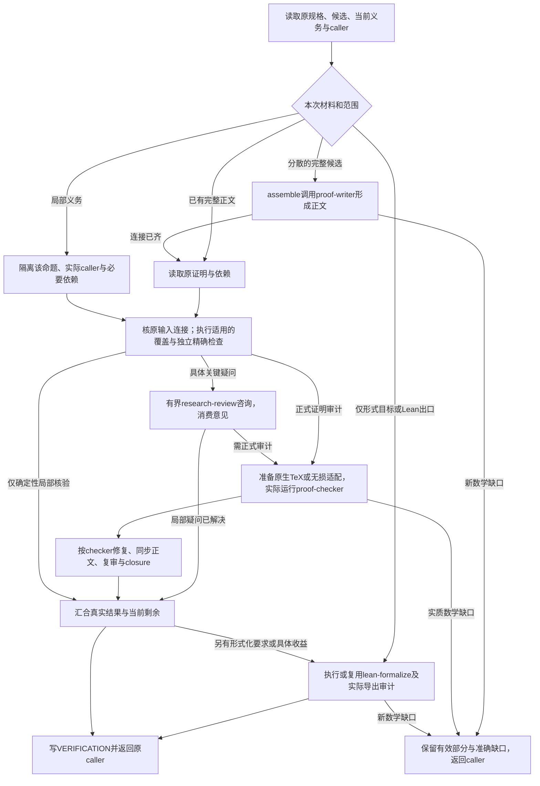

# MathRSI 装配与验证工作流

本技能接收一个候选解答或明确的局部义务，将证明、实际输入、计算和必要审阅接成可核验的证据。它对应研究主线的“装配验证”阶段，内部在需要时调用 [mathrsi-assemble](../mathrsi-assemble/SKILL.md)，再选择与疑问相符的核验。已有完整稿直接复用；不要求验证前再改写一次。

输出是工作区现有验证记录；没有约定时用 `VERIFICATION.md`。它引用真正执行得到的 `PROOF_AUDIT.{md,json}`、确定性核验结果、Lean 导出与审阅记录，说明它们各自支持什么。本技能不生成一份仿上游的 canonical audit，不自行给 wiki 新建“已验证”声明，不将模型分数或文件齐全当成原题证明。

**后继调度只由一个owner执行。** 组合调用在指定scope完成后返回原caller：局部验证回原prove义务，全局验证回主dispatcher，由它决定handoff或返回prove。本文的后继技能是结果建议，verify不同时替父流程启动它们；内部assemble、proof-checker及所需Lean仍由verify实际执行。独立调用只做用户授权的验证范围；若用户明确要求持续推进，由本agent接主调度一次后选择下一阶段，不在子验证与主流程两处重复派发。

## 这次验证怎样实际走完

先拿到要核的声明和它的实际用途，随后读取源、补齐可审输入、执行相应检查、修复并消费结果，最后带着准确剩余返回。下面是执行地图；分支按当前疑问选择，短证明不必走每个节点。



| 当前收到的材料 | 立即执行什么 | 读什么结果后才能继续 |
|---|---|---|
| 只要求形式目标、固定Lean见证或已有Lean出口 | 读原声明、真实定义、工程和导出，直接进§4执行或复用lean-formalize；不先制造TeX或proof-checker审计 | 目标连接、实际export/build/公理及未完成项；依scope返回原caller |
| 完整现稿及原规格 | 直接读现稿、进口和证据，确认本次原定理；不重复writer | 从任意原输入到结论的论证及此次尚需验证的事实 |
| 引理、表、证书散落，但声称已足以解题 | 把原题和实际材料交assemble，由它实际调用proof-writer | 完整正文与连接状态；缺新数学就交回缺口，不靠审阅补成已证 |
| prove交来的一个高风险义务 | 读该命题、上下游caller和相关域，只检查其所需材料 | 精确局部结论、适用条件与剩余；返回原prove继续下游 |
| 上次审计已有具体问题或服务中断 | 读原audit/state、raw回应和本次差异，从未完成处恢复 | 问题是否已修、哪些下游受影响、哪些服务步骤仍pending |

实际输入可直接是一段短证明及其原题，无需为了进入流程先造上述全部文件。复杂项目通常已有 `FORMAL_SPEC`、现用证明、当前义务表和恢复入口，沿用它们。以下各节说明执行地图中每一步如何取输入、做工作和把结果交给下一步。

## 进入、范围和恢复

读原规格、候选正文、当前义务和已有验证；按待核接口用任务原wiki的index/query_pack定位实体，再读其全文、条件、失败范围与原证据，不把导航摘要当验证依据。本次协调者负责wiki单一写入，子检查者交准确事实、差异与证据路径，不并写共享实体。先确定本次入口是完整原定理验收，还是“引理 L 的实际 caller”“参数域 D 的精确重算”“归约 R 的覆盖”等局部验证。局部入口是正常用法，不用每次审整个项目；但报告标题和结论保持该范围，不能将其汇总成原题已经通过。

若由 prove 为高风险子引理提前调用，调用方就是本次返回点：只装配/核验该义务实际需要的局部材料，跳过全主定理 assemble 和 handoff。收回准确结论、counterexample或未闭条件后，直接返回原 prove run 继续其下游 caller；即使局部完整通过，也不自行推进到“原题最终交付”。全局验收完成也先返回主dispatcher，建议是否进入handoff。

恢复时从最后一项具体未核事实进入。已有验证对哪个版本、哪个域、哪些声明有效，按实际材料确认；源声明、输入或算法变了，只重核受影响的义务和下游。上次服务不可用与上次数学失败分开保存。不要重开已完成的旧研究、重复未变的整卷审阅，或因一次交付中断重跑所有算术。

**先选本次要验收的成果形式。** 用户只要求形式目标、固定Lean见证或已有Lean出口时，直接进§4，给lean-formalize原命题、实际定义、工程与当前义务；已有证据按版本和范围复用。无需为了进入验证先写TeX、调用proof-writer或运行proof-checker。若还要求自然语言证明的正式审计，按§2–3执行该部分，并将Lean证据交回相应audit；形式结果不替代尚未审计的正文。两者由本verify消费后一起返回，局部调用仍回原prove。具体输入与准确返回见[固定Lean出口例](references/lean-target-entry.md)。

自然语言完整候选还散落在多份记录时，调用 assemble，交原题、已证引理、进口和证书，消费其正文和连接状态。它若指出缺实质数学，将缺口返回caller建议交prove；此时可以按原scope验证已有局部结果，但不能发起一个假定全证已齐的最终审计。已有完整稿则继续以下步骤。新稿已确定正式审计时可由assemble直接生成唯一 `PROOF.tex`，免去不必要的双载体；已有Markdown需要保留时才按下文适配。

## 1. 先处理本次真正未决的证据问题

沿原输入到结论检查关键接口，选择能解决实际疑问的检查。纯解析证明不需要制造算术表；计算机辅助证明不能省去数据含义和覆盖。至少分清下面三种对象，避免一个程序 PASS 被重复解释成三个结论。

先按已启用插件选择领域检查。Property B读取[propertyb-certificate](../../../plugins/propertyb/skills/propertyb-certificate/SKILL.md)，给原超图、完整域及实际证书，收回覆盖、准确算术和原染色连接。Degree–diameter读取[mathrsi-degree-diameter](../../../plugins/degree-diameter/skills/mathrsi-degree-diameter/SKILL.md)对齐图目标，再实际执行[dd-obstruction-certificate](../../../plugins/degree-diameter/skills/dd-obstruction-certificate/SKILL.md)的相关部分：排除义务给允许操作、必要性与有限域；正构造给实际图/标签/正文、度数与全点对覆盖证据、保留或删除的边及旧源结果，按§4–5核字面属性、覆盖、证据继承和固定Lean出口。收回准确命题、实际输入/检查范围、与原图的连接及剩余；verify亲自把它代入当前义务。仅形式目标仍直接本verify§4，按需在该范围消费领域输入，不先绕一遍自然语言审计。领域核验不另启动完整verify/proof-checker，局部结果回原prove；未启用插件时用本任务实际检查器，不强制加载上述领域。

先沿着实际证明读一遍：在每个非平凡调用处，找到它使用的精确命题，并确认当前对象给出了全部前提。若只是推导对象和符号未说清，可将这段原式、允许条件和下游用途交 [formula-derivation Codex](../skills-codex/formula-derivation/SKILL.md)／[Claude主线](../formula-derivation/SKILL.md)，读取其稳定定义与逐步推导后再核原调用；它新提出的条件仍需供给。若已有正确证明但正文漏了一步，用 [proof-writer Codex](../skills-codex/proof-writer/SKILL.md)／[Claude主线](../proof-writer/SKILL.md)补写那段，指定更新现用正文，不新造平行完整稿。若其实缺一个新定理，返回prove，不能在验证记录中把“待推导”改成已证。

文献条件不清时，把具体应用、原版本和疑问交 [mathrsi-survey](../mathrsi-survey/SKILL.md)定点补查，或用 [research-lit Codex](../skills-codex/research-lit/SKILL.md)／[Claude主线](../research-lit/SKILL.md)读取那条来源及必要引用链。收回原文位置、完整条件和能否用于当前对象的结论，再回原审计义务；不是重新准备整项研究。已有wiki有对应材料先读它，再补真正缺的原文。新增来源或失败适用条件按 [research-wiki Codex](../skills-codex/research-wiki/SKILL.md)／[Claude主线](../research-wiki/SKILL.md)记回现有知识库，保留出处和此次用途；原题的proof-axis状态仍跟随真实audit。

第一是对象域与归约。检查全称对象进入必要域的论证、分类覆盖、规范化兼容和各分支的并集是否包含原域。程序遍历一份列表不证明列表完整；某筛选条件即使便宜，也要有不会误删所需对象的依据。对只要求一个见证的任务，完整检查该见证即可，不要求搜索过程穷尽。

带标记归约在这里核实际运输：读原输入、映射及其复合，逐项代入根、目标、伙伴、必含/禁用边和其余真正使用的标记。检查最终构造经逆映射后满足原谓词，尤其增广新增的伙伴/辅助边是否被当作原边使用。单个映射合法不能代替组合后标记仍可用；局部正证书的取商若只覆盖无根代表，需补带根输入覆盖。若 caller 先选辅助配对 D 再由外部工具产生压缩输出 R，核 D 只依赖选择前已知的数据和标记，不预知或倒用 R；多省略点接口须同时运输完整孔集 H 与实际省略集 U，不能仅匹配孔数或分别匹配两个集合。发现断裂，返回该变换和具体失效标记给prove修caller，不因类数或其它证书已通过而放行。详见[v3证据§2](../mathrsi-meta-evolve/references/v3-evidence.md#2-带标记的归约需要实际运输)。

采用[同一实际输入的可用接口](../mathrsi-prove/references/actual-input-coverage.md)时，按当前合同实际核三条桥。控制关系：可选量合法、后继确实可达且共同满足下游条件，不能任意指定上游未保证的输出。覆盖刷新：接受谓词消费的是已核门，在任务已知且有回推的表示族上给同一原输入命中见证；未命中/未知保留真实范围，不将一个表示失败当全部余域。有限计划：保留 `∀H∃p∀M` 或 `∀H∀M∃p∈P(H)` 的准确顺序；条件计划可用同一 M 上失败合取不相容证明覆盖，不额外要求每项成功。分别核源域、适用、展开，缺哪个箭头就回该 caller，未变证据继续复用。

临界层证明另按 [取等与见证接口](../mathrsi-prove/references/critical-equality.md)核实际连接：旧整数界是否覆盖原域；上下端是否在同一输入/选择下相等；所有待归零差额是否非负；基数相等是否已有包含/映射依据。对交换后的实际对象核大小及容量进口的其它条件；见证定位情形须穷尽实际分块，关闭引理不循环依赖本次目标矛盾，再核被迫见证的端点/标记与最终 caller 一致。若追下一整数层，检查已重新推导松弛，未直接搬用上一层的单射或精确覆盖。一般覆盖只能迫见证经过某点，端点覆盖及角色排除才能定位方向；各自存在的见证不能替共同相容见证。失败返回具体链节给原 prove，保留未受影响结构；历史工作稿吸收到插件不自动升级其数学审计状态。

第二是检查器实际判定的命题。读真实代码、输入和输出，核计数单位、索引、重数、顺序/无序、边界、取整、精度和共同对象约定。由任务或领域插件提供的可信 checker 优先复用；不要让作者改完 checker 后只凭自报通过。若需要独立复算，应使用能独立重建该数学量的方法，读取实际输入，比较准确结果和覆盖，并保存命令、退出码和差异见证。第二次执行同一程序可验证可重现性，但不能称第二概率实现或独立算法核验。

第三是核验输出如何用于主证明。即使算术全部严格，也仍要核实际对象确实给出该公式或证书、该界确实改变目标、计算范围与分流条件相合。样本、启发式浮点和小域实验保持发现证据；用于临界严格结论的数值用整数、准确分数或有证明的定向误差依据。并非所有项都必须换成 Fraction，已有正确的整数或区间方法可以复用。

对由工作集优化产生的证书，核当前文件是实际被选的候选快照，而非末行或同名旧文件。浮点全域值只支撑探索判断；认证输入是舍入、修复后的最终精确对象，且表观浮点改进须严格大于精确有理/SOS/锥修复代价 `ε_repair` 才构成真实推进。带有非零可行性残差的近似对偶或完全正（CP）矩拟合只能连同其精确残差记作未认证拟合，绝不认证为方法不可逾越的理论下界或障碍定理。当 `{0,1}` 有界占有/缺洞松弛提交“稀疏参数化整数对偶证书”，仅需随仓保存非零权行的生成参数（如 `(q, p, inc, exc, weight)`）而不必绑定巨型 LP 矩阵：独立检查器按参数从头重建每行支撑与右端项、核对单行全称必要性，再以整数尺度 $\Lambda$ 累加总需求 $D = \sum w_r d_r$ 与状态过载惩罚 $P = \sum_W \max(0, \ell_W - \Lambda)$，直接认证 $\sum h_W \ge \lceil (D - P)/\Lambda \rceil$；若配套给出精确满足当前松弛行的 hitting 向量或 $[0,1]$ 有理向量，则仅认证该松弛模型的理论上限已封顶，不认证原组合对象存在对应构造。读领域检查器怎样在完整声明域上重新判定该对象；候选变化后可复用未变几何和覆盖证明，不能沿用旧分数、旧最坏图或仅工作集结果。新证书未通过就保持已接受best，返回实际违反对象与尚未核域给原prove；通过也按准确认证范围返回。整数Gram的PSD与有限逐图界、有限界到原渐近目标的平均引理是不同义务，分别核其caller。

执行独立计算时，给检查者实际输入、精确谓词、需要排除的错误和输出用途。例如要排除生成器漏删，就要求第二实现重新构造完整声明域，不以作者保存的合法列表决定接受；要核拒绝证书，则读绑定的实际对象逐个重放见证。主执行者收回后读命令、真实完成范围、准确差异和失败输入，再把这个有限命题代入正文所需步骤。一次只修所针对的缺口；不把“完整生成”与“全部拒绝”混成同一项，也不要求已经足够的必要门继续做更强计算。

每次实际检查或修复产生可复用的新事实，协调者即调用原 [research-wiki](../skills-codex/research-wiki/SKILL.md) 接回现有实体正文与关系：实际核验域、接受/失败条件、修正后的接口及原证据；读回实体后供原prove或下一检查使用。直接Lean、算术或固定证书核验也按准确范围写普通实体正文和VERIFICATION，不为写wiki强跑proof-checker，或把确定性局部通过改称canonical verified claim。真正proof-axis claim的创建/升级仍由proof-checker真实audit及其hook负责。共同用法见[五阶段wiki调用](../../../docs/WORKSPACE.md#7-五阶段的-wiki-读取与写回)；无新增事实就沿用已有入口，必要的关系/导航更新复用原helper，不机械重建。

wiki操作失败时保留真实核验结果、原证据和准确pending，其它独立检查/研究继续；恢复补该操作，不重跑已完成核验。把结论写进原有报告或 `VERIFICATION.md`：本次检查的精确谓词、输入和完整范围、使用方法、实际结果、仍需数学连接。若只是源代码/索引的小缺陷，修复并重跑受影响范围；若某个归约或覆盖引理根本未证，将那个义务交回 [mathrsi-prove](../mathrsi-prove/SKILL.md)。

适用新增领域时，实际执行[领域调用与返回](../../../docs/DOMAIN_ROUTING.md)“验证”中的输入→检查→消费合同。ECC调用ecc-certificate分核矩阵/目录/保存集/pair/Lean参数；两个hypercube入口分别核最终整数全域和高维平均、带标记森林与全称桥；Happy Ending调用happy-ending-certificate分核抽象见证、CNF绑定、lifting及结构接口。把返回的有限谓词和原题所需箭头写入本VERIFICATION，再决定剩余审计。局部通过回原prove，完整原题覆盖才进入最终交付；插件不另开proof-checker循环。

## 2. 区分局部对抗审阅与完整证明审计

先选本次缺口需要的路径。仅核一个算术值或固定证书，执行§1的确定性检查即可；它未覆盖的分类完整性、原对象连接仍需数学论证，不能一并写成程序已验。推进中的局部归约疑问可做下述有界research-review或所需局部Lean，结果回原义务。完整自然语言候选或已自足局部定理要做正式证明审计时，直接进§3的proof-checker，通常不先对同稿再跑一次research-review。已有核验复用；只有新增的具体疑问或用户明确要求才另加相应检查，不把两种审阅机械叠加，也不禁止必要时对不同义务采用不同证据。

一个新归约、代码与公式接口、候选反例或局部共同约束，可以复用 [research-review Codex](../skills-codex/research-review/SKILL.md)／[Claude 主线](../research-review/SKILL.md)的取证、reviewer路由和trace机制执行一个数学审阅slot。输入是原始局部证明、定义、实际 caller、代码与具体疑问。先读相应技能和backend/trace合同，实际调用选定reviewer并保存原始回应、读取/执行范围；这个slot由当前verify持有范围和返回点，不启动原版论文评分/共识循环，也不声称已跑完整research-review。修真实问题，必要时仅复核新增证据；本地短义务可用独立agent，相应同家族范围如实provisional，用户指定外部reviewer的要求不被替换。

这一slot要形成可消费的回答，例如“归约R有没有漏掉非满支撑输入，若没有，哪一步已经覆盖它”。收到意见先核原文：真实漏洞交给对应推导/实现修；模型误读则记录引用和理由，保留原回应。修后回查该疑问及受影响调用；其结论只解决这个slot。需要自然语言正式审计的完整候选仍进入下面的checker流程，不能用一封“总体认可”替代全证审计。只验形式目标时走§4，不因候选完整而增加paper-audit。

这里实际保留research-review的**原件审阅、必要的同会话证据澄清/反驳、结论与原证据对照、具体未证项及补证建议回交**。例如reviewer认为漏了边界，先给原段落和实际边界推导让它回查；若仍有争议，把原意见、回应与尚未解决的推论一起交回verify，由当前执行者判断下一步。数学适配到此返回，不沿原Step3/4的“直到双方同意”、论文实验计划或叙事改写继续；不由research-review另派证明或计算修法。`— composed:`若使用，只约定累计报告由谁写，不自动改变这些执行边界。真正修推导/代码由当前verify在范围内执行，需新数学则回prove；后续核新增证据时仍保留真实对话和原始负面意见，不只记transport成功。

要验收完整自然语言证明，或对一份自足局部定理运行正式 proof audit，使用 [proof-checker Codex](../skills-codex/proof-checker/SKILL.md)／[Claude 主线](../proof-checker/SKILL.md)。它拥有 proof skeleton、完整义务审计、反例检查、修复和复审循环。不能只取它的 reviewer prompt 然后自造 `PROOF_AUDIT.json`，也不在外面再套一个 route-loop 或定时循环来替代它的内部状态。

**实际输入适配必须先做对。** 当前两端 checker 的准备与 detector 以 `.tex`、定理/引理/proof 环境和 source-unit 为中心，不能声称任意 `PROOF.md` 能直接获得等价全证审计。完整 Markdown、独立局部证明或带代码的证明，调用前读 [proof-checker 输入与范围适配](references/proof-checker-inputs.md)。已有 LaTeX 直接用原输入；Markdown 需要有原句对应的无损审计用 TeX，审阅同时读取原文与依赖。不要把无 TeX theorem 的 detector-negative `NOT_APPLICABLE`当成数学已审。

## 3. 执行 checker 本身的流程并消费它的真实结果

向 checker 指定本次实际 proof 入口、原命题、允许进口、必要源码与证据位置、准确 scope，以及已选 reviewer。helper 通过本仓 `base/tools`实际调用；先完整读当前宿主技能及它在该阶段要求的参考，不改复制的上游源。新选择或项目 reviewer 由它的路由解析，已建立的授权不重复询问；选定服务缺失也不假装已审或悄悄改 provider。

**把上层选择实际传到每个reviewer-bearing子调用。** 按当前宿主的reviewer-backends合同解析本次覆盖项、项目 `.aris/reviewer.json`和宿主默认，并将已经给出的backend/model/effort覆盖项继续传给research-review slot、proof-checker及Lean；恢复中沿用保存route。这里的路由解析只选参数，真正首轮/续接调用、cwd、文件读取工具和终态取证按 [REVIEWER_MCP](../../../docs/REVIEWER_MCP.md)执行。Codex native、Codex MCP、Grok、Antigravity和Claude-review的schema不同，不能只运行解析脚本就记作审阅。checker要求fresh或blind的slot须新会话；需要连续回查时才用相应宿主与backend允许的续接，不借上层已有会话取消独立上下文。

向当前执行者发出的任务可以是下面这段；它是执行所读技能的自然语言调用，不是一个假定存在的统一CLI：

```text
读取本仓当前宿主的proof-checker/SKILL.md，执行其完整适用流程。
scope：FORMAL_SPEC.md的原定理；正文入口：PROOF.tex；
原始代码、进口原文与准确检查结果按正文中的路径读取。
若现用正文是Markdown，先按mathrsi-verify的输入适配说明准备TeX，
同时读取原文与源对应；最终实质修复须同步原正文。
延续本次caller已选的reviewer/backend/model/effort；无覆盖项时按项目和宿主合同解析。
实际完成source-unit读取与覆盖回执、义务ledger、首次审阅、反例pass、
修复复审及global closure；保存真实PROOF_AUDIT、state和raw回应。
报告原题是否被这份证明支持、允许进口、未闭义务和检查实际完成范围。
```

将占位路径换为实际材料；局部审计把scope换成该自足局部定理及其caller，产物放自己的局部审计目录。接下来verify读取checker实际产物和源改动，不只接收一句“已完成”。

执行其准备、source-unit 抽取与覆盖回执、全局义务 ledger、首次完整审阅、反例 pass、真实修复、复审、整体 closure 和必要 blind review。source-unit coverage 只是执行覆盖，不证明义务发现完整。精确复算、完整域证明与 reviewer 各承担各自职责，不能把其中一个核验字段扩成整个数学 PASS。

checker 的修复包含补推导、加假设、弱化结论或补准确引用。对已证明内容的漏写、错误索引、局部实现与陈述不一致，可在这次验证内修好，检查受影响调用和数据，再按 checker 自己的合同复审。加假设或弱化仅产生显式变体，不替换原目标；需要新数学定理、关键选取或大段新分类时，记录原 audit 的实际状态和 blocker，交回 prove。无需先把整个方法再评分一轮。

若checker修的是由Markdown转换的审计TeX，将实质修复同步回原正文，再核对源对应记录与最终审计输入；交付前确认两者是同一个论证。短稿可将对应写在已有audit说明，复杂转写再用SOURCE_MAP。转换稿通过不能认证尚未同步的旧正文，具体往返由上述输入适配说明执行。

跨轮合同以**对应宿主的实际技能**为准：当前 Claude 主线 Phase 3 使用保存的 reviewer thread 回查修复；Codex mirror Phase 3 每轮 fresh agent。Codex 同家族为 provisional；真实跨家族完成、scope 和身份另记。主线当前有 `--deep-fix` / `--restatement-check`，Codex mirror没有对应完整模式，不能给两个宿主统一虚构 flags。被选外部 route 的 first-call/reply 合同也不互换。

checker 未过其轮次上限时，消费它的 unrecoverable report：具体阻塞、保留的有效部分、可行修复。`FAIL`是当前证明或声明有问题，不能自动解释为原题为假；`ERROR`/`BLOCKED`是实际未审完或缺材料，也不是反例。把本次 raw verdict、acceptance 元数据、具体未闭义务与下一动作保留，不能把它们重标为 PASS 来继续交付。

## 4. 需要时接 Lean，完成它真正负责的义务

本节可以直接从形式目标入口进入；不以§3或TeX正文已完成为前提。用户要求 Lean、继续现有形式工程，或具体关键连接值得形式检查时，读 [lean-formalize Codex](../skills-codex/lean-formalize/SKILL.md)／[Claude 主线](../lean-formalize/SKILL.md)并执行。提供原命题、实际定义、固定工程、关键 proof route、当前待证接口与已有证据。它可以在证明推进中早已运行；本阶段复用当前有效结果，不要求把 Lean 永远拖到全文完成之后。

直接进入时，先把用户原声明与实际导出类型、展开定义对齐，识别结论是否仍带未供给的证书或额外假设。随后按lean-formalize完成所需证明/构建/审计，或读取当前有效的已有结果；数学缺口返回原caller建议prove，库/API问题在形式化内部处理。收回结果后，按§1的普通实体写回约定记录新增形式接口事实、准确范围与原证据，读回供原caller使用，再写§5的VERIFICATION并返回实际实体路径；仅形式目标不制造canonical PROOF_AUDIT，不为写wiki补跑checker，也不自行转handoff。

若从 checker 内部调用 Lean，返回其 checked scope、exported declaration、语义对齐、build 与传递公理证据给原 audit；不由 Lean 再调用 checker。若是 verify 直接组织两项工作，也保持各自产物与 scope，不新造相互递归的验证栈。

Lean 完成需从任意原输入装配出主命题的证明项，实际构建目标模块，展开类型和定义，检查传递公理；multi-module 另作实际入口的独立 import，短单文件按原技能不额外新建工程。`Certificate x → Target x`需要构造所需证书，定义 `Target : Prop`不是证明它。A/B/C 依它的语义对齐、关键论证和最终 export 流程；未变化的证据复用，明确指定的 reviewer 缺失保持 pending。

混合形式化还要读取顶层定理的**全部显式参数与展开定义**。标准公理列表不会显示作为参数传入的分类定理、有限扫描排除或文献命题。把每项尚未在当前工程内部构造的参数接到具名外部证据，报告Lean内已证归约、核内实际数据与外部输入各自的范围。具体验证矩阵/目录时再查最终声明是否确实引用这些常量及其合法性证明，而非只声明一个抽象“存在合格矩阵”的假设。若当前形式目标本来就是条件归约，按条件目标验收；若原题要求无该条件的结论，未供给参数仍是原题义务。ECC42的hProp2实例见[v3证据§4](../mathrsi-meta-evolve/references/v3-evidence.md#4-混合lean的参数边界)。

保存实际命令/退出码/输出，区分本次执行、静态消费历史构建、增量构建、干净重建和他人独立复现。静态读取源码与已有日志不能写成本次运行成功；缺少的目标构建或公理证据保持待核。信任基础按任务允许值说明，不把某个旧项目的 native_decide 禁令变成所有数学通用要求。形式 theorem 已核与某项交付/跨模型复核尚缺可以同时成立，不能因服务失败撤销已经成立的形式结果。

## 5. 写出能驱动下一步的 VERIFICATION.md

每批核验前及真实检查／审计结果返回后，将新增证据接到本次scope及原题所需箭头：多个局部PASS、重复审阅不变材料，或对已足够的必要门继续做更强计算，都不自动增加全局覆盖。相反，范围明确且确实在闭合剩余域的完整计算与必需核验应保留，不能仅因耗时或暂未收完而判为停滞。

**已评估完整计划内的正常分块不触发下段重评，也不算新增扩批。** 覆盖依据、有限剩余域和端到端可承接成本已经核清时，按原计划完成必要扫描、见证重放或构建；不能因每块的下一步都是“处理下一块”就判无决策增量。只在出现遗漏、实际成本越界、下游接口等关键依据变化，或到达该计划自己的重评边界时再回报，不每两块重开两位评估者。

同一瓶颈连续两个实质批次没有改变下一步决策，或局部产物持续增加而关键连接、全域覆盖或端到端成本没有改善，或到达约定检查点／扩批预算时，必须返回直接caller请求[全局进展重判](../mathrsi-research/references/global-reassessment.md)，再由它交唯一研究dispatcher消费；不能自行批准沿原路线继续扩批，也不能自行启动同级stage。批次按能产生可检验信息的实质工作计，不按消息或文件计。独立调用没有父流程时，由当前执行者承担本次授权scope内的唯一调度。具体评估者和决策流程沿共享协议，不在本技能另建循环；短证明不为形式完整强制多agent。对proof-checker的重判只在其合同允许的安全返回点进行，保留真实audit、修复状态和未决义务，不插入并行写者、不抢其内部修复／复审调度，也不借重判跳过应完成的审计。局部核验仍回原prove；重判请求先回本次caller，不直接发起route-loop。

复用已有验证记录，没有时写 `VERIFICATION.md`。至少让读者能找到以下事实，按任务自然组织即可，不要求填一张统一评分表：原题及本次准确 scope；正文与源版本/具体改变；域覆盖和原输入连接；实际确定性检查与结果；真正上游 audit 的路径、raw verdict和未决项（本次无自然语言正式审计时明确未调用）；Lean 的实际 export/build/axioms（若适用）；reviewer 实际阅读/执行范围与 pending；当前原题状态和下一步。

完整 `PROOF_AUDIT.json`在原 audit 目录，局部 audit 在它自己的 scope 目录。报告链接它们，不把多个局部 PASS 拼成一个假的全局 audit，也不把文字报告命名为上游 canonical JSON。checker 自己触发的 wiki hook 沿其真结果运行，本技能引用该claim记录；上述普通实体写回不替代或扩大这一claim边界。VERIFICATION及返回材料同时给本次实际改变的实体路径、所记事实、未闭义务与wiki操作pending，原caller读回后继续；不会为了进入交付自行造一个 verified claim。

checker默认调用 [render-html Codex](../skills-codex/render-html/SKILL.md)／[Claude主线](../render-html/SKILL.md)生成audit阅读页时，消费其HTML和实际保真检查，保持原 `PROOF_AUDIT.{md,json}`为审计入口。渲染失败按原技能是非阻塞展示问题，保存失败即可；用户若要完整证明阅读页或转交包，由主dispatcher选择handoff后制作。这样audit的阅读视图、数学审计和最终交付各有实际产物，不在verify里重复生成整套包。

组合调用最后返回原caller：局部scope交回原prove；全局scope交回主dispatcher。完成原目标所需数学与已约定核验均成立时，建议后继 [mathrsi-handoff](../mathrsi-handoff/SKILL.md)；关键数学缺失时建议返回prove，并附最小义务、actual caller、已有证据和可复用成果；普通局部数学修复先回prove；达到上述全局重判触发条件时，则由直接caller交唯一研究dispatcher决定是否重选方法，不由verify自行回route-loop。verify本次不另启动这些后继。已闭局部结果也可以作为局部交付，主目标仍open。文档或服务不可用则返回准确pending，交主调度继续无依赖工作。独立调用的持续授权按入口的单一调度规则处理。

## 实际调用与返回例

```text
读取本仓 mathrsi-verify/SKILL.md 并执行。
原题 FORMAL_SPEC.md，完整稿为现用 PROOF.tex 或 PROOF.md，
计算证据 work/exact/REPORT.md。
先沿用现稿，检查原输入到必要域的覆盖与独立准确重算；
已有TeX直接审；需保留Markdown时按reference保留原句对应并作审计TeX，
再实际执行当前宿主 proof-checker，将其真实产物链接到 VERIFICATION.md。
已有 formal/ 工程是原任务要求：复用并按 lean-formalize 核对实际主声明。
完成后返回本次caller，附建议handoff或返回prove的依据，不重复启动后继。
发现新的实质数学缺口准确保留，勿降低原题要求。
```

局部调用可以是“只验证 L 在 caller C 的假设供给及参数域 D；不要重审其余章节”。此时返回准确局部结论，列明是否进入 research-review 或自足局部 proof-checker、实际结果与剩余全局义务。恢复时先读 VERIFICATION 的 next obligation和对应源，不从全证审计第一轮重新开始。

## 已解项目中，验证产物怎样改变下一步

以下是已有流程的提炼，不要求重新执行历史计算。准确过程和原始依据见 [REAL_PROJECT_TRANSITIONS](../../../development/workflow-redesign/REAL_PROJECT_TRANSITIONS.md)。

ECC旧43/10证明曾只独立核保存集合的成员，不能支持生成无遗漏。局部verify针对这个疑问补第二套完整 `2^32` 域生成，在共同坐标下比较集合，再**返回原prove的pair caller**。全部必要pair都有低权拒绝见证、兼容图无边后，便宜必要条件已足够排除三行延拓；随后消费原题归约结束该证明，不继续更贵的三行枚举。这里完整域生成、pair见证重放和原题归约分别承担不同义务。

Property B T33的24点混合分支先把局部数值接成实际 `H → PropertyB H` caller，完成整24点后只剩23点。局部verify返回这个准确remaining，原prove继续23点，不进入最终handoff。真正六分支闭合后，全局verify才核新 `ThirtyThree.Main`、裸原输入的独立复述和传递公理；旧默认T32 build不承担新目标。最终正文审计发现3292/3315及1796/844的两处说明问题，按实际覆盖修正文，再核受影响说明；正确Lean未变，不重开路线或全部构建。

一般k证明则先完成纸面原定理审计，随后在另一个形式化阶段完成主定理C的Lean；比较D/E继续保持纸面范围。verify把这些有效结果按各自声明交给caller，让handoff准确呈现，而不为了统一成同一验证级别重做已解研究。上述T33已证 `m(5)≥34`与旧ECC43/10不存在性各自收束，五元35的完整Lean、36研究及ECC45/11不由本技能或历史案例自动恢复。
