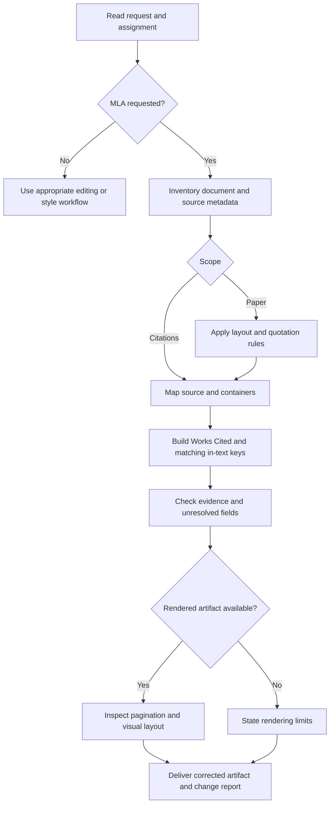

# MLA Formatting

Produce traceable MLA formatting from the document and the sources actually consulted.
Use ninth-edition guidance; check newer official guidance for changing subjects such as AI.

## When to Use

Activate for MLA manuscripts, in-text citations, quotation treatment, and Works Cited.
For conversion, preserve meaning and recheck source metadata; punctuation replacement alone is insufficient.
Do not activate for another citation style or ordinary editing unless an MLA task is also present.
If the requested style is unclear and affects the result, ask one focused question while inventorying supplied material.

## Workflow

1. Establish the assignment's edition, instructor overrides, target format, and requested scope.
   Apply explicit assignment requirements, and label departures from the MLA baseline.
2. Inventory each cited work: author order and roles, exact title, edition/version, publication facts,
   enclosing works, location, and the consulted version. Separate absent fields from unverified fields.
3. Load only the relevant reference listed below. Apply paper settings or assemble entries from
   applicable core elements. A stand-alone book needs no invented container; a chapter and its book differ.
4. Make each in-text key lead unambiguously to its Works Cited entry and add an available locator
   for a specific passage. Remove duplicated names, APA years, and unneeded page labels.
5. Check quotations against the supplied original. Preserve wording, lineation where relevant,
   and distinguish omissions or editorial changes. Do not invent quotations or locators.
6. Cross-check citation/list correspondence and alphabetization. Verify URLs and DOI metadata when
   access is available; say when only user-supplied metadata was available.
7. Inspect the final PDF or word-processing rendering when available. A plain-text review cannot
   prove margins, double spacing, a repeating header, hanging indents, or actual line counts.
8. Deliver the contract below. Ask only for missing information that materially prevents completion;
   make all independent corrections first.

## Metadata and uncertainty

Never fabricate authors, dates, page ranges, DOI strings, publishers, issue numbers, or AI model names.
Use visible placeholders only in an explicitly marked working draft; keep them out of submission-ready entries.
Omit genuinely absent optional information under MLA rules; an inaccessible field remains unverified,
not necessarily absent. Do not silently use a website-wide copyright year as a page's publication date.
If a rule is supported only by an older official post, disclose that limit and seek the current handbook
for a disputed or consequential edge case. Do not claim full handbook verification from public snippets.

## Output Contract

Return only what the task needs, with these components when applicable:

- Corrected manuscript or citation entries, preserving the author's argument and source identities.
- Short change report naming the applied edition and assignment exceptions.
- Unresolved metadata table: source, missing/unverified field, impact, next evidence needed.
- Verification status: content checked, source access limits, and rendered layout checked or pending.

For one citation, a corrected entry plus one necessary caveat is enough. Do not append a general lecture.
Use [templates/output-template.md](templates/output-template.md) when producing a paper scaffold or audit handoff.

## Anti-Patterns

### Borrowing APA's citation grammar

**Novice**: Write `(Mora, 2024, p. 18)` because every academic citation needs a year.
**Expert**: MLA ordinarily uses `(Mora 18)`; a title is added to distinguish works, with its own punctuation.
**Timeline**: MLA 9 (2021) retains author/locator logic; conversion requires source identity review.

### Treating a platform as an author or every page as a container

**Novice**: Assign a web host as author and insert a container just because a URL exists.
**Expert**: Identify responsibility and actual containment; keep the consulted work distinct from its host.
**Timeline**: The core-element model introduced in MLA 8 remains in MLA 9; older medium-specific recipes mislead.

### Proving layout from text or quote length from word count

**Novice**: Markdown looks spaced out, so certify the paper; block every quote over forty words.
**Expert**: Inspect the rendered file. MLA prose and verse have different line thresholds; APA's word threshold does not apply.
**Timeline**: Public prose guidance from 2020 is explicitly eighth-edition material; record that evidence limit.

### Freezing AI guidance in 2023

**Novice**: Copy an old chatbot example, invent a human author, or assume citation authorizes AI use.
**Expert**: Use the August 2025 update, verified model/version and actual generation date; check the assignment's AI policy separately.
**Timeline**: 13 Aug. 2025 guidance prefers stable conversation links and names the model in the version element.

## References

- [references/layout.md](references/layout.md) — Open for page setup, title/header, headings, quotations, and render inspection.
- [references/citations.md](references/citations.md) — Open for author-page edge cases and Works Cited/container construction.
- [references/sources.md](references/sources.md) — Open to verify rule provenance, edition caveats, AI freshness, or known gaps.
- [examples/expected-output.md](examples/expected-output.md) — Open for fictional book, chapter, journal, web, video, and interview examples.
- [examples/activation-evals.md](examples/activation-evals.md) — Open when testing trigger boundaries and expected task behavior.
- [templates/output-template.md](templates/output-template.md) — Open to start a manuscript or structure an audit deliverable.
- [README.md](README.md) — Open for package scope and adoption notes.
- [CHANGELOG.md](CHANGELOG.md) — Open for dated changes and evidence refresh history.
