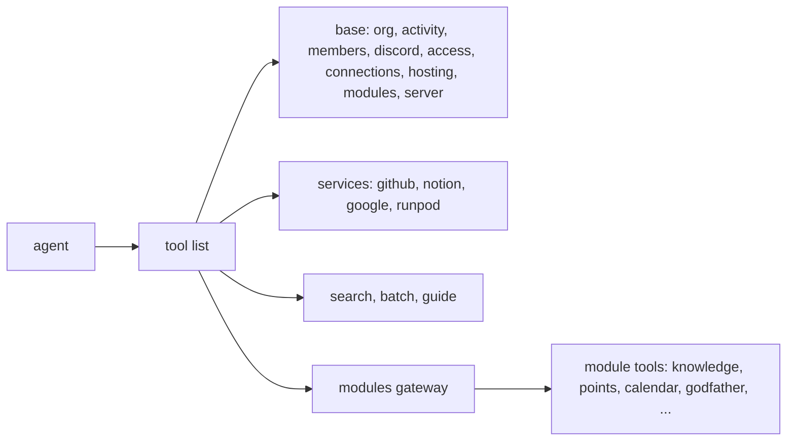

# Platform MCP

Platform runs student orgs. Its MCP server is one gateway to everything an org has. Each connection belongs to one org and sees only the tools its scopes and the org's modules allow.

## Connect

- Interactive clients (Claude Code, Claude Desktop): add the server URL, such as `https://<host>/mcp`, and sign in. OAuth signs you in with Discord and an officer approves the scopes.
- Services and bots (Hermes, Sparky): an officer makes a token on the Connections page, under For services. Send it as `Authorization: Bearer plat_...`. Never print or store the token anywhere else.

## How the tools are laid out

- Base tools and the tools of connected services are in the tool list. Call them by name.
- Module tools sit behind the gateway: `modules.list` shows the modules, `modules.skill` gives a module's skill, `modules.tools` lists its tools, `modules.call` runs one. Read the skill before the first call.
- `guide` gives these skills. `guide` with no name lists them.

## Rules

1. Read before you write. Look at the current state first (`org.info`, `hosting.get`, `activity.errors`).
2. A tool marked confirm changes something that is hard to undo. Call it without `confirm` first: the result is a dry run that says what would happen. Show that to the person, then call again with `confirm=true` and the same arguments.
3. Use `batch` for several independent calls, up to 25. Each call keeps its own scope check, confirm step and audit entry.
4. A 403 that names a scope means this connection lacks it. Over OAuth the call asks an officer to approve it. With a token, ask an officer for a token with that scope.
5. Every call is in the org's audit log (`activity.log`) under your token's name.
6. Secrets never come back from any tool. Do not ask for them in chat.
7. The org has a limit of tool calls a minute. A 429 means wait a minute.

## Pick a skill

| Task | Skill |
| --- | --- |
| Answer a question about the campus or the org | `platform-search` |
| Something broke, an error, a failed CI run | `platform-activity` |
| Deploy, roll back or check an app | `platform-hosting` |
| Tokens, secrets, webhooks, connected services | `platform-access` |
| Members, Discord roles, org settings, modules on or off | `platform-members` |
| What people said on the Discord server, find a channel or message | `platform-discord` |
| The server itself | `platform-server` |
| Points, store, calendar, knowledge, Godfather, uptime, feeds | `modules.skill` with the module name |

## Start of a session

1. `org.info`: the org, its prefix and its modules.
2. `modules.list` when the task needs a module.
3. Then the skill for the task.
