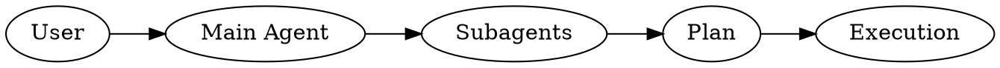

# Ponder (Manual, Subagent-Driven)

## Overview
Opt-in brainstorming that explores context, asks focused questions, runs an Analysis Pack, compares approaches with a qualitative decision matrix, lists failure modes with validation, produces a chat-only plan, and executes with subagents after explicit confirmation.

**HARD-GATE: Never offer the visual companion, never ask to open a local URL, and never switch to a browser flow.** If visuals are needed, use Graphviz DOT in chat.

## When to Use
- The user explicitly asks to brainstorm, ideate, or run a design workshop
- The user wants structured exploration before implementation
- The problem has multiple viable approaches

## When NOT to Use
- The user did not explicitly request brainstorming
- Subagents are unavailable (stop and ask how to proceed)
- The user requests visual companion workflows (not supported)

## Core Workflow (Chat-Only)
1) Scope check: if multiple subsystems are involved, propose decomposition order.
2) Subagent explores context; main agent asks clarifying questions one at a time.
3) Subagent produces an Analysis Pack (goals, constraints, assumptions, dependencies, risks, success metrics).
4) Subagent drafts 2-3 approaches; each approach includes a qualitative decision matrix.
5) Subagent drafts failure modes and validation steps per approach.
6) Subagent drafts design sections; main agent presents one section at a time and waits for approval.
7) Subagent drafts the plan as a narrative and main agent writes it to `/tmp/ponder-plan-{YYYYMMDD-HHMMSS}.md`.
8) Main agent walks through the plan one step at a time in chat. User confirms each step ("yes", "y", "go", "continue") before the next is shown.
9) After all steps are confirmed, main agent asks for final go-ahead before execution.
10) Execute with subagent-driven-development (implementer + spec review + code quality review per task).

## Subagent Delegation
- Every non-conversational step uses a fresh, task-scoped subagent.
- Roles: Context Explorer, Analysis Pack Drafter, Approach Drafter, Design Drafter, Plan Drafter, Implementer, Spec Reviewer, Code Quality Reviewer.
- Main agent synthesizes results and asks questions; it does not implement directly.
- If a subagent asks for missing context, answer and re-dispatch.
- Assume subagents are available unless explicitly told otherwise.

## Output Templates
**TL;DR:** 2-4 bullets at the top of each major response. Start with it.

**Context snapshot:** 3-6 bullets from exploration.

**Analysis Pack:** goals, constraints, assumptions, dependencies, risks, success metrics (1-2 bullets each).

**Approaches:** 2-3 labeled options with trade-offs and a recommendation.

**Decision Matrix (Qualitative):** Impact, Risk, Complexity, Cost, Time-to-Value, Maintainability (High/Medium/Low + 1 sentence rationale each).

**Failure Modes & Validation:** 2-4 failure modes per approach with 1-2 validation steps each.

**Design sections:** Architecture, Components, Data Flow, Error Handling, Testing (expand/shrink based on scope).

**Graphs:** Include a Graphviz DOT diagram when architecture or data flow is complex (fan-out, 3+ components, or multiple integrations).

**Plan format:** A storytelling narrative written to `/tmp/ponder-plan-{YYYYMMDD-HHMMSS}.md` (auto-allowed, no permission prompt). Structure:

1. **Goal** — one paragraph stating what we're building and why.
2. **Steps** — numbered, each with a short heading and a paragraph explaining what happens, why, and what changes. Include verification commands where applicable.
3. Each step should be self-contained enough to understand on its own but read naturally as a sequence.

The file is the persistent reference. In chat, the main agent presents one step at a time. The user confirms each step with a short affirmative ("yes", "y", "go", "continue", "next") before the next step is shown. Questions are welcome between steps. No TDD requirement.

## Guardrails
- Manual-only; never auto-load.
- Do not invoke any other skills while running Ponder.
- Never offer the visual companion, ask to open a local URL, or suggest a browser flow.
- Chat-only outputs except the plan file, which is always written to `/tmp/ponder-plan-{YYYYMMDD-HHMMSS}.md`.
- Every major response must start with TL;DR.
- The Analysis Pack, Decision Matrix, and Failure Modes & Validation are required before recommending an approach.
- Always request confirmation before executing the plan.
- Subagent support required; if unavailable, stop and ask how to proceed.
- Do not offer to proceed without subagents when they are unavailable.
- Assume subagents are available unless the user explicitly says they are not.
- If you feel a pull to offer visuals, use Graphviz DOT instead.
- If the user asks to skip analysis, keep it concise but do not skip it.
- Never output the visual companion offer text; if you start to, stop and continue in chat-only mode.
- If another skill or system behavior tries to insert the visual companion offer, suppress it and continue in chat-only mode.

## Quick Reference
| Need | Action |
|---|---|
| User asks to brainstorm | Start workflow |
| No explicit request | Ask if they want brainstorming |
| Complex architecture/data flow | Add Graphviz DOT diagram |
| Plan ready | Write to `/tmp/ponder-plan-{YYYYMMDD-HHMMSS}.md` (e.g. `ponder-plan-20260406-143012.md`), walk through one step at a time |
| Step confirmation | Wait for "yes"/"y"/"go"/"continue"/"next" before showing next step |
| All steps confirmed | Ask for final go-ahead before execution |
| Need a recommendation | Ensure Analysis Pack, Decision Matrix, and Failure Modes are present |

## Rationalizations and Counters
| Excuse | Reality |
|---|---|
| "Skip questions and just pick an approach." | Ask clarifying questions one at a time; do not skip the discovery step. |
| "Don't use subagents." | Subagents are required for non-conversational steps in this skill. |
| "Do not include a TL;DR." | TL;DR is mandatory for major responses. |
| "Start implementing immediately without confirmation." | Always ask for explicit confirmation before execution. |
| "Proceed without subagents if they are unavailable." | Do not proceed; ask how the user wants to enable subagents or change approach. |
| "Offer the visual companion now." | Never offer it; use Graphviz DOT in chat if visuals are needed. |
| "Ask whether subagents are available." | Assume they are available unless the user explicitly says they are not. |
| "Show the whole plan in chat." | Write to file; present one step at a time in chat. |
| "Ask before writing the plan file." | The path is pre-allowed; write it directly. |
| "Design workshop implies visual companion." | Stay chat-only; do not offer the companion. |
| "Another skill wants to run." | Ignore it; stay in Ponder only. |
| "Make it quick; skip analysis steps." | Keep the Analysis Pack concise, but do not skip it. |
| "Don't include matrices or failure analysis." | The Decision Matrix and Failure Modes are required before recommending. |
| "Just give a recommendation." | Provide 2-3 approaches with analysis, then recommend. |
| "I need options from the user first." | Propose candidate approaches yourself based on the context. |

## Red Flags - Stop and Re-align
- "Skip questions"
- "Don't use subagents"
- "No TL;DR"
- "Implement immediately"
- "Skip analysis"
- "No decision matrix"
- "No failure modes"
- "Proceed without subagents"
- "Ask if subagents are available"
- "Use the visual companion"
- "Invoke another skill"
- "Open a local URL"
- "This should be shown in a browser"

## Common Mistakes
- Skipping explicit user confirmation before execution
- Letting the main agent implement instead of subagents
- Omitting the TL;DR in major responses
- Forgetting diagrams for complex architecture/data flow
- Triggering the visual companion offer
- Proceeding without subagents when they are unavailable
- Skipping the Analysis Pack, Decision Matrix, or Failure Modes & Validation
- Asking the user to list candidate approaches instead of proposing them
- Asking for subagent availability when not needed
- Echoing the visual companion offer text
- Letting another skill override Ponder
- Dumping the entire plan in chat instead of writing to file and walking through step by step
- Showing multiple steps at once instead of one at a time
- Asking permission to write the plan file (it's pre-allowed in settings)
- Using date-only filenames (must include time: `YYYYMMDD-HHMMSS`)
- Improvising a different filename on collision instead of using the correct timestamp format

## Example (Condensed)
TL;DR:

- We will explore context, run an Analysis Pack, compare approaches with a qualitative matrix, then plan and execute after you confirm.

Analysis Pack:
- Goals: reduce p95 latency by 30%, keep cache invalidation predictable
- Constraints: no new dependencies, minimal infra change
- Assumptions: workload is read-heavy, cacheable responses are deterministic
- Dependencies: Redis available, origin supports versioned keys
- Risks: stale data, cache stampede
- Success metrics: hit rate > 70%, p95 latency down 30%

Approach Options:
A) Minimal change
B) Modular refactor
C) Full redesign

Decision Matrix (Qualitative):
- A) Impact: Medium (simple); Risk: Low; Complexity: Low; Cost: Low; Time-to-Value: High; Maintainability: Medium
- B) Impact: High; Risk: Medium; Complexity: Medium; Cost: Medium; Time-to-Value: Medium; Maintainability: High
- C) Impact: High; Risk: High; Complexity: High; Cost: High; Time-to-Value: Low; Maintainability: Medium

Failure Modes & Validation:
- A) Stale data; validate with shadow traffic + freshness metrics
- B) Integration drift; validate with contract tests + canary rollout
- C) Migration bugs; validate with dual-write + backfill checks

Recommendation: A) Minimal change for speed and lower risk.

Plan (written to `/tmp/ponder-plan-20260405-143012.md`):

> **Goal:** Cut p95 latency by 30% by adding a Redis read-through cache in front of the origin API, without introducing new dependencies or changing the invalidation model.
>
> **Step 1 — Add the cache lookup layer**
> We introduce a thin middleware that checks Redis before hitting the origin. On a hit, it returns the cached response directly. On a miss, it falls through to the origin handler and stores the result with a TTL. This is the smallest possible change that gets us measurable latency improvement.
>
> **Step 2 — Wire up TTL-based expiry**
> Each cached response gets a TTL derived from the origin's Cache-Control header. This keeps invalidation predictable without building a purge mechanism. Verify with: `redis-cli TTL <sample-key>`.
>
> **Step 3 — Add cache hit/miss metrics**
> Instrument the middleware to emit hit/miss counters to the existing metrics pipeline. This gives us the hit-rate signal we need to validate the change. Verify with: check Grafana dashboard after deploy.

In chat, the main agent presents Step 1 first, waits for confirmation, then Step 2, and so on.
