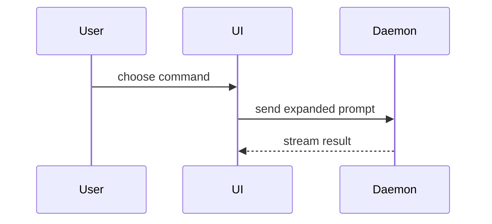

# Pr

> **Adapted for the LoopyLuci Skills collection** from [mattpocock/skills](https://github.com/mattpocock/skills). The guidance below is rewritten and condensed for this repo; commands, paths, and reference tables are preserved.

## Trigger

- Writing a PR body

## When NOT to Use

- Outside the trigger above; keep the task in the skill that owns it.

## Overview

A pull request body should make one thing obvious at a glance: what changed, how you know it works, and how dangerous it is to merge. The fastest way to do that is a small visual beside a few lines of text, not paragraphs. This template keeps the three parts that carry weight — summary, evidence, merge danger — and drops everything else.

Use this template for the PR body:

```markdown
## Summary

<diagram, diff-sketch, or tree>

## Evidence

- **Before:** <screenshot/output/failing test run>
  **After:** <screenshot/output/passing test run>

## Merge Danger

**Door:** <one-way or two-way>

<optional: description>

**Blast Radius:** <one-word description>

<optional: potential ramifications of merge>
```

## Writing Rules

Skip every preamble and keep prose short. Use the user's own domain language as defined in `GLOSSARY.md`.

## Summary

Pick the smallest view that makes the key point clear, then place it next to the short text it supports.

Match the visual form to what changed:

- Logic or an algorithm → pseudocode
- Runtime control flow → call tree
- UI structure, state, module boundaries → component tree
- File responsibilities or a broad refactor → shallow file tree
- Component interaction, control flow, or data flow → Mermaid
- What changed when the surrounding shape already exists → `diff`, with the diff shape matched to the topic

Representative examples:

Logic as pseudocode:

```text
on(save)
  if content is unchanged
    return cached result
  write new content
  return fresh result
```

UI structure as a component tree, including the state, paths, and module boundaries that matter:

```text
<SessionPage> (apps/example/src/routes/session.tsx)
  useSessionEvents()
  <SessionToolbar>
    <RunSkillButton> (packages/ui)
```

Interaction or data flow as Mermaid:



A component change as a scoped diff:

```diff
 <SessionPage>
   useSessionEvents()
   <SessionToolbar>
+    <RunSkillButton />
   <SessionTimeline>
+    <SkillResultCard />
```

Show the whole block when most of it is new, when omitted context would hide ownership or order, or when the reader needs a copyable target shape:

```ts
function expandSkill(command: string): string {
  const skillName = command.slice(1);
  return `use the ${skillName} skill`;
}
```

Use one of these forms, several, or in rare cases all of them — but exercise judgement and do not bury the reader.

## Evidence

Evidence proves the change works, ideally as a before/after pair. Screenshots are S-tier when the environment supports them and the change is visual. Execution-based evidence is A-tier: test results and console output, including the exact test that now fails and passes, shown as pseudocode.

## Merge Danger

State whether the door is one-way or two-way. Two-way doors can be walked back through; one-way doors cannot, so cheap-to-reverse PRs carry less risk. Destructive actions and hard-to-reverse decisions belong on the one-way side.

Blast radius describes the scope of potential impact — consider every possibility, including layout shifts, breakage for consumers, and mobile responsiveness.

## Verification

- [ ] Summary contains exactly one visual, in the smallest form that carries the point
- [ ] Visual sits next to the text it supports and uses only the calls, files, props, states, and boundaries the current question needs
- [ ] Evidence shows both before and after (screenshot or execution output)
- [ ] Merge Danger names the door type and the blast radius
- [ ] Domain terms match `GLOSSARY.md`
- [ ] No preamble; prose is brief

## Related Skills in This Repo

- [software-factory](../software-factory/SKILL.md) — Use when working with shared language for designing a software factory: the tasks it runs ...
- [writing-for-agents](../writing-for-agents/SKILL.md) — Use when creating or editing skills, or modifying AGENTS.md or CLAUDE.md.
- [chief-of-staff](../chief-of-staff/SKILL.md) — Use when working with pursue a long-running goal in a single session by co-ordinating suba...
- [retro](../retro/SKILL.md) — Use when conducting a retrospective on a coding session.

## Adaptation Notes

- Description rewritten into this repo's trigger form.
- Trigger and When-NOT-to-Use sections derived from the upstream guidance.
- Body condensed and restructured; commands, file paths, and tables preserved.
- Related skills linked from this repo.
- Upstream branding and attribution lines removed (attribution below).

## Source & Attribution

- Upstream: [mattpocock/skills](https://github.com/mattpocock/skills)
- Path: `_sources/mattpocock_skills/skills/engineering/pr/SKILL.md`
- License: MIT — Copyright (c) 2026 Matt Pocock
- Retrieved: 2026-11-14; rewritten and condensed by LoopyLuci Community.
