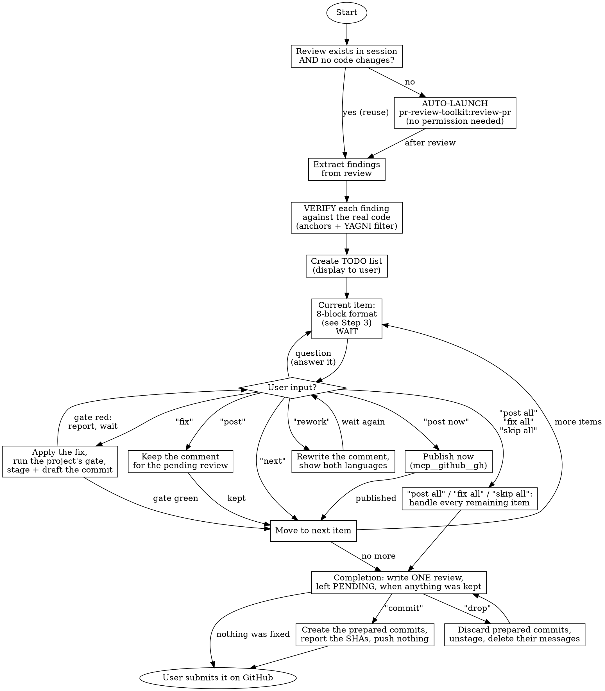

# PR Review Start-Review

## Overview

Interactive walkthrough of PR review feedback. Builds a TODO list from the review findings, then presents each item one-by-one and waits for the user.

**Preflight:** run `bash "${CLAUDE_PLUGIN_ROOT}/scripts/preflight.sh"` as the first
action. A non-zero exit stops the skill: print its output verbatim and do nothing else.

**Default deliverable: a draft review comment for the PR author, not a code change.** Most reviews target someone else's branch; the normal outcome is a comment the author acts on. Applying a fix is the exception, and it happens only on the explicit `fix` command.

**Core principle:** the user controls the pace and the review is theirs to submit. The walkthrough moves one item at a time and never batches, fixes or posts on its own initiative — only the user's own `post all`, `fix all` or `skip all` covers more than the item on screen. A decision on the item shown is also the order to move on: after `post`, `post now`, a green `fix` or `next`, the next item is rendered without a second command.

**Announce at start:** "I'm using pr-review:start-review for an interactive review walkthrough."

---

## The Iron Rule

```
NEVER apply code changes unless the user explicitly says "fix"
NEVER publish anything the PR author can see unless the user explicitly says "post now"
NEVER submit the pending review, resolve a thread or reply in one — post now is the only publication this skill performs, on that command alone
NEVER move to the next item before the user has decided the one on screen: `post`, `post now`, `fix` with a green gate and `next` are the decisions, and each one moves on by itself; a question, `rework` and a red gate hold the item. Only the batch commands "post all", "fix all" or "skip all" decide more than the item on screen
```

**No exceptions:**

- User understanding ≠ permission to fix
- User agreement ≠ permission to fix
- Obvious fix ≠ permission to fix
- "Makes sense" ≠ permission to fix
- "Go ahead" ≠ permission to fix
- "Sure" ≠ permission to fix
- "Yes" ≠ permission to fix

**Only the literal word "fix" means fix. Only the literal words "post now" publish, and they are the only publication this skill performs.**

---

## Language Rules

These are not negotiable and they differ by destination:

| Output | Language |
|--------|----------|
| Chat explanation to the user (all prose, all analysis) | **the language the user writes in** |
| Draft comment shown in chat (block 8) | **the user's language AND English**, both, side by side |
| Comment written into the pending review or posted to the PR | **English, always** |
| Anything written to a file (code, code comments, commits, PR bodies) | **English only** |

Block 8 shows both versions because the user validates the substance in their own
language, while only the English one reaches the PR.

**Everything that lands on GitHub is English. Always. Never ask the user which language to post in** — the question has no valid answer other than English, and asking it wastes a turn.

---

## GitHub calls

Every GitHub call below is written as the request the github plugin's
`mcp__github__gh` tool takes: one JSON object holding `command` and `args`. Make
it as a call of that tool, the placeholders filled in: `"<PR>"` and every other
number (`line`, `start-line`, `review-id`) as a JSON number, text as a string. A
body travels as `body` and a set of inline comments as `comments`, never as a
file path: the tool writes them to files itself.

A write made through the tool passes the session's permission check. Where this
plugin's module loads, it also holds this skill's Iron Rules (no code change
without "fix", no publication without "post now", no push): a refused call says
which word of the user lifts it. Ask the user for that word, and never take
another route around a refusal.

**When `mcp__github__gh` is not in your tool list** (a session where plugin
modules do not load, such as `claude -p`), send the same request to the same
engine from Bash, the request object on standard input, no file in between:

```bash
GH_ROOT=$(python3 "${CLAUDE_PLUGIN_ROOT}/scripts/resolve_github.py") || exit 1
python3 "$GH_ROOT/engine/gh.py" --stdin-json <<'PR_REVIEW_REQUEST'
<the request object, as JSON>
PR_REVIEW_REQUEST
```

`${CLAUDE_PLUGIN_ROOT}` names this plugin and reaches no sibling, so the resolver
reads the platform's install record rather than assembling a path into the plugin
cache. When the dependency is missing it prints an `error:` line and a `fix:`
line: stop there. Never take this route while the tool is listed.

---

## Workflow



---

## Step 1: Get Review Data

### 1.1 Check for Existing Review

**Auto-launch rule:** if `pr-review-toolkit:review-pr` was NOT run in the current session, OR the codebase changed since the last review:

> "Running pr-review-toolkit:review-pr to get fresh review data..."

Then **automatically invoke** `/pr-review-toolkit:review-pr`. Do NOT ask for permission — just run it.

**Skip auto-launch only when BOTH conditions hold:**

1. `pr-review-toolkit:review-pr` already ran in this session, AND
2. No code modifications since that review.

### 1.2 Verify Before Listing

Review agents report plausible findings, not verified ones. Before an item reaches the TODO list:

- **Open the cited file and confirm the line anchor.** A finding whose line does not say what the report claims is dropped.
- **Confirm the failure scenario is reachable** in this codebase, with this data model, on this branch.
- **Apply the YAGNI filter.** Drop speculative hardening, defensive code for unreachable states, and pre-existing behaviour the PR did not introduce. Say in chat which findings were dropped and why — the filtering is part of the review.
- **Prefer convergence.** A finding reported independently by several agents and confirmed in the code outranks a single agent's deep speculation.

### 1.3 Pending Review State

Every comment the user keeps goes into ONE review left PENDING on the PR. A pending
review is invisible to the author until its owner submits it, so nothing here reaches
the author before the user says so on GitHub. Read what already exists before the
walkthrough starts. First the PR number of the current branch:

```json
{"command": "pr-get", "args": {"format": "pr-number"}}
```

An empty answer means there is no open pull request for this branch: say so and
stop. Then the pending review on it:

```json
{"command": "review-pending", "args": {"pr": "<PR>", "format": "pending-review-summary"}}
```

`none` means the user has no pending review on this PR: the kept items open one at
completion. Any other output carries an `id` (a number), a `node_id`, `state PENDING`,
a comment count, then a `path | line | commit_id` table. Say the id and the count in
chat, and add the kept items to that review instead of opening a second one — the tool
refuses a second one.

---

## Step 2: Create TODO List

Display a numbered list, grouped by severity, in the user's language:

```
## Review TODO — <repo>#<PR>

### Blocking / Major
- [ ] #1: <one-line summary> — `path/file.php:132`
- [ ] #2: <one-line summary> — `path/file.php:37`

### Minor / Info
- [ ] #3: <one-line summary> — `path/file.php:16`

Dropped after verification: <short list + reason>

Starting with #1...
```

---

## Step 3: Walk Through Each Item

For EACH item, output exactly these eight blocks, in this order, in the user's language — except block 8, which is bilingual.

### The 8-block item format

````
## Item #N — <short title>

### 1. File and line
`path/to/file.php:132` — <exactly which line to anchor the PR comment on,
and why that one: the line of the defect, not the line of the symptom.
A range belongs here only when the defect is a block of lines the author has to
read together; never to widen a one-line anchor.>

### 2. Severity
**BLOCKING** | **MAJOR** | **MINOR** | **INFO** — <one sentence justifying the level>

### 3. Explanation
<What the code does today, in the user's language, with the relevant excerpt.
Factual: what is written, not what anyone thinks of it yet.>

### 4. Why it's a problem
<The argument. A CONCRETE scenario: inputs, state, what breaks, who is affected.
No "this could cause issues" — the exact execution path.>

### 5. Opinion
<The agent's own position: is this a genuine defect, a design choice worth
questioning, or a preference? Confidence level and what it rests on.
If the author likely had a reason, say so.>

### 6. Proposed fix
```php
// Before (line 132)
<current code>

// After
<proposed code>
```
<One sentence on what the fix changes, and what it does not cover.>

### 7. Scope
<What this item does NOT cover and deserves its own item or a separate PR.
Omit this block if there is nothing to carve out.>

### 8. Proposed comment for the developer

**In the user's language**
> <4 to 6 lines. The defect, a scenario, a proposal. Nothing else.>

**In English**
> <Same comment, same length, in English.>

---

**Options:** `post` (keep for the pending review) · `post now` (publish immediately) · `fix` · `next` · `rework` · or ask a question.
````

### Writing the draft comment (block 8)

The chat blocks 3–7 are where the reasoning lives. Block 8 is **not** a summary of them — it is the short message the author actually reads. Keep it that way.

**Verify, then ask.** Before block 8 is drafted, confirm the defect three independent ways — a grep of the callers, running the real code path or its test, a second reader's confirmation. Once verified, the comment never tells the author that something does not work. Start from the assumption that it works, say what you cannot see or reproduce, ask the author to walk you through how it gets there, and invite the test that would prove the expected behaviour.

**Hard limits:**

- **4 to 6 lines. Never more.** If it does not fit, the item is too big — split it.
- **One defect per comment.** One scenario, chosen as the most damaging. Not a list of cases.
- **One proposal**, in a single sentence, as a direction rather than a patch.
- **No code walkthrough.** No "line 128 builds X then line 133 drops it". Name the file and line once; the author can read the code.
- **No secondary concerns.** Anything that starts with "separate question" or "also worth noting" becomes its own TODO item, never a paragraph at the bottom.

**Tone:**

- Address the author, second person, present tense.
- Lead with the defect. No preamble, no praise sandwich.
- Name a real scenario, not a risk. "Reassigning a tag to an account without the feature strands the record" beats "this could cause inconsistencies".
- Propose, don't dictate — the author owns the branch and may have context the reviewer lacks.
- **No non-business references.** Never mention agents, phases, plans, workflows, Claude, or the review tooling. It reads as one developer writing to another.
- Keep both language versions equivalent in content **and** in length.
- **Two developers talking.** Informal, conversational, first person.
- No colon and no semicolon anywhere in the comment.
- No frame dump, no code excerpt, no line-by-line walkthrough unless understanding is impossible without it.
- One backticked identifier where it helps.

This is the shape to aim for:

> I have a doubt on the way back. When the device answers the `Read`, I cannot see what brings the frame to `EnableControl`, the factory does not know it and on my side a config frame with key `0F` comes out as `UnknownKeyBody`. I am surely missing something, can you walk me through how it gets there? And if you can add a test that parses a real frame and expects an `EnableControl`, that will settle it for good.

**Self-check before showing block 8:** read it aloud. If it sounds like an audit report rather than a colleague leaving a note, cut it in half.

### 3.2 WAIT

**STOP HERE.** Do not proceed until the user responds.

---

## Red Flags — STOP Immediately

If you catch yourself thinking:

- "The user clearly wants this fixed" → STOP. Wait for `fix`.
- "This is obvious, I'll just apply it" → STOP. Wait for `fix`.
- "I'll post this one, it's uncontroversial" → STOP. Nothing is kept without `post`, nothing is published without `post now`.
- "I'll create the review with an event so it's done" → STOP. `post now` is the only publication this skill performs, and no event belongs outside it. A review opened with an event is submitted, and the user never saw it.
- "The user said the rewrite is clearer, I'll keep it" → STOP. Only `post` on the version shown keeps it.
- "`post` means it should be on the PR now" → STOP. `post` keeps. Only `post now` publishes.
- "Let me show all items at once for efficiency" → STOP. One at a time, unless the user gave a batch command.
- "They said 'makes sense' so I'll fix it" → STOP. "Makes sense" ≠ `fix`.
- "I'll batch the simple ones together" → STOP. One at a time, unless the user gave a batch command.
- "The agent reported it, so it's true" → STOP. Verify the anchor first.
- "The fix is applied, I'll wait for `next`" → STOP. A fixed item with a green gate advances by itself; the user already gave the order when they said `fix`.
- "The comment is kept, I'll wait for `next`" → STOP. `post` and `post now` are decisions too; the next item is rendered at once.
- "I'll commit the fix now" → STOP. Commits land at Completion, on `commit`, and never during an item's turn.
- "The gate takes a while, I'll report the fix and run it after" → STOP. An unrun gate is a red gate; nothing is staged or drafted until it has passed.

**All of these mean: stop, and do exactly what the command the user gave says — no more, and no less.**

---

## User Commands

| Command | Action |
|---------|--------|
| `post` | Keep the current item's English comment for the pending review — nothing is sent — then move to the next item |
| `post now` | Publish the current item's comment on the PR immediately, **in English** — never ask which language. Only on this command, spelled out — then move to the next item |
| `rework` | Rewrite the current comment, then show it again in both languages and WAIT — see below |
| `fix` | Apply the proposed code change for the current item, run the project's gate, stage its files and draft its commit message, then move to the next item — see After "fix" |
| `next` | Skip the current item, move to the next |
| Questions | Answer in the user's language, then keep waiting |
| `post all` | Render each remaining block 8 in turn, keep it without waiting (the After "post" step 1 file write included, for each item), then go to Completion (explicit batch request) |
| `fix all` | Apply fixes to ALL remaining items (explicit batch request), each one gated, staged and drafted as After "fix" describes, then go to Completion |
| `skip all` | Mark all remaining as skipped, then go to Completion — the items already kept are written, never lost |
| `commit` | At Completion only: create the commits prepared by the fixed items — see Completion |
| `drop <n>` | At Completion only: discard the prepared commit of item n — unstage its files with `git restore --staged -- <the item's files>`, delete its message file, say so |
| `drop all` | At Completion only: the same, for every prepared commit |

`rework` is for a comment the user does not understand. The rewrite carries one main
idea: the defect and the consequence the user can see, one sentence for the suggestion,
at most one for a secondary consequence. Show it in the user's language and in English,
as block 8 does, then WAIT. The rewritten version replaces nothing until the user says
`post` on it — a user who says the rewrite is clearer has not kept it. After a rework,
that version is the current comment for every command: `post` and `post now` act on it,
`fix` and `next` leave it.

---

## After "post"

Nothing is sent. The comment is kept for the pending review, which is written once, at
completion.

1. Write the English body, exactly as block 8 showed it, to
   `/tmp/claude-pr-review-<PR>/comment-<n>.md` with the Write tool (n = the item
   number), creating the directory if needed, and note the path, the line and the range
   in the TODO list entry. `line` is the line the comment anchors on — the last line of
   the range when it covers several — and `start_line`, present only for a range, is its
   first line and must be below `line`; both are integers. A single-line comment carries
   no `start_line`. The user's own language stays in chat.
2. An anchor outside the PR diff cannot become an inline comment: keep the item apart,
   under "for the review body". Its English text is listed at completion, for the user
   to paste into the review when submitting it.
3. Say, in the user's language: "kept for the pending review (N so far)".
4. **Move to the next item without being asked**: render its 8 blocks, or go to Completion
   when no item remains. `post` was the decision on this item; asking for `next` on top
   of it buys nothing.

---

## After "post now"

The immediate path. It publishes on the PR, so it runs only when the user asked for it
by that name — never as the destination of a plain `post`.

When Step 1.3 found a pending review, GitHub allows no second review by the same user:
use the top-level fallback (`pr-comment`) for this item and say so.

1. **Post the English version. Always.** Never ask the user which language — see Language Rules.
2. Post as an **inline comment on the cited file and line** where the anchor is inside the PR diff; fall back to a top-level PR comment when the line is outside the diff (a migration filename, a missing test) — and say which you used.
3. Publish through the github tool, as GitHub calls describes — never `gh api` or a
   hand-built `curl`, which fail in the sandbox, and never by some other route when
   the tool refuses. For the inline case, submit a review holding the one comment,
   with the event `COMMENT` and no other:

```json
{"command": "review-submit", "args": {"pr": "<PR>", "event": "COMMENT", "comments": [{"path": "<path>", "line": "<line>", "side": "RIGHT", "body": "<the English comment>"}]}}
```

   For the top-level fallback:

```json
{"command": "pr-comment", "args": {"pr": "<PR>", "body": "<the English comment>"}}
```

4. Confirm with the posted URL.
5. **Move to the next item without being asked**: render its 8 blocks, or go to Completion
   when no item remains.

---

## After "fix"

A fix is not finished when the edit lands: it is finished when the project's own
checks agree with it. This section runs them, prepares the commit and moves on.
Nothing is committed here.

1. Apply the change with the Edit tool.

2. **Run the project's quality gate on what you just changed**, synchronously, in
   the tool call that waits for it — not in the background, and not summarised
   from memory. The gate is whatever this repository defines: the check and test
   commands its `CLAUDE.md` or `CONTRIBUTING.md` names, a `ci:check` script or the
   equivalent, and when neither document names any, the tests covering the files
   this item touched. State each command you ran with its exit code, one line
   each, as in `composer ci:check -> exit code 0`. An exit code you did not read
   is a gate you did not run.

3. **A red gate stops here.** Report the failing command, its exit code and the
   lines of its output that name the failure; say that the item is fixed but not
   green; then stop and wait for the user, exactly as an item's own turn does.
   Stage nothing, draft nothing, render no next item. The user decides what
   follows: another `fix`, a revert, or moving on.

4. **A green gate carries on.** Stage the files this item changed — those files
   by name, never `git add -A`, which would sweep up the rest of the working
   tree. Draft the commit message the repository's convention asks for, in
   English, with no trailer of any kind, and write it with the Write tool to
   `/tmp/claude-pr-review-<PR>/commit-<n>.msg` (n = the item number), beside the
   comment bodies; record its subject and the files it covers under the item in
   the walkthrough summary. **Create no commit**: the commits are created at
   Completion, on the user's word, and not before.

5. Say, in the user's language: "Fixed. Item #N: gate green (<the commands>),
   commit prepared."

6. **Move to the next item without being asked**: render its 8 blocks, or go to
   Completion when no item remains. The user ordered this change with `fix` and
   the project's own checks passed on it; making them type `next` after that buys
   nothing. A red gate is the only outcome that holds the walkthrough on the item.

---

## After "next"

1. Mark the item as skipped unless it was already kept, fixed or published — `next` moves
   on, it does not undo what the item already earned.
2. If items remain, move to the next and render its 8 blocks. Otherwise go to Completion.
3. **WAIT** for the command on the item now shown.

---

## Completion — writing the pending review

When every item has been handled and at least one was kept, the review is written now,
in one pass. Until this point nothing the user kept has left the session. Writing the
pending review is not publishing: the author sees nothing until the user submits it on
GitHub, so it needs no command. When no item was kept, no review is opened: the summary
drops both new sections and the review line.

1. **Read the state again** with the Step 1.3 `review-pending` call. It prints `none`,
   or an id and a count.

2. **When it prints `none`**, open the review with every kept item. `comments` is an
   array with one object per kept item: `path`, `line`, `side` set to `"RIGHT"`, and
   `body` — read back from the item's `comment-<n>.md`, word for word. `line` is the line
   the comment anchors on, the last line of the range when it covers several;
   `start_line`, present only for a range, is its first line and must be below `line`;
   both are integers, and a single-line comment carries no `start_line`. A range also
   adds `start_side` set to `"RIGHT"`.

```json
{"command": "review-pending-create", "args": {"pr": "<PR>", "comments": [{"path": "<path>", "line": "<line>", "side": "RIGHT", "body": "<comment-n.md>"}], "format": "error-check"}}
```

   On success this prints nothing and exits 0; the id and the count come from the read
   in step 4. A non-zero exit prints the error: stop and report it.

3. **When a review already exists**, add the kept items to it instead, one call per
   item, with the numeric `id` line the read printed, never the `node_id`. Each body is
   the one its `post` kept in `comment-<n>.md`, read back word for word. Add
   `start-line` when the comment covers a range.

```json
{"command": "review-pending-add", "args": {"pr": "<PR>", "review-id": "<id>", "path": "<path>", "line": "<line>", "body": "<comment-n.md>", "format": "error-check"}}
```

   On success this prints nothing and exits 0; the id and the count come from the read
   in step 4. A non-zero exit prints the error: stop and report it.

4. **Report from a read, never from the write.** Make the Step 1.3 `review-pending` call once more and
   take the id, the `state` — it must say `PENDING` — the comment count and the
   path/line table from THAT output. What a write printed says what was sent, not what
   the PR now holds. The count to expect is the number of kept items when the review was
   opened here, and the count Step 1.3 printed plus the kept items when they were added
   to a review that already existed. A count that does not match is a failure to report,
   not a detail to smooth over.

5. List the "for the review body" items — those whose anchor sat outside the diff. They
   are not in the review: their English text is for the user to paste into the review
   body when submitting.

6. Say, in the user's language, what is left to do: the review is pending and the author
   sees none of it. The user opens it on GitHub, edits or deletes whatever they want,
   and submits it there. This skill never submits it.

7. **Report the prepared commits and stop there.** Every item fixed with a green
   gate left its files staged and a message drafted. List them under "Prepared
   commits", in the order the items were fixed, each with the subject of its
   message and the files it covers; say that the word `commit` creates them and
   that nothing is pushed. **WAIT** for that word. A prepared commit is not a
   commit: the user may still want to rewrite a message, drop one with
   `drop <n>`, or commit nothing at all. When no item was fixed, this step and
   its summary section disappear.

   A prepared commit is unfinished work. When the walkthrough is about to end
   without that word — the user stands the session down, asks for a handoff or
   a rotation, or the session must stop for any reason — the last message
   opens with one line, before any acknowledgment or summary:
   `STOP: <N> prepared commits not created, say commit or drop`, followed by
   the list of the prepared commits (subject, files, the path of its message
   file in the walkthrough's temporary directory), and the walkthrough waits
   for the word. A session that ends with a prepared commit uncreated has
   ended on a STOP, not on a summary, and says so in its last line.

8. **On `commit`**, create them in order, one commit per fixed item. The message
   travels by file, never as an argument — a multi-line message with backticks
   does not survive shell quoting — and the item's files are named as a pathspec,
   so each commit carries that item's change and nothing else the walkthrough
   staged along the way:

```bash
git commit -F /tmp/claude-pr-review-<PR>/commit-<n>.msg -- <the item's files>
```

   Two fixed items that changed the same file cannot be separated: commit them
   together under a message covering both, and say which items share that commit.
   Report the short SHA and the subject of every commit created. **Nothing is
   pushed** — pushing is the user's, as submitting the review is.

9. **On `drop <n>` or `drop all`**, discard the prepared commit(s): unstage
   the item's files, delete its message file, and say so.

```bash
git restore --staged -- <the item's files>
```

   `drop all` repeats this for every prepared commit still staged. A `commit`
   given afterwards creates only the prepared commits left.

```
## Walkthrough complete

### Kept for the pending review (2)
- #1: <title> — `path/file.php:132`
- #3: <title> — `path/file.php:16`

### For the review body (1)
- #5: <title> — anchor outside the diff

### Commented (1)
- #6: <title> — <URL>

### Fixed (1)
- #2: <title> — `path/file.php`, gate green (<the commands>)

### Prepared commits (1)
1. <the drafted message subject> — `path/file.php` (item #2)

### Skipped (1)
- #4: <title> — dropped by the user

Review <id> — state PENDING, <N> comments. Read it on GitHub and submit it there.

| path | line | commit_id |
|---|---|---|
<the table the read printed, verbatim>

Say `commit` to create the <N> prepared commits, or `drop <n>` / `drop all` to discard them. Nothing is pushed.
```

---

## Common Mistakes

| Mistake | Why it's wrong | Correct behaviour |
|---------|----------------|-------------------|
| Explaining in a language the user did not use | The user reads their own language in chat | Their language in chat, bilingual draft |
| Asking which language to post in | There is only one answer: English | Post the English version, say nothing |
| Posting the non-English version | Everything on GitHub is English | Post the English version |
| Shipping only one language in block 8 | The user validates the substance in their own language | Always show both in chat |
| A block-8 comment longer than 6 lines | The author skims it and misses the point | Cut to the defect, one scenario, one proposal |
| Walking through the code in block 8 | The author can read their own code | Name file:line once, describe the effect |
| Bundling a second concern at the bottom | It gets lost and never answered | Make it its own TODO item |
| Writing another language into code or commits | Repository artifacts are English-only | English in every file |
| Batching on the skill's own initiative | User loses control | One item at a time, unless the user gave `post all`, `fix all` or `skip all` |
| Auto-fixing after explaining | No explicit permission | Wait for `fix` |
| Auto-posting a comment | `post now` is the only publication this skill performs | Wait for that command, spelled out |
| Listing an unverified agent finding | Wastes the author's time on a non-issue | Verify the anchor first |
| Anchoring on the symptom line | The author cannot act on it | Anchor on the defect line |
| Moving on after a question | A question is not a decision on the item | Answer, then wait |
| Waiting for `next` after `post`, `post now` or a green `fix` | The decision was the order to move on | Render the next item at once |
| Mentioning agents or tooling in a comment | Non-business reference in a durable artifact | Write as one developer to another |
| Telling the author that something does not work | Puts the author on the defensive before they've read the code | Verify three ways, then ask how it works and invite the proving test |
| Ending a session, a handoff or a rotation with a prepared commit uncreated | Unfinished work survives the session in a staged tree and a `/tmp` file nobody reads | `STOP: <N> prepared commits not created, say commit`, then wait |

---

## Quick Reference

```
1. Get/verify review data exists
2. Verify each finding against the code; drop the unverifiable and the YAGNI
3. Create the numbered TODO list, grouped by severity, in the user's language
4. For each item, render the 8 blocks:
   1) file:line  2) severity  3) explanation  4) why it's a problem
   5) opinion  6) proposed fix  7) scope  8) comment in the user's language + English
5. WAIT for the command on the item shown: post / post now / rework / fix / next, or a batch command (post all / fix all / skip all)
6. post, post now, next and a green fix each advance to the next item by themselves; a question, rework and a red gate hold it
7. On fix: gate the change, stage it, draft its message, advance by yourself
8. Write every kept comment into ONE review left PENDING
9. Report it from a read, and leave the submitting to the user
10. Create the prepared commits on "commit", and push nothing
```
