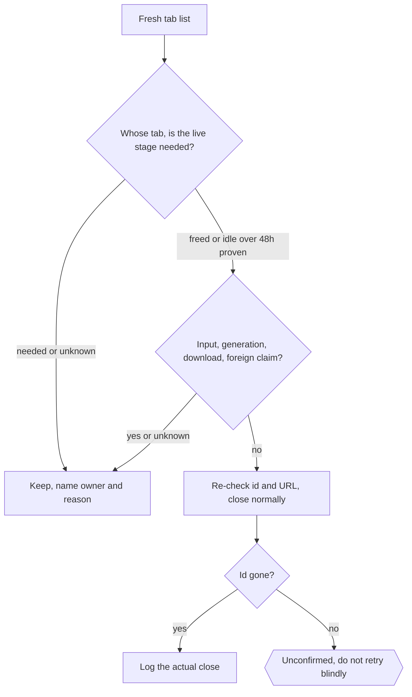

# /tab-sweep: browser tab cleanup

Rule of thumb: whoever opened a tab closes it. A nightly sweeper is the backstop, not the plan. Built for a multi-browser agent setup; the close mechanism depends on which browser connector your agent has, so name any browser you could not inspect as "not checked".

## Rule 1. The opener cleans up
1. Finished a stage: save the full result and a link to the source chat in the existing task card.
2. Check that the right result is saved and the live browser is no longer needed for this stage.
3. Close your own intermediate tabs with the connector's normal close. Do not wait for a nightly job.
4. Keep a live page only for a concrete unfinished action or a result the user still needs. Name the owner and the reason in the same card.

## Rule 2. Sweeping tabs that piled up
1. Get a fresh inventory per available browser: id, url, group, active, audible, last-accessed. Groups help find the task but do not prove its status. Do not start a new browser or service just to clean.
2. For each group find the source task, its stage and the saved results. A finished task, or an abandoned branch with a saved result, is a close candidate. An idle or not-loaded session is not proof that a tab is free.
3. Close ALL freed tabs OR tabs with proven idleness over 48 hours. Use the latest known human or agent use. Last-accessed covers UI use but not all background agent work; load time and mouse idleness do not count.
4. Keep running generation, downloads, unsaved forms, current typing and any page still needed. If the connector says "tab belongs to another session", do not bypass it with another API: ask the owner to release it, or record the exact owner and reason UNKNOWN. Never turn unknown into an eternal keep without an explanation.
5. Before closing, re-check the concrete browser + id + URL and state. If the address or owner changed, or the state is unclear, keep it with a reason. Use only the normal tab close: no process kill, no profile, cookie or session-store edits, no artificial last tab.
6. Re-read the inventory: "close was called" is not "id is gone". Count only confirmed closes of your own; do not claim parallel changes. Show groups, actions, what remains and what is unknown.

## Optional scheduled sweeper
If you automate it, a good policy is: at night close whole browsers only when the human has been idle more than 30 minutes, no download is running and no tab was touched in the last two hours (otherwise defer to the next attempt, not close). By day close only tabs untouched for more than 48 hours. Record RAM, CPU and tab counts before and after each run: that is the proof it helped. Exit codes: 0 = ran (even if everything was deferred), 1 = error, 2 = incomplete coverage.

## Counting use
One manual pass over a real task counts as one use, even if it closes 100 tabs. Log version, input, action, result and problem in an existing report; no new registry is needed.

## Decision tree

<!--kit-footer-->

---

**Like this skill?** It is part of [second-brain-starter-kit](https://github.com/tonydzi/second-brain-starter-kit): the second brain we built for ourselves and run every day at Palo Alto AI Research Lab. Install the whole set with `npx skills add tonydzi/second-brain-starter-kit`. Everything is open source and free, so take what you need.

Flagships worth a look on their own: [secondop-panel](https://github.com/tonydzi/secondop-panel) (a second opinion from a panel of external models), [claude-memory-tidy](https://github.com/tonydzi/claude-memory-tidy) (stop your agent's memory from rotting), [telegram-mcp-kit](https://github.com/tonydzi/telegram-mcp-kit) (your own Telegram over MCP in about 15 minutes).

Author: **Anton Dziatkovskii**, Palo Alto AI Research Lab. Telegram [@tonydzi](https://t.me/tonydzi) - WhatsApp [+1 341 222 9178](https://wa.me/13412229178) - X [@Tony_Stef_](https://x.com/Tony_Stef_)

**Engineers: want to test-drive this setup?** Message me. I hand out free starter seeds to engineers who test and report back, and custom skill requests are welcome.
