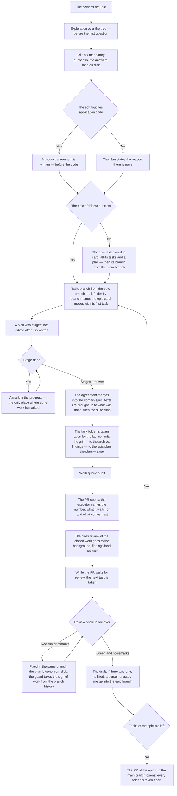

<!-- rt-kit v0.34.0 · rules/task-flow.md · 551ae817285c · правится надстройкой, не здесь -->

# Work conduct — how it works here

Rule under the law `docs/constitution/work-conduct.md`. The law says what must be true about the
course of work; here — what it is called in this tree, where it lives and what is not checked here.

**Cold part:** `pitfalls.md` next to it — traps and conduct from incident analyses. Loaded on
demand, not with the rule: an ordinary decision does not need it — whoever analyses a miss or argues
with a guard does.

**Requires:** `hooks/task-flow-guard.sh`, `hooks/task-flow-draft-guard.sh`,
`hooks/task-context-load.sh`, `hooks/grill-gate.sh`, `hooks/window-fill-guard.sh`,
`hooks/turn-exit-guard.sh`, `hooks/work-start-guard.sh`, `hooks/main-run-context.sh`

## What it is called here

| In the law | Here |
| --- | --- |
| the owner's request | what work begins with; grilled by the `/grill-me` command before the first edit |
| understanding written where the work goes | `docs/tasks/<ветка>/grill.md` — the request verbatim, the owner's answers in their words, decisions with reasons |
| the plan | `docs/tasks/<ветка>/plan.md` — the task footprint and stages with readiness signs; not edited after it is written |
| the progress | `docs/tasks/<ветка>/progress.md` — "Where we stand", decisions along the way, session entries; the only place where done work is marked |
| the product agreement written before the code | `docs/specs/<домен>/proposed/<фича>/` — the feature spec; survives the merge and merges into the domain spec |
| an epic — the unit of delivery | a card in the work queue with the epic label, a branch of its own from the main branch and a plan next to it: the opportunity, the tasks, their order |
| the epic branch | `<КЛЮЧ>-<номер эпика>-<короткий-slug>`; the branches of its tasks are taken from it, and their PRs go into it |
| the epic plan | a record outside the task folder: the folder dies with the merge, the epic outlives it; the directory — in the rule's companion |
| the task folder before the task is created | `docs/tasks/_draft-<slug>/` — outside history while there is no number |
| exploration | an `Explore` or `general-purpose` session before the first question to the owner |
| the plan review by roles | `.claude/workflows/plan.js` — need, points, agreement, critique, plan, goal |

## Where it lives

In this tree — the table in `implementation.md` next to it. Paths live there, not here: the rule
travels between repositories, the layout does not, and a path named in the rule lies in the first
tree that keeps its code differently.

## Work states

The unit of work is a state, not a step. A state has an entry, a mandatory action and an exit, and
until the action is done the work stays in the same state.

The state is declared in the "Where we stand" section of the progress by the machine-readable line
``- **State:** `этап-идёт` `` and is rewritten with it.

| State | Entry | Mandatory action | Pattern |
| --- | --- | --- | --- |
| `просьба-не-разобрана` | the owner's message about new work | exploration over the tree, then questions | `task-flow-start` |
| `эпик-заведён` | the epic card, all its tasks and its plan lie in the queue | take the epic branch from the main branch; with the first task the epic card moves to in progress | `task-flow-start` |
| `разбор-закрыт` | the owner's answers lie on disk | a product agreement, or the reason there is none | `task-flow-start` |
| `договорённость-записана` | the draft lies, or the reason is named | create the task, the branch from the epic branch, and the folder | `task-flow-start` |
| `задача-взята` | task in the work column, branch by number, folder | write the plan | `task-flow-start` |
| `замысел-записан` | the plan lies and is not edited after writing | do the first stage | `task-flow-start` |
| `этап-идёт` | a stage is begun | finish the stage and mark it in the progress | `task-flow-resume` |
| `этапы-кончились` | all stages are marked | merge the agreement, bring texts up to date, run the suite | `task-flow-close` |
| `разбор-кончился` | the suite is green, texts are up to date | take the folder apart by the last commit | `task-flow-archive` |
| `папка-разобрана` | no folder in the branch, a record in the archive | open the PR: a draft where a run is waited for, ready where the pipeline does not wake | `task-flow-close` |
| `работа-отдана` | the PR is open into the epic branch, with a reviewer | take the next task of the epic | `task-flow-resume` |
| `влито` | the PR merged by a person | rules review of the work and the work queue audit | `task-flow-archive` |
| `задачи-эпика-кончились` | every task of the epic is merged and its folder taken apart | open the PR of the epic into the main branch | `task-flow-close` |

No state has a mandatory action that sounds like "wait": waiting for someone else's step is not a
work state, so in `работа-отдана` the mandatory action is the next task, not the open PR. A blocked
task does not count as next: the same waiting under the name of work. The next is taken from the
work queue, and the queue is asked by a command: "no tasks" is a statement about the tree, backed by
output, not by the executor's memory. A filled session window is no state either: the session ends
with a handover, and the work stays where it stood. **An open card says nothing about whether the
work is taken.** A card is closed by the merge, and in a session that opens no PRs the list of open
ones does not shrink. A task is untaken when the tree holds no trace of it: open numbers are checked
against the archive — closed work has a record there with its number.

What a turn ends with — rule `turn-conduct` under the same law.

The list is shown to the owner at the start of work, and where we stand is marked on it.

The last two states cannot be declared on disk: the progress leaves with the folder, and the folder
is taken apart before the PR opens. Their sign is in the branch history — the commit that takes the
folder apart — and a guard reads it, not a line in a file.

## Flow

The course of work from the owner's request to closing: where the grill stands, what the guard
demands and where the task folder goes.

## How the law applies here
- **Editing application code is refused until the work has reached a state in which code is
  edited.** The guard demands three things: a task folder by branch name, a plan in it and a
  declared state. The agreement has a guard of its own on the same events.
- **The guard judges the declared transition, not the presence of files.** The refusal is lifted
  by the declared state — `этап-идёт`,
  `этапы-кончились`, `разбор-кончился`. The fourth road is the branch history: a folder taken apart
  means handed-in work.
- **A state line moved forward is the same declaration of intent, only machine-readable.** It is
  declared by the turn in which its mandatory action is begun by deed.
- **A refusal by state names the mandatory action of that state.** Hearing only "wrong state", the
  executor rewrites the state line instead of the step.
- **Only a word from the list counts as a state name.** A word of one's own says nothing about the
  entry, the exit or the action.
- **Two requirements — two guards, and one can be lifted without losing the other.** A line about
  unchanged behaviour lifts the agreement, not the requirement to reach the code-editing state.
- **A merged agreement does not lock the branch.** After the merge the "proposed" directory is gone
  from disk while the plan refers to it to the end: the guard tells merged from never-created by the
  branch history.
- **The agreement is required by the edit paths, not by an appraisal of the task.** `apps/**` and
  `libs/**` are the sign; rules, texts, tooling and dependencies fall outside it. The bypass is the
  line `**Behaviour:** unchanged — <the reason of the owner>` in the plan; an empty reason is not
  accepted.
- **What needs the owner's word is taken from a list, not appraised on the spot.** The appraisal
  "this is safe" is assigned by whoever finds it convenient.
- **A stop the owner sets on a later step is written down the moment it is said.** It is quoted in
  the waiting line: it holds that step and releases the exit guard.
- **A reply to the owner's order begins with the result, not with intent or its justification.** A
  justification under someone else's accepted decision reads as its appraisal. One exception:
  execution stopped by an obstacle — then the obstacle is named.
- **The last run of the main branch is read first thing in a session and after every known
  merge.** A red main branch lives until the owner notices; a red run is fixed before new work is taken.
- **A session does not start work by itself.** The handover, the state from the startup hook and an
  assigned epic say what to do, not whether to work: a start needs the owner's word in the same
  session. An empty message, one word or one path order no work.
- **A refusal by an external limiter removes the way, not the task.** It names no exit: the way is
  taken from the guard that already described this fix, and the task stays the same.
- **A question written by a past session does not become a question to the owner.** It is addressed
  to the handover's author, and some are closed by a work step.
- **The owner's instruction holds until they cancel it, and a new fact against it is a line in the
  reply about the cost, not a new question.** Re-asked is what the instruction does not cover. A
  menu where two options of three offer to cancel the owner's decision is that very cancellation.
- **An answer in the owner's message counts the same as an answer in a document.** A question
  already answered in the conversation is not asked again.
- **The owner's word about the design is a task setting, not a decision.** What they named is
  usually in the tree under that word — a name on a screen, a spec section, a model field — and is
  checked against it before the edit. Diverged — the owner is asked.
- **A task folder is created for any work, no exceptions.** An exception with even one lawful form
  is executed as permission. It goes in before the first edit.
- **The task folder goes into the branch by a commit, not lives in one working tree.** Uncommitted,
  it passes edits without refusal until the plan is already gone. Outside history one draft without
  a number is lawful.
- **The task folder is taken apart by the last commit before the PR opens, not after approval.** A
  person merges as soon as they see green, and no room is left for a closing commit.
- **After opening the PR, the executor tells the owner the number, what it waits for and what comes
  next.** A draft waits for the run, a PR opened ready waits for the owner's hand, and that is said.
- **A request to merge never comes before the work is checked.** Where the pipeline wakes for this
  base: folder taken apart and pushed → PR as a draft → run green → draft lifted → the request to
  merge, naming the number. Where it does not wake, the green push gate is the check, and opening
  the PR and asking to merge are one turn.
- **A PR that waits for a run opens as a draft, and one that waits for nothing opens ready.** An
  open PR reads as an invitation to merge. Which of the two applies is decided by the bases the pipeline wakes for, and that is read from its file.
- **The plan guard is the lower bound of the requirement, not its limit.** It demands a folder only
  for an edit of application code; the article above — for any work.
- **An instruction to work by a rule or by the progress is an instruction to do all its steps,
  including those that change history.** Marking a stage, a commit, a push and opening a PR are
  prescribed by the rule; questions are asked about what the progress lacks.
- **A taken task does not end a turn.** Creating the task, the branch, the column and the folder is
  preparation; the turn-exit guard names the first stage in its refusal.
- **The stages of a plan cover its done-sign whole.** Otherwise every stage closes, the run is
  green, and half the order is not done. Either the stages are written up to the sign, or the sign
  is narrowed to what the stages give.
- **Every rule of the product agreement becomes a step of some stage.** The plan names, per rule,
  the stage that writes its code and the check that proves it, and is compared with the agreement
  rule by rule before the first stage: a rule with no stage is found at the merge review, when the
  code is written.
- **A stage's readiness sign is taken from the output of a command run while the plan is written.**
  Written by a guess, it fails at the stage itself.
- **A plan for work that ports a technique from outside is written by a measurement of one's own
  code.** Reading the sample says how it is built; what is needed here is said by a count over
  one's own files.
- **A count that becomes the measure of the work is bounded by the declaration, not by the file.**
  A file holds neighbouring sets too.
- **Waiting for one part of a stage is never a stop of the stage.** The parts independent of what is
  awaited are done in the same turn; the owner is told what is done and what is left for their step.
- **A finding made mid-stage is checked against the plan's exit conditions before the first edit.**
  A finding named by no exit condition goes to the section on what the work does not do, and is
  filed as a task.
- **Done work is marked only in the progress.** "Where we stand" is rewritten by every session, not
  appended.
- **The plan names the steps of every stage, and the progress mirrors them with a mark each.** The
  plan is not edited after it is written, the marks change every turn; a line nobody can call done
  is not a step.
- **The numbers and the names of the steps are copied from the plan, not reworded.** A check matches
  the two lists: a reworded name reads as a different step.
- **Exactly one step carries the mark of going on right now, while any step is not done.** Marked on
  none, the progress says the work stands; marked on two, it says nothing at all.
- **A word for a new notion is looked up in the tree's glossary.** It goes into the context whole
  at session start, so "did not read it" is never a ground.
- **The task folder is created as a draft and gets its number by a command.** Until the grill ends,
  how many tasks come out is unknown, so the number never comes first.
- **An abandoned grill is visible.** A draft older than a week is listed by the work queue audit.
- **Work ordered in words becomes a task in the queue in the same turn.** Even if it will not be
  done now: a draft folder has no number, and one session knows of it. Postponed work names a
  date; postponed silently, it reads as done.
- **Work begins with the epic, and a task outside one is not taken.** The main branch takes the
  whole or does not take it. Work outside an epic exists only by
  the owner's word about that work, said about that work.
- **The epic branch is taken before the first task of the epic, not with it.** Taken later, it
  leaves the first task on the main branch.
- **The epic card moves to in progress by the same turn that takes its first task.** The owner
  follows the epic by one card: left in place, it reads as never started.
- **The next task is taken from the epic plan, and the queue list is asked only where there is no
  epic.** A list of numbers does not tell someone else's epic from one's own.
- **Which epic this working copy leads is read from the table of assignments, and the owner writes
  it.** A card of the queue is not an order; a guard refuses every call that takes work until
  their word.
- **An epic is not closed by a sign confirmed by reading alone.** What is checkable by eye is
  called checked only with a command and its output.
- **The tasks of an epic are created all at once, by the same turn as the epic itself.** Creating
  them one at a time hides the volume.
- **A task of an epic is linked to the epic card as a sub-issue, not only named in the plan.** The
  board reads no text: without the link it looks like a task outside one. Closed tasks are linked.
- **The epic plan names how the branches of its tasks stand, on a par with their order.** Two
  arrangements: each branch from the epic branch, or a stack — each from the previous. The written
  arrangement binds whoever creates the branch.
- **The plan names the points: the epic its milestone, the task the change a person will see.** The
  role `product-strategist` tries to prove the miss in planning and before the PR. A proved miss is
  fixed or named to the owner; no pipeline stops. Every PR body carries the table of points.
- **An edit of a rule names the metric it should move, and the next report judges it.** An edit that
  moved nothing is named so. The technique is the pattern `task-flow-cycle`.
- **Work is judged by the role `goal-critic` against the owner's words.** A plan is no evidence to
  it, its reply is not edited, and the PR body carries its table.
- **A mission is set by the owner.** A session only proposes a wording from its analysis and waits
  for approval.
- **The PR of the epic opens when its last folder is taken apart, and not a task earlier.** A folder
  left in the epic branch reaches the main branch with it. Until then nobody is offered the epic
  branch: its button means the whole epic.
- **The epic plan lies where it is found without the network and after the merge.** The card holds
  no task order, and the folder dies with the merge. What the owner names along the way is appended
  there by the turn that took it.
- **Building by a sample begins with reading the sample itself, whole, by walking the directories.**
- **What acts on the tree, not on the edit, lies outside the index.** The path to the sample and the
  permission to work outside the epic do not belong to the branch and live next to the handover. A
  number in the permitted list repeats the owner's word, not replaces it.
- **Closed work is reviewed by the rules as a closing step, not as a separate request.** What was
  loaded and what was missing is seen only by the session that led the work.
- **The review of closed work goes to the background, and the executor takes the next task.** The
  digest is gathered before the launch, the findings are accepted in one turn.
- **The review's findings wait for the owner, and only the digest of observations leaves for the
  package.** A proposal sent unreviewed becomes the work of someone who did not order it. The digest
  is always sent: it says what was used and is never an opinion.
- **The cheap closing step goes before the costly one, and the run — after the merge.** A run
  before the merge checks what will not reach main.
- **The agreement merges into the domain spec by one of the last commits of the branch, before the
  PR opens.** By then the bindings are known, and `proposed/` never appears in main. What is ready
  to merge is listed by `npm run check:specs`.
- **The folder of a closed task is taken apart, not moved whole.** What explains a decision goes to
  `docs/archive/`; the rest is deleted. One not taken apart is caught by the work queue audit.
- **Opening the PR and lifting the draft are refused while the branch carries its task folder.** A
  person presses merge on the host, where there are no guards: a lifted draft reads to them as an
  invitation. The branch content is judged, not the working tree.
- **A branch that removed the folder adds a record to the archive.** Removing is cheaper than taking
  apart, and the grill leaves first — the only record of the owner's words.
- **The bypass is the line `Task-folder-skip: <reason>` in the PR or in the command itself.** An
  empty reason is no bypass, and the bypass lifts the refusal but does not silence the work queue
  audit line.

## What of the law is not here

Nothing checks the completeness of the written understanding: the machine sees that a record exists,
not that it closes every gap. The same for a question worth asking and not asked — it leaves no
trace. The owner judges both.

The guard judges by the edit paths, not by whether the work changes behaviour. A refactoring gets no
sign of its own: the appraisal "behaviour does not change" would be assigned by whoever it hinders.

Nothing of the grill itself is checked.

The conversation guard judges shared words between the question's topic and the owner's last
message, not meaning; its refusal names the lawful move.

Nothing watches the plan's immutability.

Nothing checks that the texts match what was done: the machine cannot see what went stale in a rule
or a spec. This is held by the closing step and the task footprint in the plan. A rule and a spec
are edited in the branch, a law is not: its article goes to the owner as text, and the work goes on
without it.

What went to the archive is not checked: the owner judges it at review.

The task folder guard judges the executor's call, not the host's button: a person merging from their
side passes it in silence, and there the requirement is held by a section in the PR body.

A tree may reverse the hand-in order by an override. Which package steps stop being executed then
nothing counts; it is held by reading both texts in a row on every such edit.

## Patterns

- `task-flow-start` — exploration, grill, agreement, plan, task and branch.
- `task-flow-resume` — returning to unfinished work in a new session.
- `task-flow-close` — lifting the draft, merging the agreement, bringing the texts up to date.
- `task-flow-archive` — taking the task folder apart, the move to the archive, review by the rules.
- `task-flow-cycle` — an edit chosen by the report and judged by the next one.
