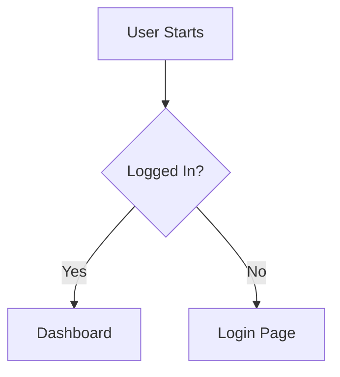

# How to Write a Product Requirements Document (PRD)

> **CRITICAL**: MUST save the final PRD to a file (e.g., `documents/prd-<slug>.md`). Do NOT only output in chat — always persist to disk. The file is written AFTER the round of clarifying questions in Section 2 step 2 has been answered, never in the reply that asks them.

When generating or refining a Product Requirements Document (PRD), follow these
guidelines to ensure clarity, completeness, and alignment. This rule is designed
to apply "Prompt Engineering" principles—clarity, constraints, and structure—to
documentation.

## 0. Question Format (FR-UNIVERSAL.QA-FORMAT)

This format binds on EVERY question you put to the user, in every turn: the first round of clarifying questions, a later round, and a single follow-up question — for example one that surfaces a conflict between two of the user's constraints. A question you ask because a project rule told you to stop and ask is still a question to the user and still follows this format.

- **Numbered** — each question is a numbered list item (`1.`, `2.`, …), not a heading, a bold-only line, or a paragraph. A single question is still `1. …`. Bold text after the number is fine (`1. **Which statuses trigger a push?**`); the number inside the bold (`**1. Title**`) is not a list item.
- **Self-contained** — the question is answerable from itself and its options alone. Name what is being decided and what the answer changes, inside the question. "Which of the above?", a bare "Your choice?", and "Which variant do you prefer?" with nothing restated are defects: they send the reader back up the transcript to reconstruct the question.
- **Each option stands on its own** — a reader often jumps straight to the options, so an option's title and the lines under it must be enough to choose without the text above the question or the earlier turns. The title is a short name after the option's letter or number, and the reader answers with that letter or number; the `**Essence:**` line under it says what would be done, to what, and what the reader gets. A short reply option with no analysis of its own (Apply / Skip / Edit) has no Essence line, and its title says it alone. **Inside an option, name things in words, never by a report's ids.** Every line of the option — title, Essence, Pros, Cons, Risks, Best for — is read without the report, and ids slip in most often in Pros, Cons and Risks. Write what the thing is instead of its label: "the checkout errand on the shop site", not `E4`; "the search box ignoring the first keystroke", not `N3`. A label in parentheses after a general phrase — "the two most expensive errands (E4, E3)" — is still a bare label: name each item. A number taken from a report keeps what it measures in the same sentence: a percentage names the whole it is a share of ("page text takes about 40% of the cost", not "a 40% share"), and a sum says whose cost it is. **Any phrase that stands for a group is a pointer**: a count ("the four slow pages", "the same three errands"), a category ("the anomalies", "the issues found"), a rank or superlative ("the costliest runs"), "these", "as above", "the current round" — and so is a partial list, a count followed by a few examples or a "such as". Replace it with every member of the group, named in words, in that option — even when the list is long, even when the report above already lists them; if the whole set does not fit, drop the group from the option. Test: with the report deleted, could the reader name every member from this option alone? A word coined in this session gets a short explanation in the option. An explanation elsewhere in the reply does not count — not in the report above the question, not in another option. Before sending, read each option alone, line by line, and list every label (letters plus digits such as `E4` or `N3`), number, group phrase (a count, a category, a superlative, "the same", "these") and coined term in it; replace each with words or remove it.
- **No catch-all option** — never add an option whose only content is an invitation to answer freely ("Other", "Something else", "Your own variant", "Tell me what you need"). The user can always type a free-form reply instead of a letter or number, and an IDE's question tool (`AskUserQuestion` and the like) already offers a free-text answer of its own, so such an option adds a line and no choice. An option that names a concrete alternative is a real option, even when its title starts with "Other".
- **`agent's choice`** — on a multi-select where the user delegates with `agent's choice` (or its language equivalent), pick the subset yourself, justify the pick in one line, and proceed without re-asking for confirmation.
- When the choices are mutually exclusive alternatives with their own analysis, that analysis is nested under the option inside the question — never repeated as a separate block before it. It opens with the `**Essence:**` line, then `**Pros:**`, `**Cons:**`, `**Risks:**` and `**Best for:**`, each on its own labelled line.

## 1. Core Principles

- **Outcome-Oriented**: Focus on the _value_ delivered to the user, not just the
  technical implementation.
- **Measurable**: Requirements must be testable. Avoid vague terms like "fast"
  or "reliable" without metrics.
- **Unambiguous**: Remove ambiguity. If a requirement can be interpreted in
  multiple ways, it is a bug in the PRD.
- **Living Document**: Acknowledge that the PRD evolves. A target nobody has
  approved yet is still written as a number and marked as a proposal; it is
  never left blank or replaced by an open question. Proposals are what remains
  after the user was asked (Section 2), not a substitute for asking.

## 2. Writing Strategy (AI Instructions)

When asked to write a PRD:

1. **Analyze the Request**: Identify the core problem, target audience, and
   business goal.
2. **Ask Clarifying Questions — first, and alone**: your first reply to a PRD
   request is one round of clarifying questions and nothing else. Do not create
   or write the PRD file in that reply, and do not draft the PRD in chat. This
   round is not conditional: a request always leaves numbers for the user to
   decide (see Quantitative targets below), so "the request gives enough
   context to draft" is never a reason to skip it. The one exception is a user
   who said in the request itself to skip questions and use your
   recommendations — then draft at once and mark every target you chose
   `(proposed, awaiting approval)`. Follow the **Question Format** section above
   (FR-UNIVERSAL.QA-FORMAT).
   - **Context**: ask about what the request does not state and the PRD
     depends on — the target audience, constraints (platforms, providers,
     budget), and the timeline.
   - **Quantitative targets**: list every number the PRD will need that the
     request does not give — latency, throughput, availability, retry limits,
     supported OS or browser versions, guardrail thresholds. Ask about them in
     the same round of questions, and for each one offer a concrete recommended
     value and the reason for it — `Recommended: <value>, because <reason>` —
     so the user can accept it in one word. A value with no reason gives the
     user nothing to judge it by. The user still decides the number; you only
     make the decision cheap.
   - **When the product's own data is unknown**: not knowing the product's
     current value — its supported OS floor, its baseline, its provider limits —
     is the normal case, and exactly the case the recommendation is for. It is
     not a reason to withhold one. Recommend a concrete number from public data
     and common practice (for OS versions: the oldest versions that still hold
     a large share of active devices) and say in the reason that it is a
     starting point the user can replace with their own figure. "Please specify
     your versions", "the versions the app supports today", "set after
     reviewing baselines" and "confirm during technical review" are not
     values.
3. **Drafting**: only after the user has answered the round in step 2. Use
   the template below. A target the user confirmed or gave is a requirement. A
   target you asked about and the user left unanswered goes in as your
   recommended value marked `(proposed, awaiting approval)`, and Open Questions
   lists it for approval with that value. A number you notice only while
   drafting is handled the same way: your recommended value, marked as a
   proposal, listed in Open Questions — never a blank, a "TBD", or a question
   without a value.
4. **Review**: Check against the "Bad vs Good" examples in Section 4.
5. **Persist**: MUST write the final PRD to a file (e.g., `documents/prd-<slug>.md`
   or a path specified by the user). Do NOT only output the PRD in chat — always
   save it to disk using the file write tool (Write, write_to_file, etc.).

## 3. PRD Template

### [PRD] {Title} {Status: Draft/Review/Approved}

#### 1. Executive Summary

- **Problem Statement**: Clear, concise description of the user pain point or
  business opportunity.
- **Proposed Solution**: High-level overview of the feature/product.
- **Value Proposition**: Why is this important? What is the expected impact?

#### 2. Success Metrics (KPIs)

- **Primary Metric**: The one number that defines success (e.g., Conversion Rate
  +5%).
- **Guardrail Metrics**: What specific negative outcomes must we avoid? (e.g.,
  Latency < 200ms, Error rate < 1%).

#### 3. Scope & User Stories

**Target Audience**: [Persona Name] - [Short Description]

| ID   | User Story                                        | Acceptance Criteria              | Priority |
| ---- | ------------------------------------------------- | -------------------------------- | -------- |
| US-1 | As a [User], I want to [Action] so that [Benefit] | 1. Criterion A 2. Criterion B | P0       |

**Out of Scope**:

- List specific features or use cases that are explicitly excluded to prevent
  scope creep.

#### 4. Functional Requirements

- **Core Logic**: Detailed business rules (e.g., "If user is unverified,
  restrict access to X").
- **Edge Cases**: Empty states, error states, offline behavior.
- **Data Requirements**: Fields, validation rules, sources.

#### 5. Non-Functional Requirements

- **Performance**: Latency, throughput, load expectations.
- **Security**: Authentication, authorization, data privacy (GDPR/PII).
- **Compatibility**: Browsers, devices, OS versions.

#### 6. User Experience (UX)

- **Flow**: Describe the user journey (or insert Mermaid diagram).
- **UI Elements**: Key inputs, outputs, and feedback mechanisms.

#### 7. Dependencies & Risks

- **Dependencies**: APIs, other teams, third-party services.
- **Risks**: Technical challenges, compliance issues, adoption risks.
- **Mitigation**: How will we handle these risks?

#### 8. Open Questions

- List of unresolved questions that need input from stakeholders or technical
  research.
- Every `(proposed, awaiting approval)` target, with its proposed value.

## 4. Examples: "Bad" vs "Good" Requirements

**Ambiguity vs. Specificity**

- 🔴 **Bad**: "The system should be fast."
- 🟢 **Good**: "API response time must be under 200ms for 95% of requests at a
  load of 100 QPS."

**Implementation vs. Intent**

- 🔴 **Bad**: "Add a blue button that says Save."
- 🟢 **Good**: "The user must be able to persist their changes. The action
  should be prominent and follow the primary action style guide."

**Error Handling**

- 🔴 **Bad**: "Handle errors gracefully."
- 🟢 **Good**: "If the backend is unreachable, display a toast notification with
  the message 'Connection failed, retrying...' and automatically retry 3 times
  with exponential backoff."

## 5. Visuals

Use Mermaid diagrams where possible to illustrate flows:

