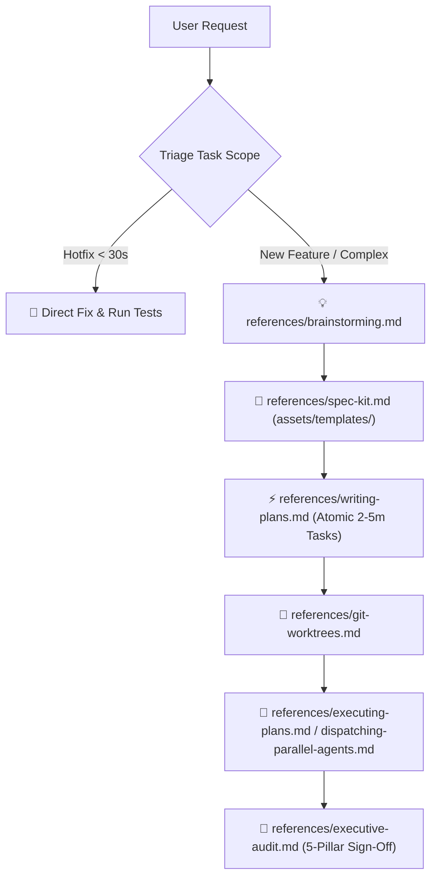

# 👑 Kio Core Delivery, SDD & Orchestration (`kio-core-delivery`)

The router for Kio's specification-driven development (SDD), atomic task planning, and multi-agent orchestration. Knowledge lives in `references/`, document templates in `assets/templates/`, and automation utilities in `scripts/`. This file only points the way and holds the mandatory quality gates.

`KIO_DELIVERY_ROOT` = this skill's install directory (e.g. `~/.claude/skills/kio-core-delivery`). Commands below use `${KIO_DELIVERY_ROOT:-skills/kio-core-delivery}`.

## ⚙️ How to work

1. **Triage the request scope before acting:**
   - **Hotfix / Trivial change (< 30s, single file):** apply the minimal diff directly and run verification tests immediately without ceremony.
   - **Bounded change (existing flow in the repo):** ask only the key clarifying questions, present a concise design in chat, and wait for user approval before coding.
   - **New feature / Architectural work:** follow Brainstorming → Spec-Kit / Atomic Plan → Isolated Worktree → Disciplined Execution.
2. **Pick one primary reference** from the [routing table](#-routing-table) and follow its process.
3. **Never write production code before the design or plan is approved** on new features or architectural changes.
4. **MANDATORY reads (open the file first):** writing a spec → `references/spec-kit.md`; breaking work into tasks → `references/writing-plans.md`; executing a plan → `references/executing-plans.md`; final sign-off → `references/executive-audit.md`. In the answer, name the reference you followed.

## 🧭 Routing table

| Task | Open | Notes |
|---|---|---|
| Explore ideas, clarify requirements before coding | `references/brainstorming.md` | 3 paths: Spike, Bounded, Architectural; subagent spec review in `references/spec-document-reviewer-prompt.md` |
| Render live browser mockups / diagrams during brainstorming | `references/visual-companion.md` | Server: `scripts/start-server.sh`, `scripts/stop-server.sh` |
| Design a system with the 4-phase Spec-Kit SDD workflow | `references/spec-kit.md` | Deep methodology: `references/spec-driven.md`; templates in `assets/templates/*-template.md` and `assets/templates/commands/*.md` |
| Break a spec into 2–5 minute atomic tasks | `references/writing-plans.md` | Self-contained TDD tasks; plan review prompt in `references/plan-document-reviewer-prompt.md` |
| Execute a written implementation plan step by step | `references/executing-plans.md` | Disciplined checkpoints and verification gates |
| Keep persistent working memory on disk for long tasks (5+ steps) | `references/planning-with-files/README.md` | Templates: `assets/templates/task_plan.md`, `findings.md`, `progress.md`; scripts: `scripts/planning/init-session.sh`; details: `reference.md`, `examples.md` |
| Dispatch multiple independent subagents in parallel | `references/dispatching-parallel-agents.md` | One subagent per independent problem domain with zero shared state |
| Isolate feature work in a Git worktree | `references/git-worktrees.md` | Detect existing isolation → native tool → `git worktree add` |
| Route tasks across local AI CLIs (`claude`, `codex`, `agy`) | `references/engine-router.md` | CLI: `python3 "${KIO_DELIVERY_ROOT:-skills/kio-core-delivery}/scripts/kio_router.py"` |
| Run the 5-pillar executive audit & final sign-off | `references/executive-audit.md` | Security, Lean Code < 700 lines, UI/UX Anti-Slop, SDD + Test Cases, Business Alignment |

## 🔀 Selection rules for overlaps

| Need | Start at | Switch when |
|---|---|---|
| "I have a new feature idea, requirements are still fuzzy" | `references/brainstorming.md` | Design is approved and needs full SDD artifacts → `references/spec-kit.md`; or ready for immediate task breakdown → `references/writing-plans.md` |
| "Write a formal PRD / technical spec for a complex system" | `references/spec-kit.md` (`assets/templates/spec-template.md`) | `spec.md` & `plan.md` are ready and need 2–5 min coding steps → `references/writing-plans.md` |
| "Track progress and research findings across a multi-step session" | `references/planning-with-files/README.md` | Need a step-by-step implementation blueprint with exact file paths and test code → `references/writing-plans.md` |
| "Execute an existing implementation plan" | `references/executing-plans.md` | 2+ independent tasks or test failures across unrelated subsystems → `references/dispatching-parallel-agents.md` |
| "Dispatch work across different local AI CLI engines" | `references/engine-router.md` (`scripts/kio_router.py`) | Coordinating subagents inside the current host session → `references/dispatching-parallel-agents.md` |

## 🧩 Workflows

| Job | Order |
|---|---|
| End-to-end new feature | `brainstorming.md` → `spec-kit.md` (or `writing-plans.md`) → `git-worktrees.md` → `executing-plans.md` → `executive-audit.md` |
| Long research or multi-phase refactor | `planning-with-files/README.md` (`scripts/planning/init-session.sh`) → update `task_plan.md`, `findings.md`, `progress.md` after each phase |
| Fixing multiple unrelated test failures | `dispatching-parallel-agents.md` → integrate summaries → run full test suite |

UI implementation belongs to `kio-frontend-craft`; backend/DB to `kio-backend-cloud`; deep testing and SAST to `kio-qa-security`.

## 🛡️ Mandatory quality gates

1. **No blind coding without scope approval:** for new features, present the design or plan and obtain user approval before writing production code.
2. **Zero placeholders in plans:** every task in an implementation plan must name exact file paths, function/interface signatures, and verification commands — never write `TODO`, `TBD`, or `"add appropriate error handling"`.
3. **Atomic 2–5 minute granularity:** every task ends with an independently runnable verification step.
4. **Workspace isolation on major features:** prefer native worktree tools or `.worktrees/` (verified ignored via `git check-ignore` per `references/git-worktrees.md`).
5. **No AI attribution footprints in commits or PRs:** never add `Generated with Claude Code` or AI `Co-Authored-By` trailers unless explicitly requested by the user.
6. **Language:** answer in the language of the user's request (an English prompt gets an English answer), even when skill documents are written in another language.

## 📦 What's included

- `references/` — 12 delivery guides listed in the routing table (`brainstorming.md`, `visual-companion.md`, `spec-kit.md`, `spec-driven.md`, `writing-plans.md`, `executing-plans.md`, `dispatching-parallel-agents.md`, `git-worktrees.md`, `engine-router.md`, `executive-audit.md`, and `planning-with-files/`).
- `assets/templates/` — 5 Spec-Kit templates (`constitution-template.md`, `spec-template.md`, `plan-template.md`, `tasks-template.md`, `checklist-template.md`), 9 command workflows in `assets/templates/commands/`, and 7 persistent planning templates (`task_plan.md`, `task_plan_autonomous.md`, `findings.md`, `progress.md`, `loop.md`, `analytics_task_plan.md`, `analytics_findings.md`).
- `scripts/` — `kio_router.py` (tested via `python3 -m unittest discover -s skills/kio-core-delivery/tests`), the Visual Brainstorming server (`start-server.sh`, `stop-server.sh`, `server.cjs`, `helper.js`, `frame-template.html`), and the persistent file-planning scripts in `scripts/planning/`.
- `THIRD_PARTY_NOTICES.md` — open-source credits and licenses (`obra/superpowers`, `github/spec-kit`, `OthmanAdi/planning-with-files`); keep it when redistributing.
