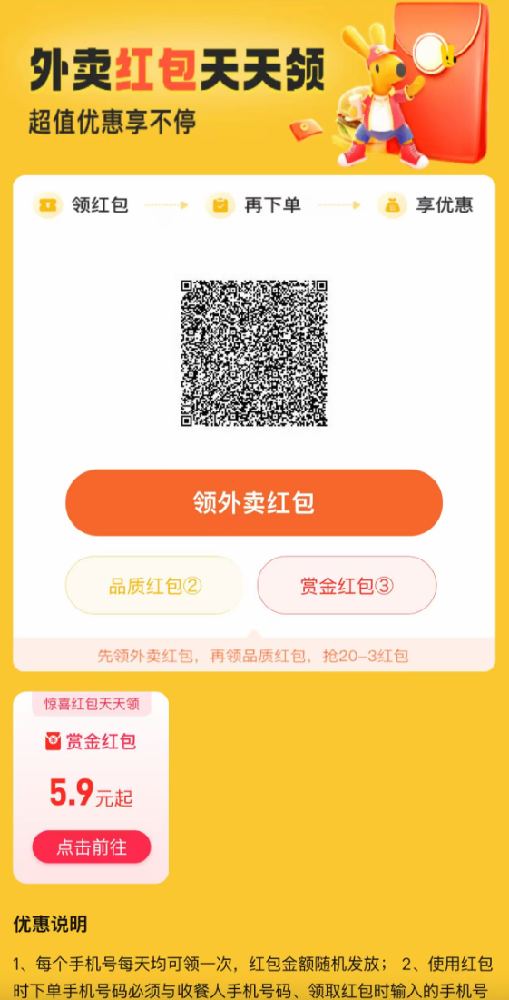
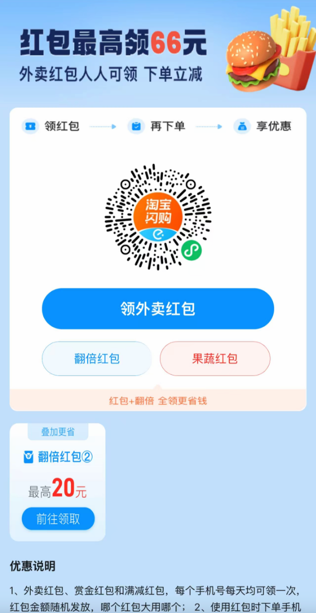

# takeout-coupon 外卖优惠券

一键获取美团、饿了么/淘宝闪购、京东外卖的隐藏优惠券口令与红包，附带聚合领券页面。复制口令到对应 APP 即可领取，天天领外卖红包。

## 安装

**Agent Skills（Claude Code / OpenClaw / Cursor 等）：**

```bash
npx skills add moooai/takeout-coupon
```

**OpenClaw（ClawHub）：**

```bash
clawhub install takeout-coupon
```

[](https://skills.sh)

## 使用

对 AI 助手说：

- "有什么外卖优惠券？"
- "帮我找美团外卖红包"
- "京东外卖怎么领券？"

或直接运行脚本：

```bash
python scripts/fetch_coupons.py              # 全平台
python scripts/fetch_coupons.py -p meituan   # 仅美团
python scripts/fetch_coupons.py --json       # 原始 JSON
```

## 领取页面示例

扫码或点击领取链接后看到的红包页面：

**美团外卖红包**（天天领红包，叠加使用）：



**饿了么/淘宝闪购红包**（最高领 66 元，可叠加果蔬红包）：



## 重要说明

- `coupon_code` 必须原样呈现给用户，禁止修改任何字符（口令含 %、¥、✔、！等平台特定符号）
- API 请求自动附加 `ch` / `u` 归因参数（匿名安装标识，用于渠道统计）

## 许可

MIT
