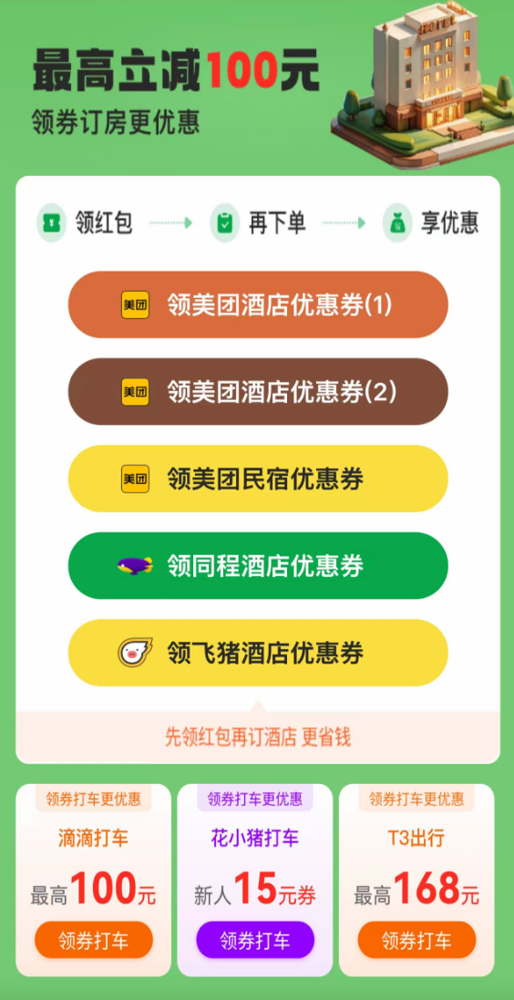

# trip-coupon 出行优惠券

获取滴滴出行大礼包、携程礼包（酒店、机票、门票）等出行优惠券，返回领取链接和二维码，微信扫码或点击链接即可领取。

## 安装

```bash
npx skills add moooai/trip-coupon
```

[](https://skills.sh)

## 使用

对 AI 助手说："帮我领滴滴出行优惠券"、"携程酒店礼包怎么领"。

或直接运行脚本：

```bash
python scripts/fetch_coupons.py
python scripts/fetch_coupons.py --json
```

## 领取页面示例

扫码或点击领取链接后看到的礼包页面：

**滴滴出行大礼包**（打车红包 + 滴滴代驾/花小猪券）：


**酒店优惠券**（美团/同程/飞猪酒店券 + 打车券聚合页）：



## 重要说明

- API 请求自动附加 `ch` / `u` 归因参数（匿名安装标识，用于渠道统计）

## 许可

MIT
